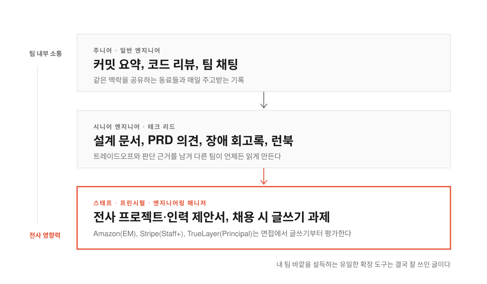
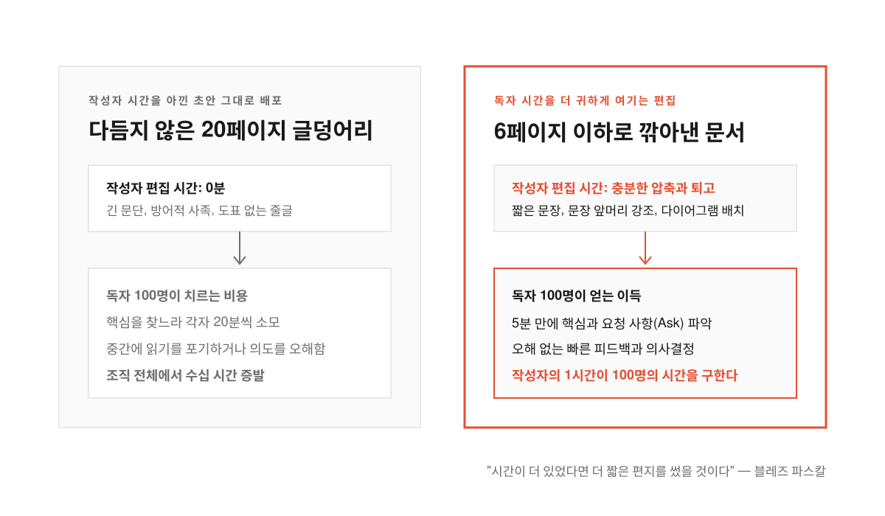
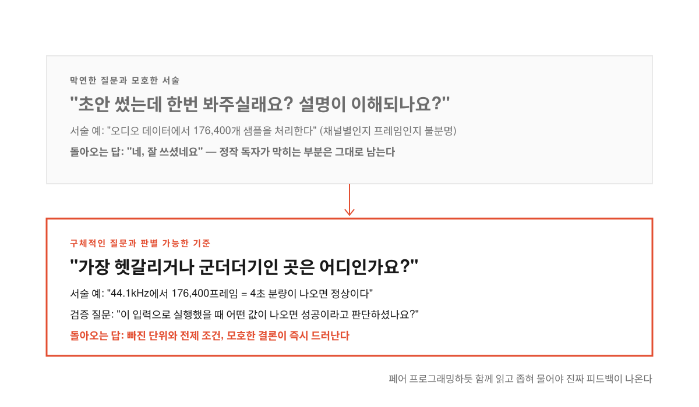

몇 주 동안 밤잠을 설쳐 가며 시스템 병목을 잡고 아키텍처 개편안을 노션 페이지 가득 적어 팀 채널에 올린다. 설계에는 빈틈이 없다고 자신했는데 스태프 엔지니어 승진 심사나 기획 회의에서는 아무도 그 문서를 끝까지 읽지 않는다. 첫 문단부터 배경 설명이 스무 줄씩 이어지니 바쁜 동료와 임원들이 스크롤만 내리다 창을 닫은 탓이다.

승진이 막힌 시니어 개발자나 생각을 또렷하게 전달하지 못해 답답해하는 엔지니어링 매니저들이 자주 부딪히는 벽이다. 코드는 컴파일러만 통과하면 돌아가지만 팀 바깥의 사람들을 설득하고 예산을 따내는 일은 사람이 읽는 문장을 통과해야 이루어진다.

뉴스레터 〈The Pragmatic Engineer〉를 운영하는 게르겔리 오로스(Gergely Orosz)가 공개한 [「Becoming a Better Writer in Tech」](https://newsletter.pragmaticengineer.com/p/becoming-a-better-writer)와 [GeekNews 토픽 #36367](https://news.hada.io/topic?id=36367)은 기술 직군에서 글쓰기가 어떻게 커리어의 병목이자 지렛대가 되는지 파고든다. 초안 작성과 편집, 동료 피드백과 주간 루틴으로 글쓰기 근육을 키우는 방법을 짚어 본다.

<!--more-->

## 하루에 코드보다 자연어 단어를 더 많이 치는 시니어의 현실

<figure>
  
  <figcaption>직급이 올라갈수록 코드보다 글이 먼저 다른 팀과 의사결정권자에게 닿는다.</figcaption>
</figure>

원격 근무와 분산 팀이 일상화되면서 글쓰기는 기술 리더십의 기본 조건이 되었다. 아마존(Amazon)은 엔지니어링 매니저 채용을 글쓰기 과제로 시작하고 스트라이프(Stripe)는 스태프(Staff) 이상 엔지니어 면접에, 트루레이어(TrueLayer)는 프린시펄(Principal) 엔지니어 채용에 글쓰기 평가를 넣었다. 코드를 짜기 전에 생각을 글로 구조화할 수 있는지부터 검증하는 셈이다.

고성장 스타트업이나 빅테크의 엔지니어는 하루 동안 코드보다 일반 단어를 더 많이 적는다. 커밋 요약과 코드 리뷰 댓글, 채팅과 이메일은 물론 설계 문서, 제품 요구사항 문서(PRD, 제품이 풀 문제와 기능을 정의한 문서) 댓글, 장애 회고록(postmortem, 장애 원인과 재발 방지책을 기록한 문서), 승진 문서까지 써야 한다. 스태프 엔지니어나 매니저가 되면 회의 요약과 제안서, 주간 보고서까지 겹쳐 글쓰기 비중이 더 커진다.

조직이 클수록 글이 닿는 범위도 넓어진다. 옆자리 팀원과는 말로 소통해도 팀 바깥의 엔지니어들에게 영향을 미치려면 글을 써야 하기 때문이다. 판단과 트레이드오프(한쪽을 얻기 위해 다른 쪽을 포기하는 선택)의 근거도 글로 적어 두어야만 코딩 가이드라인이나 런북(runbook, 운영·장애 대응 절차서)처럼 조직 전체가 꺼내 읽는 자산으로 남는다.

글이 읽히려면 첫머리에서 시선을 붙잡아야 한다. 메타(Meta) 최고기술책임자(CTO) 앤드루 보즈워스, 슬랙(Slack) 부사장 출신 마이클 롭, 캄(Calm) CTO 윌 라슨, 마이크로소프트 윈도우 부문을 이끌었던 스티븐 시노프스키처럼 손꼽히는 기술 리더들이 다작하는 작가라는 사실도 우연이 아니다. **내가 직접 손대지 않는 팀과 조직 전체를 움직이는 힘은 결국 얼마나 명확한 글을 쓰느냐에서 갈린다.**

## 아마존의 6페이지 제한과 8가지 편집 기술

<figure>
  
  <figcaption>백 명이 읽는 문서라면 쓰는 사람이 한 시간 더 깎아내는 쪽이 조직 전체의 시간을 아낀다.</figcaption>
</figure>

잘 쓰인 글 뒤에는 생각을 쏟아내는 초안 작성, 읽기 쉽게 다듬는 편집, 다른 사람의 눈으로 점검받는 피드백의 세 단계가 숨어 있다. 채팅부터 기획서까지 첫 버전은 작성자 본인에게만 친절한 초안일 뿐이다.

편집은 받는 사람의 자리에 앉아 내 글을 다시 읽는 데서 출발한다. 빽빽한 글덩어리를 깨고 한 문단에 하나의 생각만 담아 나눈다. 스마트폰으로 읽을 이메일은 문단이 한 화면을 덮지 않게 짧게 끊고 노트북으로 여는 구글 독스(Google Docs) 문서는 호흡을 조금 더 길게 가져간다. 이메일에 흔히 붙이는 "제가 아직 맥락을 다 이해하지 못했을 수도 있어 미리 사과드립니다만 왜 그런지 설명해 주실 수 있을까요?" 같은 방어적 사족도 덜어낸다.

> Writing a relatively short planning document – where the length is capped at six pages – in practice often takes significantly more time than one that would not have a length limit. Because of the length limit, every paragraph is valuable. Those writing this document will put in lots of work to cut the unnecessary parts and make the content crisp and easy to read.

글쓰기 문화로 유명한 아마존이 프로젝트 제안서를 최대 6페이지로 묶고 1페이지 요약본을 선호하는 이유도 여기에 있다. 블레즈 파스칼이 "시간이 더 있었다면 더 짧은 편지를 썼을 것이다"라고 남긴 말처럼 분량 제한을 지키려 문단을 깎아낼수록 글은 선명해진다. 긴 문장을 쪼개고 헤밍웨이 에디터(Hemingway Editor, 복잡한 문장과 부사를 잡아내는 무료 웹·20달러 데스크톱 도구)나 그래머리(Grammarly, 문법·어조 교정 도구)로 문법 오류를 잡는다.

구조와 시각 자료도 독자의 눈을 돕는다. 짧은 항목은 글머리 기호로 묶고 각 항목이 여러 문단으로 길어질 때는 번호를 매기며 중요한 결론은 굵은 글씨로 표시하되 핵심이 문장 앞머리에 오도록 어순을 바꾼다. 클라우드플레어(Cloudflare)가 2021년 페이스북 장애 원인을 분석할 때 매 문단마다 도표를 넣어 설명 길이를 몇 배나 줄였듯 기술 문서에서는 다이어그램 한 장이 수천 단어보다 낫다. 전 아마존 엔지니어 커티스 아인스만의 조언처럼 내 시간보다 독자의 시간을 더 귀하게 여겨야 한다. **한 사람에게 보내는 디엠은 가볍게 훑어보고 보내도 되지만 백 명이 읽는 전사 문서라면 쓰는 사람이 시간을 들여 백 명의 시간을 아껴 주어야 한다.**

## 페어 프로그래밍처럼 글을 고치고 구체적으로 질문하기

<figure>
  
  <figcaption>질문이 구체적일수록 돌아오는 피드백도 글의 빈틈을 정확히 찌른다.</figcaption>
</figure>

혼자 여러 번 고쳐 쓴 글도 독자 눈에는 낯설 수 있다. 구글 독스처럼 댓글과 수정 제안 기능이 있는 도구에 초안을 올리고 동료에게 피드백을 청해야 하는 이유다. 금융 공학 부사장 크리스 헨슨(Chris Henson)은 중요한 문서를 쓸 때 매니저와 통화를 켜 두고 페어 프로그래밍(두 개발자가 한 화면을 보며 함께 코딩하는 방식)을 하듯 글을 함께 다듬는다. 같이 문장을 고치다 보면 메시지가 또렷해질 뿐 아니라 문서를 보내기 전에 처리해야 할 실무 과제가 드러나기도 한다.

동료들이 귀찮아할까 봐 걱정할 필요는 없다. 현장의 엔지니어 대부분은 피드백을 너무 적게 구해서 손해를 본다. 다만 초안을 건네며 "어때요?"라고 막연하게 물으면 읽는 사람도 무엇을 봐주어야 할지 몰라 겉도는 답만 내놓기 쉽다. "딱 한 가지만 고친다면 어디를 고치면 좋을까요?", "군더더기처럼 느껴진 부분은 어디인가요?", "가장 헷갈리는 대목은 어디였나요?"처럼 질문을 좁혀야 날카로운 의견이 돌아온다.

GeekNews 댓글에서 짚었듯 따라 해 보는 튜토리얼이나 기술 문서라면 검증 기준까지 구체화할 수 있다. 오디오 처리 예제에 그냥 '176,400개 샘플'이라고 적으면 채널별 샘플인지 프레임인지 모호하지만 '44.1kHz에서 176,400프레임 = 4초'라고 적으면 독자가 결과를 바로 판별할 수 있다. 피드백을 구할 때도 "설명이 이해되나요?" 대신 "이 입력으로 실행했을 때 어떤 값이 나오면 성공이라고 판단하셨나요?"라고 물으면 빠진 단위나 전제 조건이 금방 드러난다.

독자가 많은 책이나 외부 기고문이라면 전문 편집자를 쓰는 것도 좋은 투자다. 오로스도 첫 책부터 편집자와 일했고 뉴스레터는 도미닉 그로버가 편집한다. 사내 기술 블로그에 기고해 테크니컬 라이터의 첨삭을 받거나 'Who Pays Technical Writers'에 실린 매체에 기고해 원고료 몇백 달러와 무료 편집을 받는 길도 있다. **자동화 도구의 제안 중 무엇을 버리고 무엇을 취할지 가려내는 감각도 동료와 편집자의 피드백을 내 글에 반복해서 적용해 볼 때 자란다.**

## 소설 읽기와 '5-15 주간 보고서'로 만드는 글쓰기 근육

가장 먼저 점검할 기본기는 자판을 보지 않고 치는 타이핑(touch typing)이다. 키보드를 내려다보며 치는 동안에는 생각의 흐름이 끊겨 글을 적게, 느리게 쓸 수밖에 없다. 손가락이 생각의 속도를 따라잡아야 아이디어를 초안으로 막힘없이 옮길 수 있다.

눈을 키우는 훈련으로는 소설 읽기와 좋은 업무 문서 수집이 꼽힌다. 기술 서적은 독자가 지식을 얻으려고 참고 읽지만 소설은 독자를 끌어당기지 못하면 바로 덮히기 때문에 문장 호흡과 전개 기술이 집약되어 있다. 오로스가 매일 밤 잠들기 전 한 시간씩 소설을 읽는 이유다. 사내외의 훌륭한 상태 보고서, 출시 공지, 설계 문서와 장애 회고록도 모아 두었다가 다음 제안서를 쓸 때 옆에 띄워 놓고 구조와 어조를 모방해 본다.

여기에 매주 반복하는 실전 루틴을 붙여야 진짜 근육이 붙는다. 대표적인 훈련이 매주 금요일 15분을 들여 매니저와 동료가 5분 안에 읽을 수 있는 보고서를 쓰는 '5-15 주간 업데이트(5-15 updates)'다. 회의에서 자진해 서기를 맡아 결정 사항을 요약본으로 공유하거나 엑스칼리드로(Excalidraw), 루시드차트(Lucidchart), 미로(Miro)로 도표를 곁들인 설계 문서와 제안서를 다듬어 올리는 일도 훌륭한 연습장이다.

윌리엄 진서의 《On Writing Well》, 스트렁크와 화이트의 《The Elements of Style》, 구글의 테크니컬 라이팅 무료 강의로 기본기를 다지며 스테판 벅(Stefan Buck)이 요약한 문장을 기억해 둘 만하다. **"글쓰기는 내가 무슨 생각을 하는지 설명하는 일이 아니라 독자가 무슨 생각을 하게 될지를 바꾸는 일이다."**

출처: Gergely Orosz, [Becoming a Better Writer in Tech](https://newsletter.pragmaticengineer.com/p/becoming-a-better-writer), The Pragmatic Engineer · [GeekNews 토픽 #36367](https://news.hada.io/topic?id=36367).
