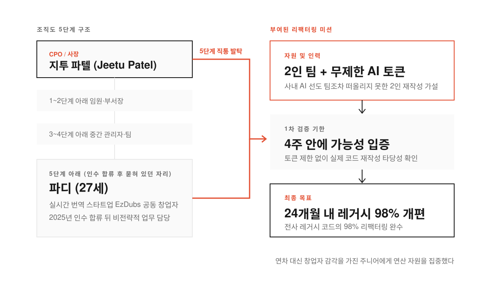
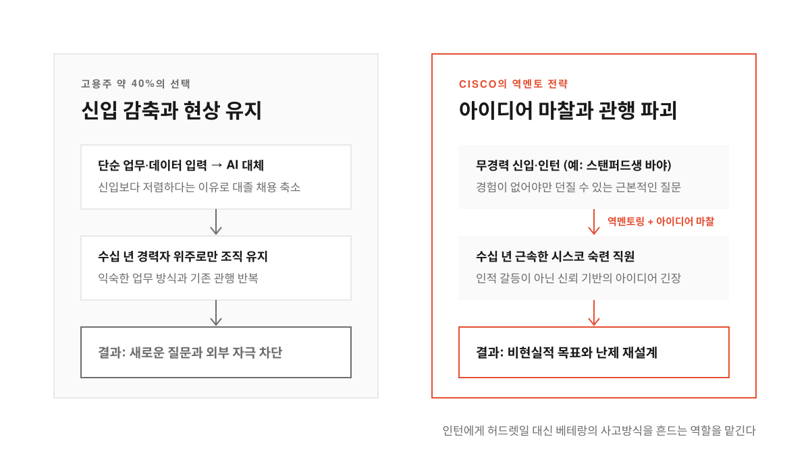
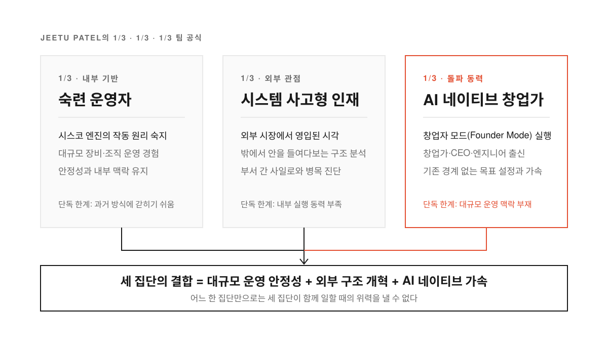
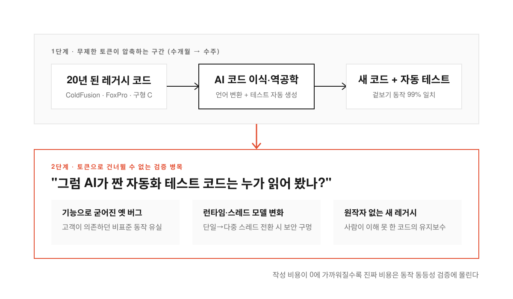

20년 넘게 굴러온 사내 핵심 시스템의 코드를 다시 짜야 한다고 해 보자. 보통의 대기업이라면 시스템 역사를 꿰고 있는 수십 년 경력의 수석 아키텍트를 부르고 수십 명짜리 전담 부서를 꾸려 수년 치 이행 계획서부터 쓴다. 사소한 설정 하나를 건드렸다가 전 세계 장비가 멈출까 봐 아무도 쉽게 손을 대지 못하기 때문이다.

시가총액 4,290억 달러 규모의 네트워크 기업 시스코(Cisco)는 정반대 길을 택했다. 사장 겸 최고제품책임자(CPO) 지투 파텔(Jeetu Patel)은 조직도에서 자기보다 다섯 단계나 아래에 묻혀 있던 27세 엔지니어를 찾아내 전사 레거시 코드(오래전에 짜여 유지보수가 어려워진 낡은 코드) 개편을 맡겼다. 조건은 AI 토큰을 무제한으로 쓸 것과 2인 팀으로 24개월 안에 레거시 코드의 98%를 리팩터링(외부 동작은 그대로 두고 내부 코드 구조만 개선하는 작업)할 것이다.

[포춘(Fortune) 인터뷰](https://fortune.com/2026/10/30/cisco-president-jeetu-patel-gen-z-27-year-old-unlimited-ai-tokens-rewrite-legacy-code-entry-level-jobs/)와 [GeekNews](https://news.hada.io/topic?id=36324)·[Hacker News 토론](https://news.ycombinator.com/item?id=50304122)은 이 과감한 발탁과 그 뒤에 깔린 주니어 채용 전략, 그리고 AI 재작성이 마주한 검증의 벽을 함께 짚는다.

<!--more-->

## 조직도 다섯 단계 아래에서 찾아낸 27세와 무제한 토큰

<figure>
  
  <figcaption>조직도 다섯 단계를 건너뛰어 2인 팀에 무제한 AI 토큰을 쥐여주고 4주 만에 가능성을 증명하게 했다.</figcaption>
</figure>

이 프로젝트를 맡은 인물은 파드마나반 크리슈나무르티(Padmanabhan Krishnamurthy), 별칭 파디(Paddy)다. 파디는 2023년 와이콤비네이터(Y Combinator) 지원을 받아 실시간 번역 스타트업 이즈덥스(EzDubs)를 공동 창업했다. 화자의 목소리와 감정을 살려 30개 이상 언어로 전화 통화를 통역하는 회사다. 시드 투자로 420만 달러를 유치했던 이 회사를 시스코가 2025년 11월에 인수하면서 파디도 시스코에 합류했다.

문제는 인수 뒤의 배치였다. 창업자이자 최고경영자(CEO)로 제품을 직접 만들던 사람이 대기업 조직도 다섯 단계 아래에 파묻혀 전략과 거리가 먼 일을 맡고 있었다. 전환점은 파텔 사장이 샌프란시스코 사무실에 들러 파디와 대화를 나눈 날 찾아왔다. 파디는 시스코의 거대한 레거시 코드를 단 두 명으로 다시 짤 수 있다고 봤다. 파텔의 직속 팀에서 AI 활용에 가장 앞선 사람들조차 감히 떠올리지 못한 발상이었다.

파텔은 파디에게 AI 토큰을 무제한으로 열어 주며 마음껏 밀어붙여 보라고 했다. 파디는 자기 가설을 입증할 기간으로 먼저 4주를 잡았고 최종 목표는 24개월 안에 시스코 레거시 코드의 98%를 리팩터링하는 데 두었다. 아직 검증 단계여서 실제 코드 개선 수치는 공개되지 않았지만 파텔은 이미 기존 체제에 도전하고 주변에 활력을 불어넣을 '제2의 파디'를 찾고 있다. **수십 년 경력자만 대형 프로젝트를 맡는다는 불문율을 깨고 창업자 감각을 가진 주니어에게 무제한 연산 자원을 몰아준 셈이다.**

## 신입 채용을 줄이는 40%의 기업과 거꾸로 가는 역멘토 전략

<figure>
  
  <figcaption>단순 반복 업무는 AI에 넘기고 신입과 인턴은 베테랑의 굳어진 공식을 깨는 역멘토로 배치한다.</figcaption>
</figure>

시스코의 행보가 더 눈에 띄는 이유는 바깥 채용 시장이 정반대로 움직이기 때문이다. 설문에 응답한 고용주의 약 40%는 AI가 같은 일을 더 싸게 처리한다는 이유로 대졸 신입 채용을 줄이겠다고 답했다. 신입에게 맡기던 자료 정리나 기초 구현을 AI로 대체하고 경력자만 남기려는 흐름이다.

파텔은 초급 인력을 뽑지 않고 기존 인력만 유지하면 조직에 새로운 생각이 들어올 통로가 막힌다고 본다. 숙련된 직원도 새 아이디어를 낼 수는 있지만 경험이 전혀 없는 사람만 던질 수 있는 질문까지는 떠올리지 못하기 때문이다. 수십 년 근속한 베테랑과 Z세대를 한 방에 넣어 생기는 마찰도 피하지 않는다. 사람이나 성격끼리 부딪히는 갈등이 아니라 아이디어를 둘러싼 긴장을 일부러 만들고 서로 신뢰하는 바탕 위에서 비현실적으로 보일 만큼 높은 목표를 세우게 한다.

이 원칙은 인턴십에도 똑같이 적용된다. 파텔은 스탠퍼드대 17~18세 장학생 강연에서 학생들이 줄지어 질문할 때 한쪽에서 끝까지 듣기만 하던 바야(Baya)라는 학생을 만났다. 파텔은 대화를 한 번 잘하는지보다 약속을 끝까지 지키는지 보려고 매달 AI에 관해 배운 점을 이메일로 보내 달라고 요청했다. 바야는 한 달도 빠뜨리지 않고 메일을 보냈고 시스코 인턴으로 합류한 뒤 숙련된 직원들이 풀지 못했던 과제를 재설계해 냈다.

> I didn’t bring her in so that she can do grunt work and do data entry. We brought her in so that she could actually teach our people how to think completely differently.

인턴을 허드렛일이나 데이터 입력에 쓰는 대신 기존 직원에게 전혀 다른 사고방식을 가르치는 '역멘토(reverse mentor)'로 삼았다. 파텔은 지금 바야를 정식 채용하려 한다.

## 낡은 공식이 없는 무경력자를 찾는 투자자와 창업자들

<figure>
  
  <figcaption>한 집단만으로는 부족하며 내부 숙련도와 외부 시스템 시각, AI 네이티브의 돌파력이 맞물려야 속도가 난다.</figcaption>
</figure>

경험 부족을 오히려 무기로 보는 시각은 시스코만의 이야기가 아니다. 스라이브 캐피털(Thrive Capital) 창업자 조시 쿠슈너(Josh Kushner)는 업계 경력 4년 미만의 인재를 선호한다. 스라이브 캐피털은 현재 기업가치 1조 2,500억 달러로 최대 300억 달러 조달을 추진 중인 OpenAI의 초기 투자사다. 쿠슈너가 26세에 회사를 세웠을 때 투자자들은 노련한 경력자를 뽑으라고 압박했지만 유능한 경력자가 26세 밑으로 들어올 리 없다는 역선택(정보나 위치 차이로 오히려 부적합한 대상을 고르게 되는 현상)을 꿰뚫어 봤다. 대신 주변에서 가장 똑똑한 또래를 모았고 회사가 커진 지금도 화려한 이력서 대신 벽을 뚫고 나갈 젊은 인재를 찾는다.

펩시코(PepsiCo), 네슬레(Nestlé), 마스(Mars)를 고객사로 둔 생성형 AI 플랫폼 테이스트와이즈(Tastewise)의 창업자 알론 첸(Alon Chen)도 경력과 학위를 따지지 않고 Z세대를 뽑는다. 똑같은 일을 해내는 새로운 도구가 쏟아지는 시대에 예전 방식을 깊이 익힌 사람일수록 과거의 성공 공식에 갇히기 쉽다는 이유다. 연구개발(R&D)에는 여전히 베테랑을 쓰지만 고객이 AI에서 가치를 뽑아내게 돕는 부서에는 고정관념이 없는 22세 신입을 배치해 기술과 사업, 고객 사이를 유연하게 오가게 한다. 테슬라와 OpenAI, 핀터레스트에 초기 투자한 윌아이엠(Will.i.am) 역시 다음 기술 돌파구가 MIT와 스탠퍼드의 젊은 AI 네이티브에게서 나올 것으로 보고 이들을 찾는 데 집중한다.

그렇다고 시스코가 베테랑을 배제하고 젊은 층으로만 팀을 채우지는 않는다. 파텔은 속도를 유지하려고 자기 팀을 세 집단이 대략 3분의 1씩 차지하도록 맞췄다. 첫 번째 3분의 1은 시스코라는 거대한 엔진이 어떻게 돌아가는지 꿰고 있는 숙련된 대규모 운영자다. 두 번째 3분의 1은 바깥 시장에서 합류해 외부의 시선을 불어넣는 시스템 사고형 인재다. 마지막 3분의 1이 파디처럼 창업자 모드(founder mode, 관료주의를 거치지 않고 창업자처럼 직접 문제를 파고드는 방식)로 움직이는 AI 네이티브 창업가와 엔지니어다. **세 집단 중 어느 하나만으로는 힘을 내기 어렵고 내부의 운영 경험과 외부의 시각, AI 네이티브의 돌파력이 한데 맞물릴 때 비로소 조직이 움직인다.**

## 코드 재작성은 빨라졌지만 그 테스트 코드는 누가 읽었나

<figure>
  
  <figcaption>코드를 옮겨 적는 시간은 몇 주로 줄었지만 바뀐 코드와 테스트가 기존 동작과 같은지 확인하는 책임은 남는다.</figcaption>
</figure>

경영진의 과감한 베팅과 별개로 현장 엔지니어들의 시선은 '2인 팀의 98% 리팩터링'을 기술적으로 어떻게 검증할지에 쏠렸다. [Hacker News 토론](https://news.ycombinator.com/item?id=50304122)에서는 실제로 AI를 앞세워 해묵은 레거시를 걷어낸 경험담이 여럿 올라왔다. 한 엔지니어는 최소 12년 동안 미뤄 두었던 콜드퓨전(ColdFusion) 사이트를 클로드 코드(Claude Code, 월 200달러 요금제)로 일주일 만에 약 5만 줄 규모의 자바 스프링(Java Spring) 코드로 옮겼다. 수작업으로는 12~18개월 걸릴 일이었지만 브라우저를 연동해 기존 사이트와 새 사이트 화면을 자동으로 대조하며 개발부터 검증, 배포까지 2주 안에 끝냈고 한 달 넘게 문제없이 운영 중이다.

또 다른 팀은 20년 된 임베디드 시스템을 관리하던 개발자 두 명이 은퇴하자 중급 개발자 한 명이 업무 시간의 절반만 써서 3개월 만에 전체 코드 재작성과 문서화를 마쳤다. 이때 쓴 토큰 비용은 약 2만 달러였다. 도스(DOS) 환경의 1990년대 폭스프로(FoxPro) 앱을 일주일 만에 99% 같게 역공학하거나 기드라(Ghidra, 역공학 도구)와 딥시크(DeepSeek)로 32비트 게임을 40분 만에 웹어셈블리(Wasm)로 재컴파일한 사례도 이어졌다.

하지만 화면을 나란히 띄워 비교할 수 있는 웹 사이트와 달리 시스코의 네트워크 장비와 인프라는 검증 차원이 다르다. 시스코는 최근 수년간 수많은 보안 취약점(CVE)과 하드코딩된 비밀번호 문제로 곤욕을 치러 왔다. 더구나 오래된 코드에서는 방치된 버그 자체가 고객이 의존하는 기능으로 굳어져 있거나 단일 스레드 가정을 다중 스레드로 바꾸는 순간 새 보안 구멍이 열리기도 한다. SQLite처럼 75만 개에 달하는 테스트가 미리 갖춰져 있지 않다면 99% 같다는 말은 나머지 1%에서 치명적인 장애가 터진다는 뜻이 된다.

토론에서 가장 뼈아픈 질문도 바로 이 지점을 찔렀다. 사내에서 AI 재작성 계획이 나올 때마다 누군가 두 버전의 업무 로직이 같은지 코드를 읽어 봤느냐고 물으면 다들 자동화 테스트가 있다고 답한다. **하지만 "그럼 AI가 짠 그 자동화 테스트 코드는 누가 읽어 봤나?"라고 되물으면 회의실에 침묵이 흐르고 계획은 보류된다.** AI가 무엇을 왜 바꿨는지 아키텍처 결정 기록(ADR)으로 남기며 사람의 이해를 돕는 교사로 쓸 수도 있지만 원작자도 읽지 않은 코드를 LLM끼리만 주고받게 두면 또 다른 레거시가 될 뿐이다. 무제한 토큰이 4주 뒤 시스코에 안겨 줄 성적표도 결국 얼마나 빨리 고쳐 썼는지가 아니라 바뀐 98%의 코드를 사람이 어떻게 검증하고 책임질지에서 갈릴 것이다.
