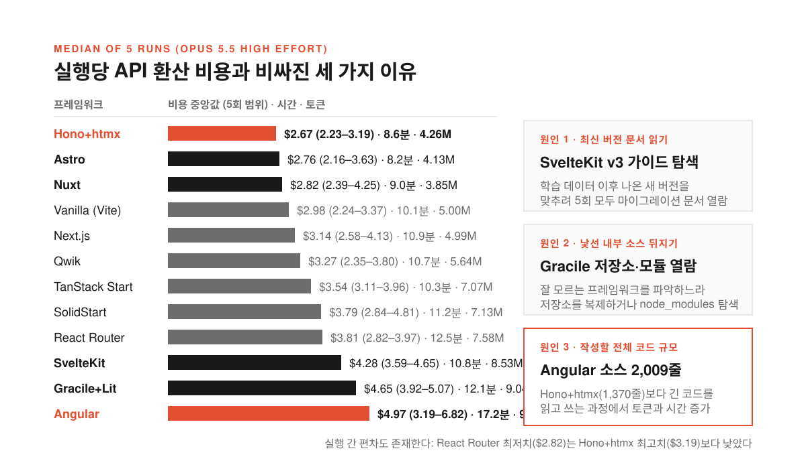
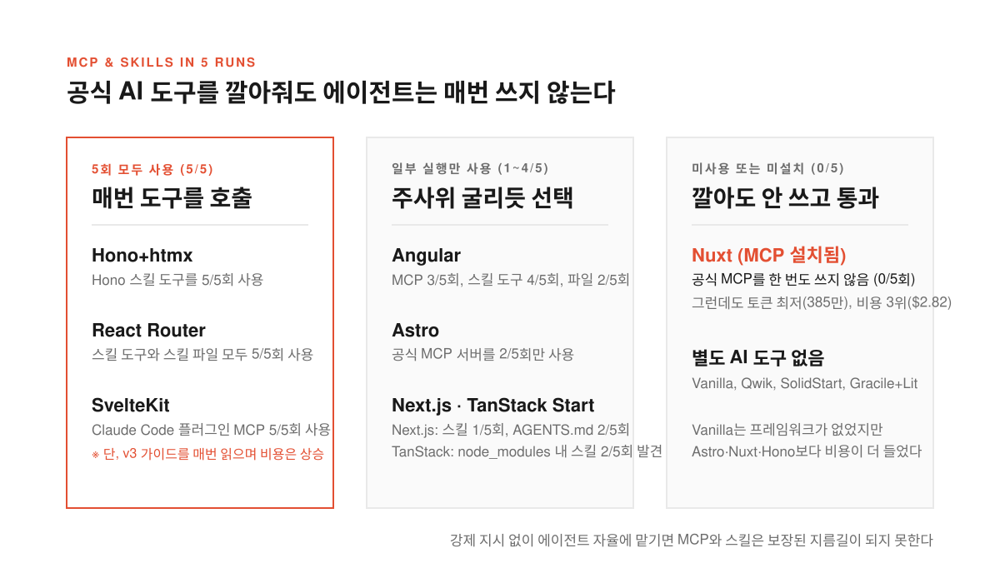
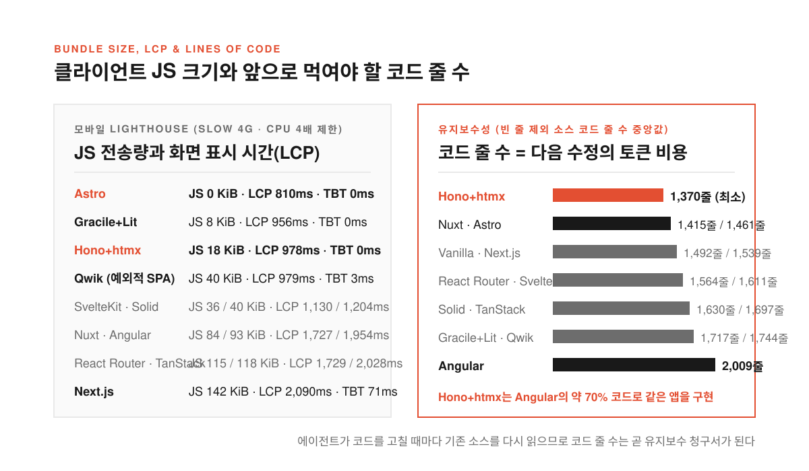

새 웹 프로젝트를 시작할 때마다 팀에서는 비슷한 논쟁이 열린다. 예전에는 JSX 손맛이나 가상 DOM(화면 변화를 메모리에서 먼저 계산하는 구조)이 빠르다는 주장이 선택을 좌우했다면 요즘은 에이전트가 기준이다. "이 프레임워크가 에이전트에게 잘 맞는다"거나 "AI가 실수를 덜 하고 빠르다"는 말로 프런트엔드를 갈아엎는다.

막상 그 주장을 뒷받침하는 벤치마크(같은 조건에서 성능을 재는 실험)를 찾아보면 숫자가 없다. 알렉스 러셀이 '프런트엔드의 잃어버린 10년'이라 부르고 발두르 비아르드나손이 '대중문화로서의 프로그래밍'이라 꼬집었듯 도구를 먼저 고른 뒤 논리를 사후에 붙이는 습관이 바이브 코딩 시대에도 남았다.

놀런 로슨(Nolan Lawson)은 이 인상을 숫자로 확인해 보기로 했다. [블로그 원문](https://nolanlawson.com/2026/10/28/the-ai-cost-of-javascript-frameworks/)과 [GeekNews 토픽](https://news.hada.io/topic?id=36393)에 공개한 실험에서 그는 Opus 5.5(높은 노력 수준)에게 같은 포켓몬 앱 명세를 주고 Next.js, Nuxt, Astro, SvelteKit, Angular, Hono+htmx 등 12개 조합으로 5번씩 총 60번을 만들게 했다.

<!--more-->

## Hono+htmx는 2.67달러, Angular는 4.97달러가 나온 이유

<figure>
  
  <figcaption>학습 데이터에 없는 최신 문서를 읽거나 생성해야 할 전체 코드가 길어질수록 토큰과 시간이 두 배 가까이 벌어졌다.</figcaption>
</figure>

실험 대상은 [PokéAPI](https://pokeapi.co/)로 포켓몬 목록·타입·기술·게임 정보와 검색·필터를 제공하는 콘텐츠 중심 앱이다. 적합성 테스트를 주되 Shadow DOM(컴포넌트 내부를 격리하는 웹 표준)을 쓰는 웹 컴포넌트까지 검사하려고 접근성 트리(스크린 리더가 읽는 화면 구조)로 채점했다. 정적 HTML 사전 생성 반칙과 Tailwind·Bootstrap은 금지하고 디자인 토큰만 쓰게 했다.

5회 중앙값으로 줄을 세우자 API 환산 비용에서 격차가 드러났다. Hono+htmx(2.67달러), Astro(2.76달러), Nuxt(2.82달러), Vanilla(2.98달러), Next.js(3.14달러), Qwik(3.27달러)이 저렴했고 TanStack Start(3.54달러), SolidStart(3.79달러), React Router(3.81달러)가 뒤를 이었다. 반면 SvelteKit(4.28달러), Gracile+Lit(4.65달러), Angular(4.97달러)는 비쌌다. 시간과 토큰도 Astro(8.2분, 413만), Hono+htmx(8.6분, 426만), Nuxt(9.0분, 385만)가 빨랐고 Angular는 17.2분에 976만 토큰을 썼다.

물론 LLM은 확률적 모델이라 주사위가 나쁘면 엉뚱한 데 토큰을 쓰기도 해서 React Router 최저치(2.82달러)는 Hono+htmx 최고치(3.19달러)보다 낮았다. **하지만 전체 흐름을 보면 모델이 프레임워크를 얼마나 잘 아는지와 얼마나 긴 코드를 짜야 하는지가 비용을 갈랐다.** 최신 버전을 쓰라고 하자 SvelteKit 에이전트는 5번 모두 학습 데이터에 없던 [v3 마이그레이션 가이드](https://svelte.dev/docs/kit/migrating-to-sveltekit-3)를 읽었다. Gracile+Lit은 Gracile을 몰라 저장소를 복제하거나 `node_modules`를 읽었고 Angular는 코드가 길어 비용이 높았다.

## 공식 MCP와 스킬을 깔아줘도 에이전트는 매번 쓰지 않는다

<figure>
  
  <figcaption>공식 AI 도구를 미리 설치해 두어도 에이전트가 실제로 열어 보는 빈도는 프레임워크마다 크게 갈렸다.</figcaption>
</figure>

특정 프레임워크가 불리하다는 지적에는 "공식 MCP(모델이 외부 도구나 문서를 연결하는 규약)나 스킬을 쓰면 된다"는 반론이 붙는다. 로슨은 각 프레임워크의 공식 MCP와 스킬, 플러그인을 샌드박스에 미리 깔아 두되 일반적인 바이브 코딩을 반영해 사용을 강제하지는 않았다.

막상 돌려 보니 에이전트들은 준비된 도구를 매번 쓰지 않았다. Hono+htmx(스킬 5/5회), React Router(스킬 도구·파일 5/5회), SvelteKit(플러그인 MCP 5/5회)만 다섯 번 모두 호출했다. Angular는 MCP 3회, 스킬 도구 4회, 파일 2회만 썼고 Astro는 MCP를 2회만 썼다. Next.js는 `next-devtools-mcp`와 `next-dev-loop` 스킬을 준비했지만 스킬 파일 1회, `AGENTS.md` 2회만 읽었고 TanStack Start는 `node_modules`의 스킬 파일을 2회 발견했다.

특히 눈에 띄는 건 Nuxt와 Vanilla였다. Nuxt는 공식 MCP를 한 번도 쓰지 않았지만 토큰 최저(385만)와 비용 3위(2.82달러)를 기록했다. 반대로 Vite 위에서 프레임워크 없이 순수 JS·TS만 쓰게 한 Vanilla(2.98달러, 10.1분, 500만)는 Hono+htmx나 Astro, Nuxt보다 비싸고 느렸다. **아무 프레임워크도 안 쓰는 것보다 적당한 틀을 주는 편이 나을 수 있으며 지금의 MCP나 스킬이 때로는 도움보다 해가 될 수 있다는 의심도 남긴다.**

## 클라이언트 JS 0KiB와 142KiB가 가른 모바일 로딩과 구현 사고

<figure>
  
  <figcaption>클라이언트로 보내는 JS 크기와 전체 소스 코드 줄 수에서 프레임워크의 기본 체급이 그대로 드러났다.</figcaption>
</figure>

에이전트들은 [Lighthouse](https://developer.chrome.com/docs/lighthouse/) 평가를 모른 채 구현을 마쳤다. Ubuntu 24.04 기반 Framework 13 노트북에서 CPU 4배 제한과 Slow 4G 조건으로 모바일 홈페이지를 잰 결과 접근성은 모두 100점, 레이아웃 밀림(CLS)은 Vanilla(0.111) 외에 모두 0.000이었고 성능도 97~100점이었다.

대신 JS 전송량과 최대 콘텐츠 페인트(LCP, 가장 큰 콘텐츠가 표시되는 시간)에서 차이가 났다. JS 전송량 중앙값은 Astro 0KiB, Vanilla 7KiB, Gracile+Lit 8KiB, Hono+htmx 18KiB, SvelteKit 36KiB, SolidStart·Qwik 각 40KiB였고 Nuxt 84KiB, Angular 93KiB, React Router 115KiB, TanStack Start 118KiB, Next.js 142KiB 순이었다. 총 차단 시간(TBT)은 Astro, Gracile+Lit, Hono+htmx, SvelteKit, Vanilla가 0ms였고 Nuxt 40ms, Next.js 71ms, Angular 103ms였다.

LCP는 HTML로 바로 화면을 그리는 다중 페이지 앱(MPA)이 클라이언트 JS 실행과 데이터 요청을 기다리는 단일 페이지 앱(SPA)을 앞섰다. Astro(810ms), Gracile+Lit(956ms), Hono+htmx(978ms)가 빨랐고 Angular(1,954ms), TanStack Start(2,028ms), Next.js(2,090ms)는 두 배가량 걸렸다. 예외는 Qwik으로 클라이언트 라우팅을 쓰는 SPA인데도 979ms로 MPA 그룹에 들었다.

구현 편차도 컸다. Next.js는 5개 중 1개만 이미지 지연 로딩을 피하고 4개는 지연 로딩을 걸어 LCP가 1,028~2,187ms로 흔들렸다. Vanilla는 5회 모두 SPA를 짰고 Gracile+Lit은 2회에서 Lit을 빼먹었다. **Angular는 명세에 리버스 프록시(요청을 내부로 넘기는 중계 서버) 뒤에서 실행된다고 적혀 있었는데도 2회에서 SSR 앱이 localhost 외 요청을 거부해 실패했고 품질과 코드량은 성공한 3회만 집계했다.**

## 에이전트 시대의 코드 줄 수는 곧 다음 수정의 토큰 청구서다

유지보수성은 빈 줄을 뺀 소스 코드 줄 수로 비교했다. 중앙값은 Hono+htmx가 1,370줄로 가장 짧았고 Nuxt(1,415줄), Astro(1,461줄), Vanilla(1,492줄), Next.js(1,539줄), React Router(1,564줄)가 뒤를 이었다. 이어서 SvelteKit(1,611줄), SolidStart(1,630줄), TanStack Start(1,697줄), Gracile+Lit(1,717줄), Qwik(1,744줄) 순이었고 Angular가 2,009줄로 가장 길었다.

> “Frameworks are not tools for organizing your code; they are tools for organizing your mind.”

리치 해리스(Rich Harris)의 말처럼 프레임워크는 유지할 코드를 줄이고 생각을 정리하는 도구다. 에이전트가 코드를 짜는 시대에는 코드 길이가 돈과 직결된다. 기능을 고칠 때마다 에이전트가 기존 소스를 읽고 고쳐 써야 하므로 코드 줄 수가 앞으로 쓸 토큰 양을 결정하기 때문이다. Hono+htmx가 Angular의 약 70% 코드만으로 같은 앱을 더 빨리 구현했다는 점은 향후 유지보수 청구서에서도 차이가 난다는 뜻이다.

물론 콘텐츠 중심 앱과 Lighthouse 지표는 MPA에 유리하다. 복잡한 대시보드나 게임, 앱 내부 상호작용을 쟀다면 SPA가 앞섰을 수 있고 로슨도 후속 실험을 위해 [벤치마크 저장소](https://github.com/nolanlawson/agent-framework-benchmark)를 열어 두었다. **그럼에도 손으로 코드를 치던 시절의 습관만으로 `npm install` 뒤에 익숙한 이름을 적고 있다면 이제는 에이전트가 그 스택을 다루는 비용부터 숫자로 따져 볼 때다.**

출처: Nolan Lawson, [The AI cost of JavaScript frameworks](https://nolanlawson.com/2026/10/28/the-ai-cost-of-javascript-frameworks/) · [GeekNews 토픽 #36393](https://news.hada.io/topic?id=36393).

