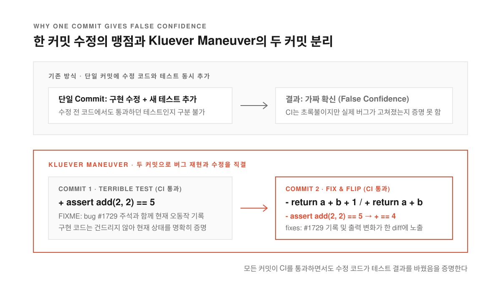
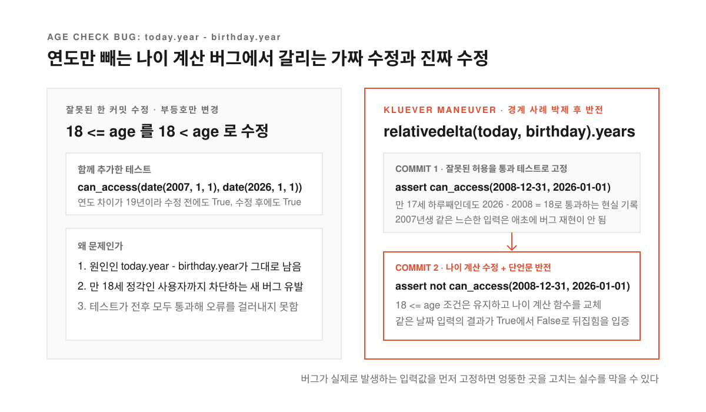
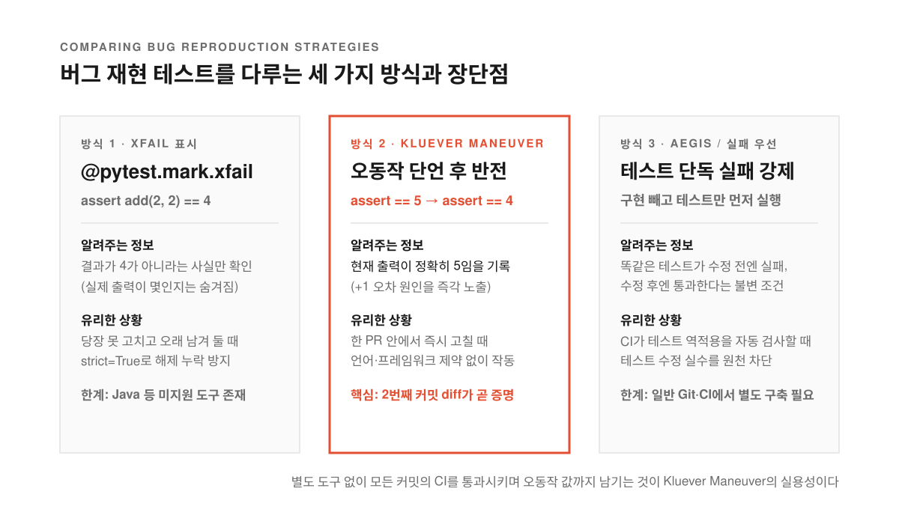
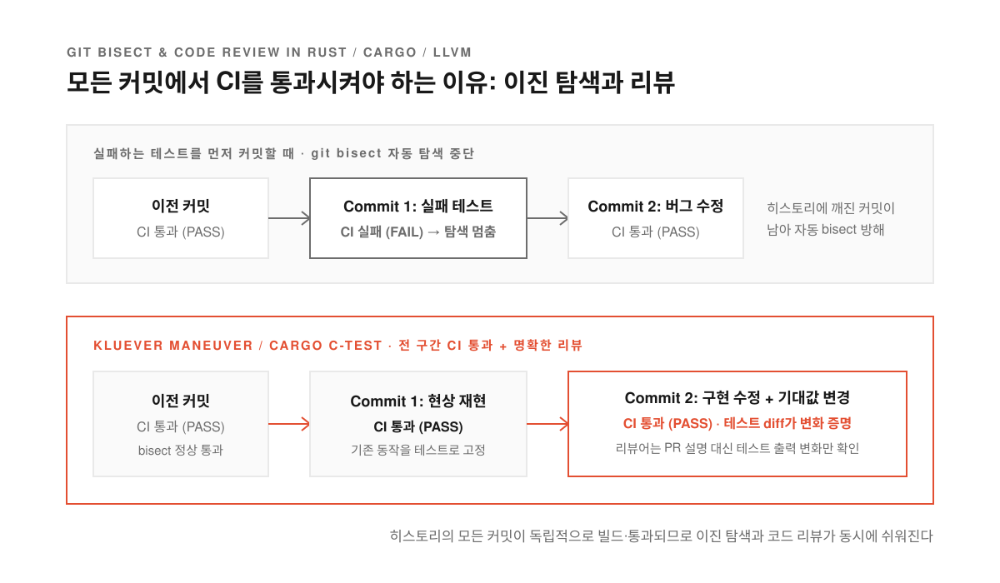

버그를 하나 잡아내서 코드 두 줄을 고치고 회귀 테스트(고친 버그가 다시 생기지 않는지 확인하는 테스트)까지 붙여서 풀 리퀘스트를 올린다. CI(코드를 합치기 전에 자동으로 빌드와 테스트를 돌려 보는 시스템)의 초록색 통과 표시가 뜨면 리뷰어도 안심하고 승인 버튼을 누른다. 그런데 며칠 뒤 똑같은 장애가 다시 터진다. 새로 넣은 테스트가 사실은 버그를 고치기 전의 옛날 코드에서도 멀쩡히 통과하는 무용지물이었기 때문이다.

수정 코드와 테스트를 한 커밋에 묶어 올리면 이런 착시가 자주 일어난다. 코드를 고친 사람도 테스트가 초록불을 띄우는 순간 문제가 해결됐다고 믿어 버리고 리뷰어도 변경된 코드와 새 테스트가 나란히 들어 있으니 그 테스트가 실제로 버그를 잡아내는지 의심하지 않는다. 테스트가 수정 전에는 실패하고 수정 후에만 통과한다는 사실을 커밋 기록 어디에서도 증명하지 않은 채 넘어가는 셈이다.

프로그래머 조르디 구티에레스 에르모소(Jordi Gutiérrez Hermoso)가 소개한 [The Kluever Maneuver](https://jordi.inversethought.com/blog/the-kluever-maneuver/)와 이를 다룬 [GeekNews](https://news.hada.io/topic?id=36361)·[Lobste.rs 토론](https://lobste.rs/s/rpiu3w/kluever_maneuver)은 이 문제를 단순한 규칙으로 푼다. 버그를 고칠 때 무조건 커밋을 두 개로 쪼개되 첫 번째 커밋에는 고장 난 현재 동작을 정답이라고 단언하는 통과 테스트부터 넣는 방식이다.

<!--more-->

## 2 더하기 2가 5라고 우기는 첫 번째 커밋

<figure>
  
  <figcaption>첫 커밋에서 망가진 현재 출력을 그대로 통과시키고 두 번째 커밋에서 구현과 테스트 기대값을 나란히 뒤집는다.</figcaption>
</figure>

두 숫자를 더하는 `add(a, b)` 함수가 실수로 `a + b + 1`을 반환한다고 해 보자. Kluever Maneuver를 쓰면 버그를 발견했을 때 `arith.py`의 함수 본문부터 고치지 않는다. 대신 첫 번째 커밋에서 테스트 파일만 열어 `assert add(2, 2) == 5`라는 단언문(조건이 참인지 확인하는 코드)을 적고 그대로 커밋한다. 지금 코드는 실제로 5를 내놓으니 이 틀린 테스트는 CI를 통과한다.

이어서 바로 두 번째 커밋을 만든다. 여기서는 `add(a, b)`의 구현을 `a + b`로 고치면서 앞선 커밋에 넣었던 테스트의 기대값도 `assert add(2, 2) == 4`로 함께 바꾼다. 두 번째 커밋의 변경 내역(diff)을 열어 보면 함수 코드 한 줄과 테스트의 기댓값 숫자가 `5`에서 `4`로 바뀐 줄이 위아래로 나란히 찍힌다.

이 이름은 필자에게 이 기법을 알려 준 동료 커트 클루버(Kurt Kluever)에서 따왔다. 클루버는 이 방식을 평소 '형편없는 테스트(terrible tests)'라고 불렀다.

> Jordi, can you please write a terrible test for this?

틀렸다는 사실을 알면서도 그 잘못된 결과를 정답으로 삼는 테스트부터 짜 달라는 뜻이다. 이렇게 두 단계를 밟으면 지금 버그가 어떻게 동작하는지 눈으로 확인할 수 있고 내 수정 코드가 실제로 프로그램의 출력을 바꿨다는 증거가 남으며 두 커밋 모두에서 CI가 깨지지 않고 초록불을 유지한다.

## 18세 미만 차단 코드에서 드러나는 가짜 수정의 함정

<figure>
  
  <figcaption>엉뚱한 곳을 고치고 느슨한 테스트를 붙이면 수정 전후 모두 통과하지만 버그 재현 커밋을 먼저 두면 기대값이 뒤집히지 않아 가짜 수정이 들통난다.</figcaption>
</figure>

덧셈 예제는 단순하지만 날짜나 경계값을 다루는 코드로 가면 한 커밋 수정의 함정이 훨씬 교묘해진다. 미성년자 접근을 막으려고 `age_in_years(birthday, today)` 함수가 `today.year - birthday.year`를 반환하고 `can_access(birthday, today)` 함수가 `18 <= age_in_years(birthday, today)`로 통과 여부를 판단하는 파이썬 코드가 있다고 하자.

이 코드는 월과 일을 무시하고 연도만 뺀다는 결함이 있다. 오늘이 2026년 10월이라면 2008년 12월에 태어난 사람은 아직 생일이 지나지 않아 만 17세인데도 `2026 - 2008`이 `18`이 되어 성인 인증을 통과해 버린다. 이 버그를 본 개발자가 흔히 1씩 어긋나는 오류(off-by-one error)라고 넘겨짚고 `can_access`의 비교 연산자를 `18 <=`에서 `18 <`로 고친다. 그러고는 2007년 1월 1일생이 2026년 1월 1일에 통과하는지 확인하는 `assert can_access(date(2007, 1, 1), date(2026, 1, 1))` 테스트를 함께 커밋한다.

얼핏 보면 코드도 고쳤고 테스트도 통과하니 완벽한 수정처럼 보인다. 하지만 진짜 문제는 `can_access`의 부등호가 아니라 연도만 빼는 `age_in_years`에 있었다. 더구나 함께 넣은 2007년생 테스트는 연도 차이가 19년이라 부등호를 바꾸기 전에도 통과하고 바꾼 뒤에도 통과한다. **버그는 그대로 남았는데 수정 전후에 똑같이 통과하는 테스트가 붙으면서 버그를 고쳤다는 가짜 확신만 심어 준 셈이다.**

여기에 Kluever Maneuver를 적용하면 가짜 수정이 끼어들 틈이 사라진다. 첫 번째 커밋에서 2008년 12월 31일생이 2026년 1월 1일에 성인으로 통과해 버리는 잘못된 동작을 `assert can_access(date(2008, 12, 31), date(2026, 1, 1))`이라는 통과 테스트로 먼저 기록하기 때문이다. 첫 커밋에 이 기준점을 박아 두고 나면 두 번째 커밋에서는 연도 뺄셈을 `dateutil.relativedelta`의 `relativedelta(today, birthday).years`로 고치고 테스트 단언문도 접근이 거부되는 `assert not`으로 뒤집을 수밖에 없다.

## XFAIL 데코레이터와 두 커밋 뒤집기는 무엇이 다른가

<figure>
  
  <figcaption>XFAIL은 정답이 아니라는 사실만 알리지만 통과 테스트는 지금 코드가 어떤 오답을 내놓는지까지 구체적으로 기록한다.</figcaption>
</figure>

이 기법을 본 개발자들이 가장 먼저 던지는 반론은 테스트 프레임워크의 `XFAIL(예상된 실패)` 기능이나 TDD(테스트 주도 개발)의 실패 우선 원칙을 쓰면 되지 않느냐는 질문이다. 첫 커밋에서 처음부터 올바른 기대값인 `assert add(2, 2) == 4`를 적고 파이썬 pytest의 `@pytest.mark.xfail` 데코레이터(함수 위에 붙여 동작 방식을 지정하는 표식)를 달아 두면 CI도 통과하고 코드 저장소에 오답을 남기지 않아도 된다는 주장이다.

에르모소는 먼저 자바(Java)를 비롯해 모든 언어의 테스트 도구가 `XFAIL`과 같은 기능을 기본으로 제공하지는 않는다는 점을 짚는다. 설령 도구가 지원하더라도 '통과하는 오답 테스트'와 '실패가 예상된 정답 테스트'는 담고 있는 정보량이 다르다. `XFAIL`을 붙인 `assert add(2, 2) == 4`는 현재 덧셈 결과가 4가 아니라는 사실만 알려줄 뿐 실제로 몇이 나오는지는 말해 주지 않는다. 반면 `assert add(2, 2) == 5`는 현재 결과가 정확히 5라는 사실까지 드러내어 1이 더해지고 있다는 버그의 원인을 파악하기 쉽게 해 준다.

물론 당장 버그를 고칠 수 없어서 문제만 기록해 두고 오랫동안 브랜치에 남겨야 한다면 `XFAIL`이 더 낫다. 오답을 정답처럼 적어 둔 테스트가 몇 달 동안 코드베이스에 남으면 나중에 코드를 읽는 동료들이 원래 의도된 동작인 줄 알고 오해할 수 있기 때문이다. 그래서 Lobste.rs 토론에서도 평소에는 `@pytest.mark.xfail(strict=True)`를 써서 버그가 고쳐졌을 때 데코레이터 제거를 강제하거나 과거 버전 관리 도구였던 이지스(Aegis)처럼 시스템이 새 테스트만 먼저 옛 코드에 돌려 실패하는지 확인한 뒤에야 병합을 허락하던 방식이 함께 거론됐다.

결국 두 커밋 기법이 노리는 무대는 장기 보관이 아니라 한 풀 리퀘스트 안에서 일어나는 즉각적인 대조다. 첫 커밋의 테스트에는 `FIXME: bug #1729`처럼 이슈 추적기 번호를 달아 버그 재현임을 표시하고 바로 이어지는 두 번째 커밋에서 `FIXME` 표시를 지우며 커밋 메시지에 `fixes: #1729`를 적어 수정과 연결한다.

## Rust와 Cargo부터 LLVM까지 대형 오픈소스가 이 순서를 고집하는 이유

<figure>
  
  <figcaption>모든 커밋이 테스트를 통과해야 git bisect 자동 탐색이 멈추지 않고 리뷰어도 두 번째 커밋의 테스트 diff만 보고 수정을 검증할 수 있다.</figcaption>
</figure>

이 기법은 개인의 습관에 그치지 않고 여러 대형 프로젝트에서 표준 관행으로 쓰인다. Lobste.rs 토론에서는 구글에서 같은 방식을 배워 CUE 프로젝트에 도입했다는 경험담부터 컴파일러 인프라 프로젝트인 LLVM과 러스트 공식 저장소(`rust-lang/rust`)에서 새 기여자의 버그 수정 PR을 검토할 때 두 커밋 구성을 자주 요청한다는 이야기가 이어졌다.

러스트의 패키지 관리자 카고(Cargo) 팀의 에드 페이지(Ed Page)는 기여 가이드의 [C-TEST(문제 재현하기) 항목](https://epage.github.io/dev/pr-style/#c-test)으로 이 원칙을 정리해 두었다. 카고 팀은 PR을 올릴 때 기존 동작을 그대로 재현하는 테스트 커밋으로 시작하고 그다음 기능이나 버그 수정 커밋에서 코드와 함께 테스트의 기대 출력을 바꾸도록 안내한다. 긴 PR 설명문보다 두 번째 커밋의 테스트 변경 내역(diff)에 찍힌 전후 출력 차이가 이 코드가 무엇을 바꿨는지 리뷰어에게 훨씬 명확하게 보여 주기 때문이다.

여기서 모든 커밋마다 CI가 통과해야 한다는 조건은 `git bisect(문제가 발생한 커밋을 이진 탐색으로 찾아내는 Git 명령어)`를 돌릴 때 힘을 발휘한다. 만약 첫 커밋에 실패하는 테스트를 넣고 두 번째 커밋에서 고쳤다면 저장소 역사 중간에 테스트가 깨진 커밋이 남는다. 나중에 다른 버그를 찾으려고 수백 개 커밋 사이에서 자동화 스크립트로 `git bisect`를 돌릴 때 이렇게 실패하는 커밋을 밟으면 탐색이 엉뚱한 곳에서 멈춘다.

모든 PR을 하나로 합쳐서 병합(squash merge)하는 팀이거나 누군가 두 번째 수정 커밋만 되돌려(revert) 버그 단언문이 본줄기에 남는 일을 걱정하는 팀이라면 이 방식을 그대로 쓰기 조심스러울 수 있다. **그럼에도 코드를 고치기 전에 망가진 현재 동작을 먼저 테스트로 붙잡고 내 수정 코드가 그 테스트의 출력을 뒤집는 순간을 직접 확인하는 절차만큼은 어떤 병합 전략에서도 유효하다.** 내 테스트가 현재 버그를 정확히 겨냥했는지 먼저 확인하는 그 한 걸음이 가짜 초록불에 속아 넘어가는 배포를 막아 준다.
