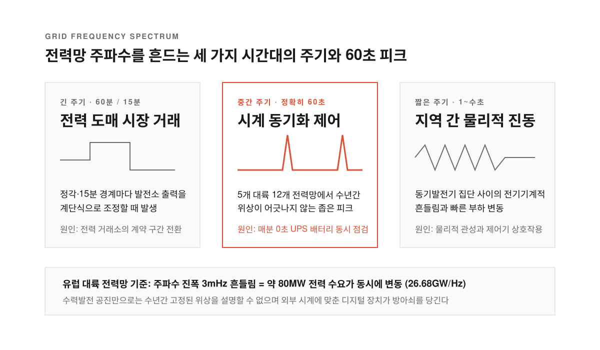
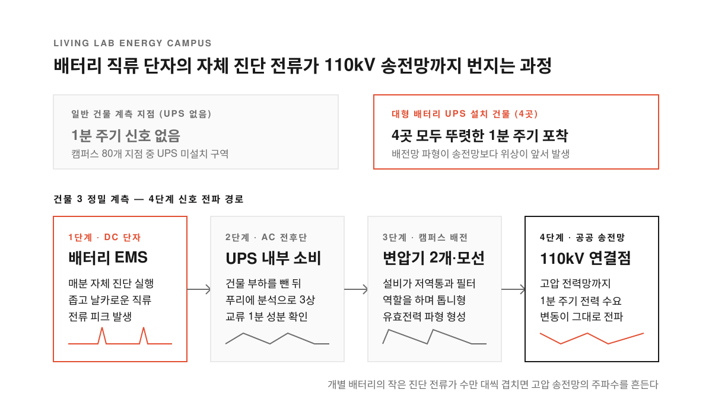
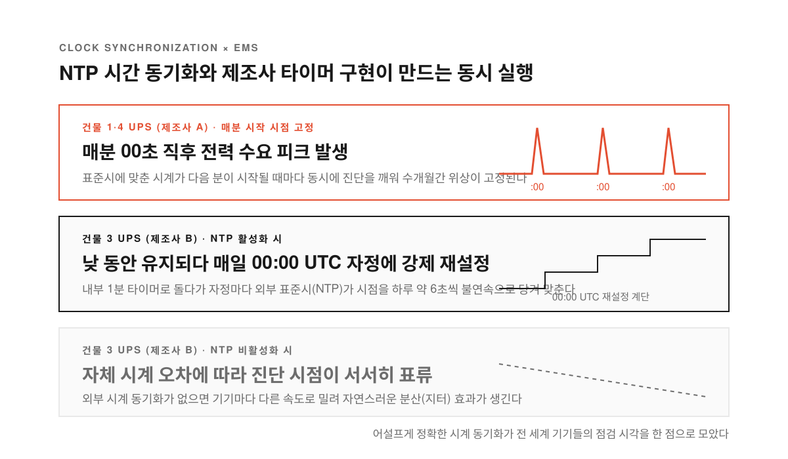
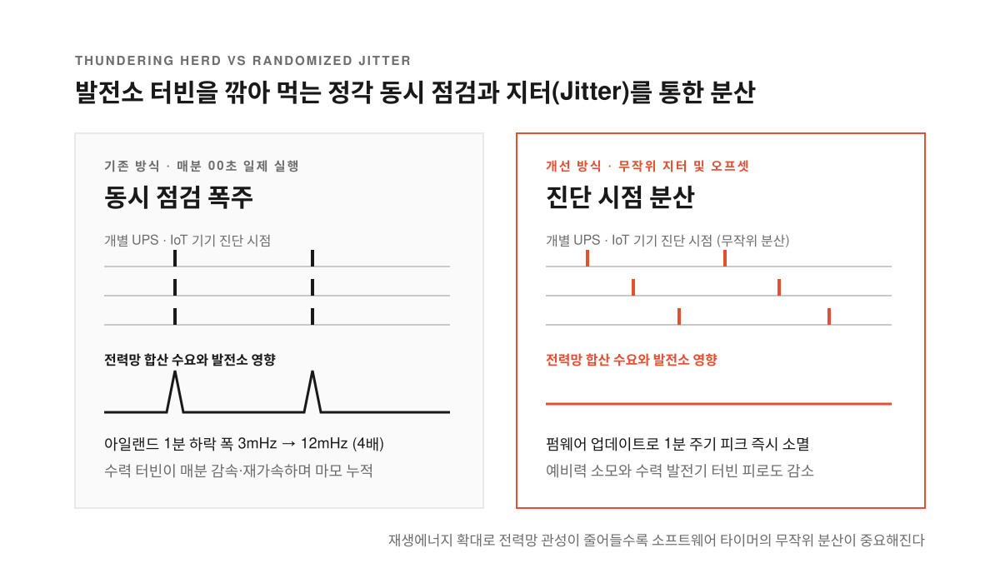

백엔드 서버에 수만 대의 기기가 매분 0초(`* * * * *`)마다 상태 확인 요청을 보내면 서버가 주저앉는 동시 요청 폭주(thundering herd, 수많은 장치가 한 시점에 몰려 과부하를 주는 현상)가 일어난다. 분산 시스템 개발자에게 익숙한 이 설계 실수가 인터넷 서버가 아니라 국가 전력망에서 수년째 벌어지고 있었다.

독일 최대 송전망 운영사인 테네트 독일(TenneT Germany)은 유럽 전력망 주파수가 60초마다 잠깐씩 떨어지는 현상을 수년간 관측했다. 주파수는 발전량과 소비량이 맞물리는 저울이다. 그런데 매분 초침이 0초를 지날 때마다 누군가 대형 스위치를 동시에 올렸다가 내리듯 주파수가 내려앉았다.

율리히 연구소(Forschungszentrum Jülich)의 디르크 비트하우트(Dirk Witthaut) 연구팀이 쾰른대·카를스루에 공대·테네트 독일 연구진과 함께 발표한 [Nature Energy 논문](https://www.nature.com/articles/s41560-026-02144-0)과 [보도자료](https://www.fz-juelich.de/en/news/archive/press-release/2026/mystery-of-60-second-fluctuations-in-power-grids-solved)는 이 미스터리의 범인을 특정했다. 정전 대비용 대규모 무정전 전원장치(UPS, 전원이 끊겨도 배터리 전기를 즉시 공급하는 장치)들이 매분 시작 시점에 일제히 배터리 상태를 점검하면서 전 세계 전력망을 흔들고 있었다.

<!--more-->

## 한국을 포함한 5개 대륙 12개 전력망에 찍힌 60초의 맥박

<figure>
  
  <figcaption>수력발전 제어계의 자체 진동만으로는 수년 동안 한 치도 밀리지 않는 60초 주기의 위상을 설명할 수 없다.</figcaption>
</figure>

교류 전력망의 기준 주파수(유럽 50Hz, 한국·미국 60Hz)는 발전소 터빈 회전 속도와 직결된다. 전력 소비가 발전량을 앞지르면 발전기 회전이 무거워져 주파수가 떨어지고 전기가 남으면 올라간다. 연구팀이 40만 가구 규모의 아이슬란드부터 4억 명 이상이 연결된 유럽 대륙 전력망까지 5개 대륙 12개 전력망 데이터를 푸리에 변환(신호를 주기별 성분으로 분해하는 기법)으로 분석하자 똑같은 맥박이 드러났다. 유럽·호주·미국·남아공은 물론 3.5개월간 측정한 한국 배전망에서도 정확히 60초 주기에 날카로운 피크가 찍혔다.

전력망 주파수에는 원래 알려진 주기들이 있다. 60분·15분 주기의 큰 흔들림은 전력 시장 거래 구간이 바뀔 때 발전소들이 출력을 계단식으로 조정해서 생기고 1~수초 주기의 짧은 흔들림은 발전기 집단끼리 에너지를 주고받는 진동에서 비롯된다. 그동안 전력공학계는 그 사이의 1분 안팎 흔들림을 초저주파 진동(ULFO)이라 부르며 수력발전 터빈과 조속기(회전 속도를 유지하는 밸브 제어기)의 내부 공진 탓으로 여겼다.

그러나 스칸디나비아 수력발전 모델과 머신러닝으로 검증해 보니 수력발전 공진만으로는 설명이 불가능했다. 외부 시계가 없는 기계적 진동이라면 시간이 흐르면서 파형의 시작 시점(위상)이 밀리고 전력망마다 주기가 달라야 한다. 하지만 실제 1분 파형은 매분 0초에 주파수가 가장 높았다가 전반부 동안 떨어지는 모양이 수년간 어긋나지 않았다. 유럽 전력망 주파수 특성 계수(26.68GW/Hz)로 환산하면 진폭 3mHz의 흔들림은 **매분 약 80MW 규모의 전력 수요가 시계에 맞춘 듯 동시에 치솟았다가 빠진다는 계산이 나온다.**

## 캠퍼스 80개 지점을 뒤져 배터리 직류 단자에서 110kV 송전망까지 추적하다

<figure>
  
  <figcaption>배터리 관리 시스템의 짧은 직류 진단 피크가 변압기와 모선을 거치며 공공 고압 송전망의 1분 주기 전력 수요 변동으로 이어진다.</figcaption>
</figure>

범인이 대형 발전소가 아니라는 단서는 파형의 시간차에서 나왔다. 고압 송전망과 지역 배전망 측정값을 비교하자 배전망 파형이 송전망보다 살짝 앞서 움직였다. 배전망 쪽 장치들이 먼저 전기를 끌어 쓰면 발전기들이 뒤늦게 부족분을 메우려 반응했다.

> It quickly became clear to us that the cause must be something controlled by the clock. The observed effect can only be produced if many devices are consuming electricity at the same time.

결정적인 물증은 캠퍼스 전체를 실험실로 꾸민 리빙랩 에너지 캠퍼스에서 나왔다. 연구팀은 건물과 변압기 80여 곳에 3초 해상도 전력품질 계측기를 달아 말단 부하를 뒤졌다. 분석 결과 정확히 4개 건물의 전력선에서만 선명한 1분 주기 유효전력 파형이 잡혔다. **이 4개 건물은 모두 정전 대비용 대형 배터리 기반 UPS를 갖추고 있었고 UPS가 없는 건물에서는 단 한 곳도 같은 신호가 나타나지 않았다.**

연구팀은 그중 건물 3의 UPS 내부에 계측기를 물려 신호의 출발점을 쫓아갔다. 배터리 직류(DC) 단자에서 매분 반복되는 좁은 전류 피크가 먼저 포착됐고 제조사 역시 이 전류가 배터리 에너지 관리 시스템(EMS)이 1분마다 실행하는 자체 진단 때문임을 확인해 주었다. 건물 부하를 뺀 교류(AC) 3상 전류에서도 1분 성분이 확인됐으며 이 신호는 변압기 두 개와 모선(bus bar)을 거쳐 공공 110kV 고압 전력망 연결점까지 전파됐다.

## NTP 시계 동기화가 만든 전력망의 동시 요청 폭주

<figure>
  
  <figcaption>외부 표준시 동기화가 없으면 기기마다 시점이 흩어지지만 NTP가 켜지면 전 세계 장비의 진단 주기가 한 시점으로 묶인다.</figcaption>
</figure>

서로 다른 도시의 수많은 배터리가 어떻게 같은 초에 잔량 점검을 시작했을까. 답은 제조사들이 고른 60초 주기와 네트워크 시간 프로토콜(NTP, 인터넷으로 컴퓨터 시계를 국제표준시에 맞추는 규약)의 결합에 있었다. 진단 주기 표준이 없다 보니 제조사들은 직관적인 1분 간격을 택했고 매분이 시작되는 0초를 점검 시각으로 지정했다.

캠퍼스 건물들의 주간 전력 파형을 비교하자 제조사별 설계 차이도 드러났다. 건물 1과 4의 UPS는 매분 시작 직후 수요가 솟구치는 파형이 측정 기간 내내 같은 자리에 고정됐다. 반면 다른 제조사 제품인 건물 3의 UPS는 좁은 직류 충격이 설비를 통과하며 저역통과 필터(빠른 변화는 걸러내고 느린 흐름만 남기는 회로)를 거친 듯 치솟았다가 완만히 가라앉는 톱니 파형을 그렸고 매주 위상이 조금씩 밀렸다.

건물 3의 배터리 관리 시스템에서 NTP 동기화를 껐다 켜며 실험하자 내부 타이머의 동작이 밝혀졌다. NTP를 끄면 시계 오차 때문에 진단 시점이 국제표준시(UTC) 기준에서 완만하게 흘러갔다. 반대로 NTP를 켜면 낮에는 자체 타이머로 돌면서 하루 약 6초씩 밀리다가 매일 자정(00:00 UTC)에 외부 표준시에 맞춰 타이머가 불연속적으로 재설정되며 제자리로 돌아왔다.

[GeekNews](https://news.hada.io/topic?id=36376)와 [Lobste.rs](https://lobste.rs/s/qwou15/mystery_60_second_fluctuations_power) 개발자들이 지적했듯 시계를 철저히 맞춘 설정이 오히려 화를 키웠다. 단순 마이크로컨트롤러가 전원 투입 시점부터 60초씩 세기만 했다면 시계 오차와 가동 시점이 자연스러운 분산 효과를 냈을 것이다. **하지만 전 세계 데이터센터와 빌딩의 UPS들이 NTP로 시계를 맞추고 다음 분이 시작되기를 기다리면서 소프트웨어의 고전적 장애 패턴인 동시 요청 폭주가 물리적 전력망에서 재현됐다.**

## 데이터센터 확산과 발전소 터빈 마모를 막는 가장 단순한 해법, 지터

<figure>
  
  <figcaption>점검 주기에 무작위 지연이나 오프셋만 넣어도 진단 기능을 유지하면서 전력망의 합산 피크를 지울 수 있다.</figcaption>
</figure>

1분마다 되풀이되는 흔들림이 당장 정전을 부르지는 않더라도 발전 설비에는 물리적 상처를 남긴다. 매분 수요가 치솟을 때마다 수력발전소 터빈이 순간적으로 느려졌다가 주파수를 복구하려 다시 가속하기를 하루 1,440번씩 반복하기 때문이다. 스칸디나비아에서는 1분 진폭이 10mHz를 수시로 넘기며 터빈 마모 우려가 제기됐고 2023년 예비력(FCR-N) 규정을 개정해 10~300초 대역 사인파 시험과 감쇠 요건을 도입한 뒤에야 10mHz 초과 진동을 억눌렀다.

다가오는 전력 환경은 이 1분 신호를 양쪽에서 더 키운다. 데이터센터가 국가 전력의 약 18%(독일은 약 3%)를 쓰는 아일랜드에서는 대형 UPS 증가와 함께 1분 주파수 하락 폭이 2016년 약 3mHz에서 2021년 약 12mHz로 4배 커졌고 개별 하락 폭이 20mHz를 넘기기도 했다. 스마트 오븐과 라즈베리파이 클러스터에서도 1분·30초 주기의 전력 패턴이 확인됐으며 히트펌프·세탁기·태양광 인버터 같은 사물인터넷(IoT) 기기도 비슷한 파장을 만들 수 있다. 동시에 무거운 터빈으로 주파수 변화를 버텨주던 석탄·가스 발전소가 줄고 태양광·풍력이 늘면서 전력망 관성(inertia)이 줄고 있는데 마요르카섬에서는 2019년 말 주요 석탄발전소가 정기 가동에서 빠지자 1분 신호 진폭이 약 50%나 뛰었다.

예비력 규정 강화나 호주의 1차 주파수 응답(PFR) 의무화는 충격을 발전기가 억누르게 할 뿐 동시 전력 소비라는 원인을 없애지 못한다. 근본 해법은 타이머에 무작위 지연인 지터(jitter)나 적응형 오프셋을 넣거나 이벤트 기반으로 진단을 돌려 수많은 장치가 같은 초에 전력을 끌어 쓰지 않게 흩뜨리는 데 있다.

연구팀이 건물 3의 UPS 제조사와 논의해 배포한 소프트웨어 업데이트는 배터리 블록 하나의 엄격한 1분 주기 전류 피크를 제거했다. 다만 진단이 여전히 정해진 시점들에 실행되어 원인을 절반만 덜어낸 상태였고 가정용 가전은 출고 뒤 업데이트와 표준 조율이 훨씬 까다롭다. **코드 한 줄의 타이머 설정이 110kV 송전망을 흔들고 발전소 터빈의 수명을 깎아 먹는 시대에는 소프트웨어의 실행 시점과 무작위 분산 설계도 전력망 안전 규격의 일부로 다뤄져야 한다.**

출처: Forschungszentrum Jülich, [보도자료](https://www.fz-juelich.de/en/news/archive/press-release/2026/mystery-of-60-second-fluctuations-in-power-grids-solved) · Nature Energy, [논문](https://www.nature.com/articles/s41560-026-02144-0) · [GeekNews #36376](https://news.hada.io/topic?id=36376) · [Lobste.rs](https://lobste.rs/s/qwou15/mystery_60_second_fluctuations_power).
