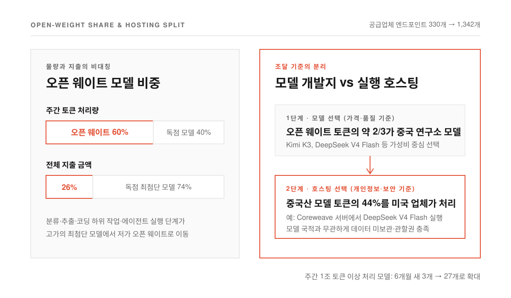
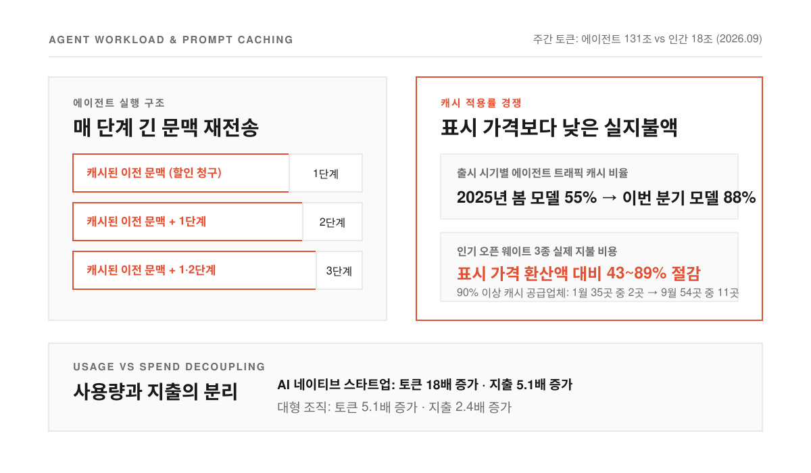
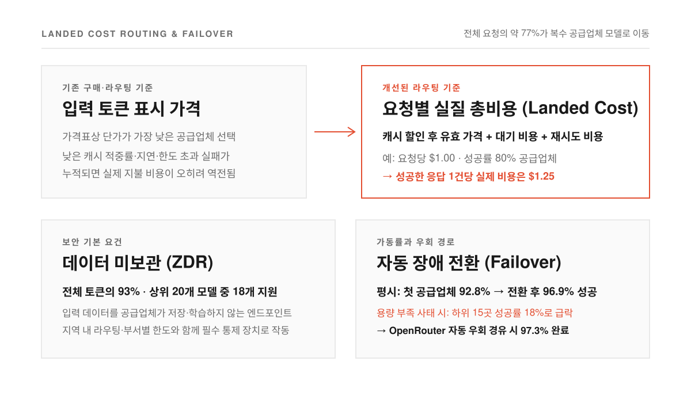

사내 곳곳에 코딩 도구와 자동화 봇을 붙이다 보면 월말 청구서가 어디서 얼마나 불어날지 가늠하기 어려울 때가 많다. 부서마다 비싼 최첨단 모델을 기본값으로 걸어 두고 기존 업무용 소프트웨어에도 추가 요금이 붙는 AI 기능이 하나둘 들어오면서 매출총이익률(매출에서 직접 원가를 뺀 이익 비율)이 눈에 띄게 깎인다. 여기에 비싼 AI 엔지니어 인건비까지 겹치면 재무 담당자나 개발 리더 모두 AI 비용을 손익계산서에서 가장 무거운 항목으로 마주하게 된다.

문제는 많은 기업이 여전히 기존 업무용 소프트웨어를 사듯 AI를 구매한다는 점이다. 공급업체 한 곳을 골라 연간 사용 약정을 맺고 정해진 시점이 되어서야 계약을 다시 검토한다. 하지만 매달 새 모델이 쏟아지고 작업마다 알맞은 모델과 호스팅 업체가 수시로 바뀌는 환경에서는 이런 고정 계약이 오히려 비용을 키우는 족쇄가 되기 쉽다.

수백 개 LLM을 하나의 계정으로 연결하는 게이트웨이이자 마켓플레이스인 OpenRouter의 인사이트 총괄 피터 워커(Peter Walker)가 공개한 [「State of AI Tokenomics: What CFOs Need to Know」](https://www.onlycfo.io/p/ai-tokenomics)와 [GeekNews 토픽 #36434](https://news.hada.io/topic?id=36434)은 실제 트래픽 데이터를 통해 이 시장이 어떻게 움직이는지 보여 준다. 2025년 1월 주간 약 5,000억 개였던 OpenRouter의 토큰 처리량은 2026년 9월 말 164조 개로 뛰었지만 같은 기간 100만 토큰당 평균 지불 가격은 0.77달러에서 0.14달러로 내려갔다. 사용량이 폭증하는데 단가는 가파르게 떨어지는 이 시장의 작동 원리를 짚어 본다.

<!--more-->

## 오픈 웨이트 모델의 부상과 개발지·호스팅의 분리

<figure>
  
  <figcaption>오픈 웨이트 모델이 일상 작업 물량의 60%를 흡수하는 동안 지출 비중은 26%에 머물고 모델 개발지와 실행 인프라는 별개로 선택된다.</figcaption>
</figure>

AI 추론(학습된 모델에 입력을 넣어 답을 얻어내는 과정) 시장을 흔드는 첫 번째 변화는 모델 공급의 급증이다. 2024년 초 이후 OpenRouter에 출시된 모델은 862개에 달하며 그중 362개는 2026년 10월 이전에 나와 이미 2025년 한 해 출시량을 넘어섰다. 잠깐 반짝하고 사라지는 모델도 많지만 주간 1조 토큰 이상을 처리하는 주력 모델 수는 최근 6개월 사이 3개에서 27개로 늘었다. 토큰 기준 1위 모델 개발사도 최근 8개 분기 동안 다섯 번이나 바뀌었고 선두 업체의 점유율은 약 40%에서 21%로 낮아졌다. 2026년 초만 해도 Anthropic과 OpenAI 합산 지출에서 Anthropic이 약 80%를 차지했으나 9월에는 두 회사의 비중이 거의 비슷해졌다.

이 다변화 속에서 물량을 빠르게 흡수한 주역은 오픈 웨이트 모델(학습된 가중치를 공개해 누구나 서버에 올려 실행할 수 있는 모델)이다. 현재 오픈 웨이트 모델은 OpenRouter 주간 토큰의 약 60%를 처리하지만 전체 지출에서 차지하는 비중은 26%에 그친다. 분류나 정보 추출, 코딩 하위 작업, 에이전트의 개별 실행 단계처럼 일상적이고 반복적인 업무가 비싼 최첨단 모델에서 훨씬 저렴한 모델로 대거 이동했기 때문이다.

눈여겨볼 대목은 오픈 웨이트 토큰의 약 3분의 2가 중국 연구소가 만든 모델에서 나온다는 점이다. 보안과 규제를 챙겨야 하는 기업에는 조달 딜레마가 될 법하지만 실제 데이터를 보면 모델을 만든 곳과 모델이 돌아가는 곳은 별개의 선택으로 다뤄진다. 중국산 모델이 처리하는 토큰의 44%는 미국에 본사를 둔 공급업체가 호스팅하고 있다.

거의 모든 오픈 웨이트 모델을 여러 추론 공급업체가 동시에 서비스하면서 모델과 공급업체의 조합을 뜻하는 엔드포인트(예컨대 Coreweave 서버에서 돌아가는 DeepSeek V4 Flash) 수는 2026년 초 약 330개에서 1,342개로 불어났다. **기업 입장에서는 모델 자체는 가격과 품질만 보고 고른 뒤 실제 데이터 처리는 개인정보 보호 요건에 맞는 본국 호스팅 업체에 맡기는 분리가 가능해진 셈이다.**

## 에이전트가 키운 토큰 물량과 프롬프트 캐싱이 가르는 실제 단가

<figure>
  
  <figcaption>에이전트 트래픽이 인간 사용량을 압도하면서 같은 모델이라도 공급업체의 프롬프트 캐싱 비율이 실제 청구 금액을 좌우한다.</figcaption>
</figure>

토큰 물량이 주간 164조 개까지 치솟은 데는 사람보다 소프트웨어 에이전트의 영향이 컸다. 2026년 2월 6일을 기점으로 OpenRouter에서 에이전트가 쓰는 토큰이 인간 사용자의 토큰을 추월했다. 9월 말 기준으로 에이전트 작업은 주간 약 131조 토큰을 기록해 18조 토큰에 머문 인간 사용자 작업과 큰 격차를 벌렸다.

에이전트 트래픽은 단순히 양만 많은 것이 아니라 토큰을 쓰는 방식 자체가 사람과 다르다. 에이전트는 문제를 풀기 위해 여러 단계에 걸쳐 도구를 호출하고 결과를 확인하는데 매 단계마다 이전 대화와 코드, 문서 같은 긴 문맥을 처음부터 다시 보낸다. 이 때문에 반복되는 입력 문맥을 서버에 저장해 두고 정상 가격의 일부만 청구하는 프롬프트 캐싱(prompt caching)이 AI 비용을 좌우하는 가장 중요한 가격 요소로 올라섰다.

새로 나오는 모델과 추론 공급업체들이 앞다퉈 캐시 효율을 끌어올리는 이유도 여기에 있다. 2025년 봄에 출시된 모델들은 에이전트 트래픽의 55%를 캐시하는 데 그쳤지만 이번 분기에 출시된 모델들은 88%를 캐시한다. 에이전트 트래픽의 90% 이상을 캐시로 처리하는 공급업체 수도 2026년 1월 35곳 중 2곳에서 9월에는 54곳 중 11곳으로 늘었다.

이 흐름들이 맞물리면서 토큰 사용량 증가율이 지출 증가율을 크게 앞지르고 있다. 2025년 9월 플랫폼에서 100달러 이상을 썼던 AI 네이티브 스타트업 집단은 토큰 사용량이 18배로 늘어나는 동안 지출은 5.1배 증가하는 데 그쳤다. 대형 조직 역시 토큰 사용량이 5.1배 늘어나는 동안 지출은 2.4배만 늘었다. Opus 5.5처럼 표시 가격이 높은 모델 대신 Kimi K3나 DeepSeek V4 Flash, 혹은 OpenAI와 Anthropic이 최근 내놓은 저렴한 고성능 모델인 Luna와 Haiku로 일상 작업을 돌리고 캐시 최적화까지 더한 덕분이다. **인기 오픈 웨이트 모델 3종에서는 고객이 실제로 낸 금액이 표시 가격 환산액보다 43~89%나 낮았으며 표시 가격이 가장 싼 공급업체가 실제 사용에서도 가장 저렴한 경우는 드물었다.**

## 표시 가격의 착시와 대기·재시도를 합산한 실질 총비용

<figure>
  
  <figcaption>실패율 20%인 1달러 요청의 실제 성공당 비용은 1.25달러가 되므로 표시 단가보다 캐시·지연·재시도를 합친 실질 총비용이 기준이 된다.</figcaption>
</figure>

같은 모델을 여러 공급업체가 팔고 캐시 적용률마다 청구액이 달라지면 가격표에 적힌 토큰당 단가는 기준점 구실을 하지 못한다. OpenRouter로 들어오는 요청의 약 77%는 둘 이상의 공급업체가 제공하는 모델로 향하기 때문에 매 요청마다 어느 공급업체로 트래픽을 보낼지 결정해야 한다.

예전에는 기본 라우팅(요청을 전달할 경로를 정하는 일) 알고리듬이 주로 입력 토큰의 표시 가격만 보고 공급업체를 골랐다. 반면 개선된 라우팅 알고리듬은 재무팀에서 흔히 쓰는 실질 총비용(landed cost), 즉 물건값에 운임과 부대비용을 모두 더한 최종 원가 개념을 요청 단위로 계산한다. 캐시 할인을 반영한 유효 가격에 응답을 기다리는 대기 비용과 실패했을 때 다시 요청하는 재시도 비용을 모두 합산하는 방식이다.

재시도 비용의 계산은 단순하다. 요청 한 번에 1달러를 받는 공급업체의 응답 성공률이 80%라면 성공한 답변 하나를 얻는 데 드는 실제 비용은 1.25달러가 된다. 서류상 표시 가격이 아무리 싸 보여도 요청 한도 제한이나 오류 응답이 잦아 재시도가 반복되면 결국 더 비싼 값을 치르게 된다. 트래픽이 표시 가격이 아니라 실질 총비용을 따라 움직이기 시작하면 공급업체들은 단순 단가 인하를 넘어 응답 속도와 안정성에서 경쟁할 수밖에 없다.

가격 못지않게 챙겨야 할 구매 조건은 데이터 보호와 가동률이다. 현재 OpenRouter 전체 토큰의 93%와 상위 20개 모델 중 18개 모델에서는 입력 데이터를 서버에 남기지 않는 데이터 미보관(ZDR, Zero Data Retention) 엔드포인트를 쓸 수 있어 기업들의 기본 보안 요건을 충족한다. 가동률 역시 단일 공급업체에 의존할 때와 자동 장애 전환(failover)을 거칠 때의 차이가 크다. 10월 초 요청 6,000만 건 표본에서 첫 번째 공급업체 시도의 성공률은 92.8%였지만 자동 장애 전환을 거친 뒤에는 96.9%로 올라갔다. **한 차례 용량 부족 사태가 발생했을 때 타격이 컸던 공급업체 15곳의 성공률은 18%까지 떨어졌지만 자동 우회 경로를 탄 요청은 97.3%가 정상 완료됐다.**

## 고정된 연간 소프트웨어 계약에서 원자재 조달과 실험의 재무로

데이터가 보여 주는 흐름은 뚜렷하다. AI 추론은 한 번 계약하고 1년 내내 쓰는 정액제 소프트웨어가 아니라 단가는 내려가고 사용량은 늘며 최적의 공급업체가 몇 달, 심지어 몇 분 단위로 바뀌는 원자재성 투입 요소에 가깝다. OpenRouter의 수백 개 기업이 월간 토큰 사용량을 크게 늘리면서도 총지출을 오히려 줄였고 더 많은 기업이 사용량을 대폭 키우면서 지출 증가 속도를 낮춘 비결도 이 시장 구조를 활용한 데 있다.

피터 워커는 6개월 전만 돌아봐도 다른 시대처럼 느껴질 만큼 변화 속도가 빨라지고 있다고 짚는다.

> The model your company will love most may not have even launched yet. Only companies with a culture of experimentation, with a finance perspective to match, will be able to stay at the frontier in terms of applied intelligence.

우리 회사에 가장 잘 맞는 모델이 아직 세상에 나오지 않았을 수도 있는 시기에는 잘 세운 계획도 언제든 전면 수정할 준비가 되어 있어야 한다. 특정 모델이나 단일 추론 공급업체 한 곳에 묶이는 대신 데이터 미보관, 지역 내 라우팅, 부서별 지출 한도, 장애 시 대체 경로 같은 운영 통제 장치(가드레일)를 먼저 명확히 세워 두는 편이 낫다. **안전한 통제선 안에서 새로운 모델과 공급업체를 상시 실험하고 실질 총비용에 따라 트래픽을 옮길 수 있는 조직만이 폭증하는 토큰 사용량을 감당 가능한 비용으로 바꿀 수 있다.**

출처: OnlyCFO · Peter Walker, [State of AI Tokenomics: What CFOs Need to Know](https://www.onlycfo.io/p/ai-tokenomics) · [GeekNews 토픽 #36434](https://news.hada.io/topic?id=36434).
