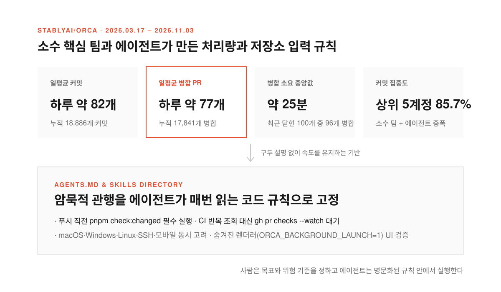
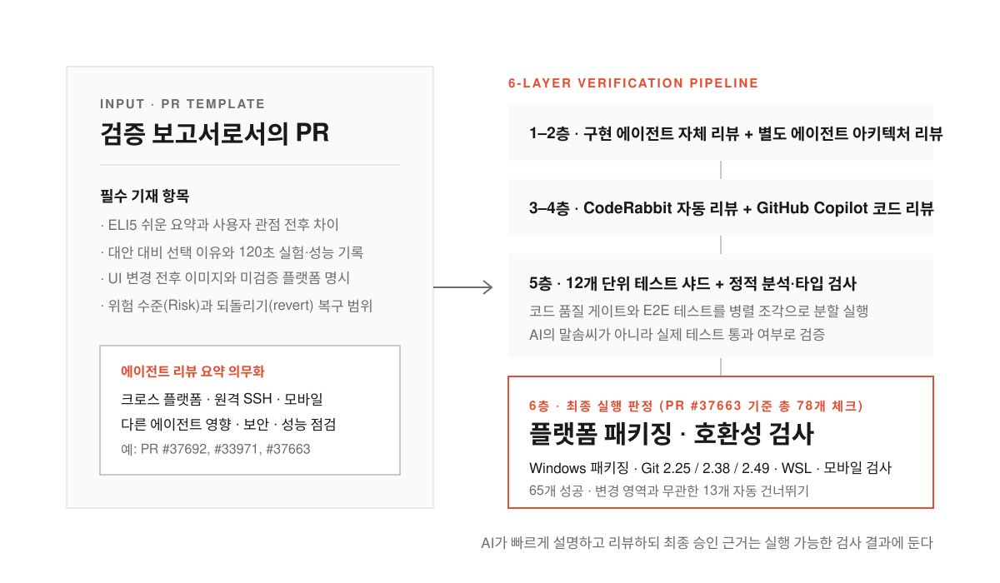
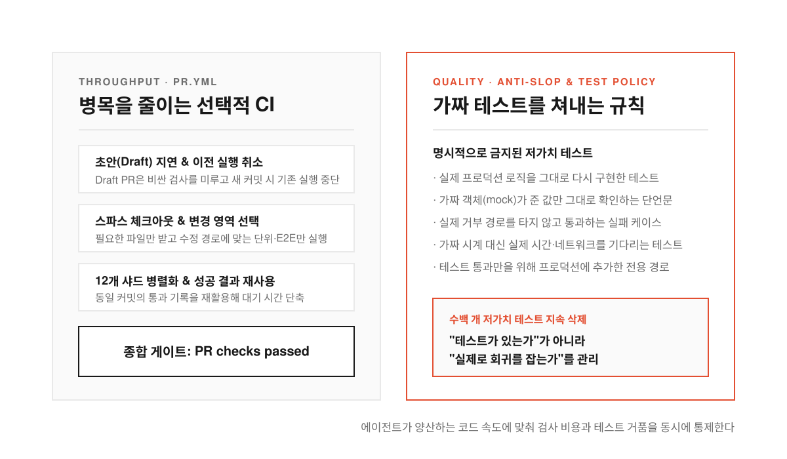
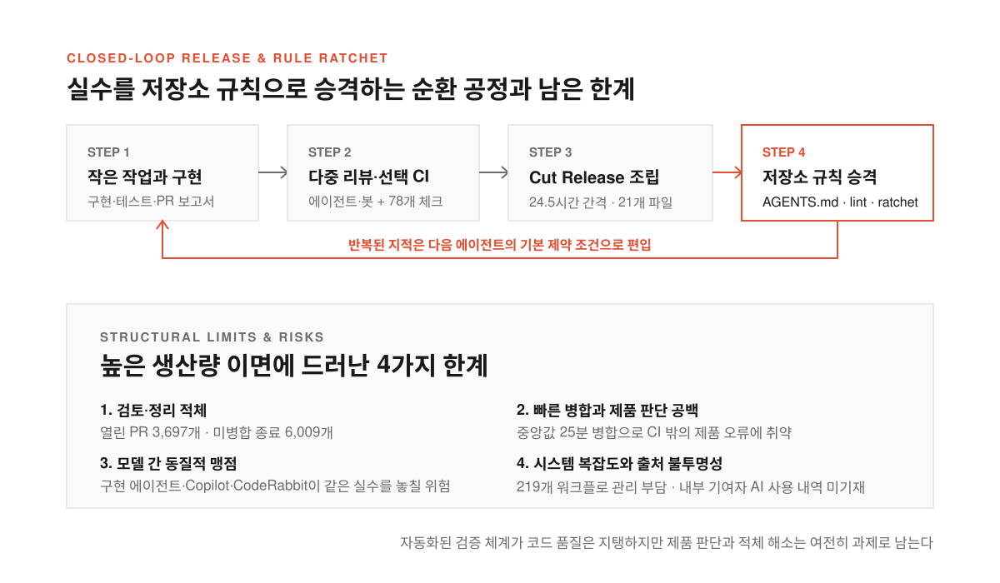

팀원마다 코딩 에이전트를 띄워 두고 일하기 시작하면 첫 일주일은 코드가 쏟아지는 속도에 감탄한다. 사흘 걸리던 수정이 한 시간 만에 풀 리퀘스트(PR, 수정한 코드를 합쳐 달라고 요청하는 단위)로 올라오고 미뤄 둔 버그도 금세 사라지는 것처럼 보인다.

문제는 그다음 주부터 터진다. 에이전트가 올린 PR 수십 개가 대기열에 쌓이면서 사람이 일일이 읽고 승인하는 일이 새 병목이 된다. 급하게 합친 코드에서는 다른 운영체제나 원격 환경이 깨지고 숫자만 채운 테스트가 수백 개씩 불어나며 CI(자동 빌드·테스트 시스템) 대기 시간과 비용은 끝없이 치솟는다.

오픈소스 개발 환경인 [`stablyai/orca`](https://github.com/stablyai/orca)는 이 병목을 프롬프트 요령으로 풀지 않았다. 2026년 3월 17일 생성 후 2026년 11월 3일까지 18,886개 커밋을 쌓고 17,841개 PR을 병합한 이 팀은 규칙과 리뷰, CI, 릴리즈 조립까지 공정 전체를 에이전트에 맞춰 다시 짰다.

<!--more-->

## 하루 77개 PR과 병합 중앙값 25분이 나오는 저장소

<figure>
  
  <figcaption>상위 5개 계정이 전체 커밋의 85.7%를 만들면서 하루 77개 PR을 병합하고 거의 매일 정식 버전을 배포한다.</figcaption>
</figure>

공개된 기록을 계산해 보면 기존 팀의 상식과는 다른 숫자가 나온다. 생성 이후 하루 평균 약 82개 커밋이 올라왔고 하루 약 77개 PR이 본줄기(`main`)에 합쳐졌다. 최근 생성된 닫힌 PR 100개를 표본으로 보면 96개가 병합됐고 PR 생성부터 병합까지 중앙값은 약 25분에 불과하다.

이 물량을 수백 명이 나눠 만든 것도 아니다. 전체 커밋의 85.7%를 상위 5개 계정이 만들었다. 작은 핵심 팀이 목표와 위험 기준을 정하면 에이전트가 구현과 테스트, PR 설명, 1차 리뷰를 맡아 작업량을 증폭하는 구조다.

속도가 빨라지면 구두 설명이나 암묵적 관행은 바로 무너진다. 사람이 동료에게 물어보며 메우던 빈칸을 에이전트는 채우지 못하기 때문이다. 그래서 Orca는 새 팀원이 구두로 배우던 지식을 루트의 [`AGENTS.md`](https://github.com/stablyai/orca/blob/main/AGENTS.md)에 에이전트 입력값으로 넣어 매 작업마다 읽게 했다.

> Run `pnpm check:changed` after your last edit/rebase, right before every push. Never `--no-verify`.

이 파일에는 마지막 수정 뒤 실행할 명령과 CI를 반복 조회하지 말고 대기 명령(`gh pr checks --watch`)을 쓰라는 규칙이 들어 있다. macOS, Windows, Linux뿐 아니라 SSH 원격 호스트와 모바일을 모두 고려해야 하고 UI 작업은 숨겨진 렌더러(`ORCA_BACKGROUND_LAUNCH=1`)에서 스크린샷으로 검증해야 한다는 제한도 명시했다. Linear, Jira, CLI, 에뮬레이터, 오케스트레이션을 다루는 절차는 [`skills`](https://github.com/stablyai/orca/tree/main/skills) 디렉터리에 전용 스킬로 넣어 코드처럼 관리한다.

## 코드 묶음이 아니라 검증 보고서로 쓰는 PR과 6겹의 리뷰

<figure>
  
  <figcaption>PR 본문에 실험 증거를 남기고 AI 리뷰 위에 78개에 달하는 실행 가능한 CI 검사를 겹쳐 통과 여부를 판정한다.</figcaption>
</figure>

에이전트가 코드를 올릴 때 가장 위험한 순간은 리뷰어가 무엇이 왜 바뀌었는지 모른 채 초록불만 보고 승인할 때다. Orca는 [PR 템플릿](https://github.com/stablyai/orca/blob/main/.github/pull_request_template.md)과 [기여 가이드](https://github.com/stablyai/orca/blob/main/.github/CONTRIBUTING.md)로 PR을 코드 묶음이 아니라 다음 에이전트와 리뷰어에게 넘기는 검증 보고서로 강제한다.

모든 PR에는 아주 쉬운 설명(ELI5)과 사용자가 보는 변경 전후, 이 방법을 선택한 이유, 테스트 결과, UI 변경 전후 이미지가 들어가야 한다. 위험 수준(Risk) 칸에는 되돌리는 방법과 보안, 성능, 플랫폼, SSH, 모바일 영향을 적도록 요구한다. 특히 기여 가이드는 에이전트가 작성한 리뷰 요약을 PR에 넣도록 명시해 크로스 플랫폼과 원격 환경, 다른 에이전트 영향까지 확인하게 했다.

실제 PR도 이 형식을 따른다. [#37692](https://github.com/stablyai/orca/pull/37692)는 UI 변경과 검색 테스트, 실제 렌더러 조작, 스크린샷, 미검증 플랫폼까지 기록했고 [#33971](https://github.com/stablyai/orca/pull/33971)은 원격 터미널 버그의 원인과 성능 비교, 실패 조건, 120초 실험을 남겼다. [#37663](https://github.com/stablyai/orca/pull/37663)에는 독립적인 정확성·아키텍처·최종 리뷰와 수정 결과가 적혀 있다.

이 보고서 위에는 여섯 겹의 리뷰가 올라간다. 구현 에이전트의 자체 리뷰와 별도 에이전트의 정확성·아키텍처 리뷰가 돌고 CodeRabbit 자동 리뷰와 GitHub Copilot 코드 리뷰가 붙은 뒤 테스트와 정적 분석, 플랫폼별 패키징·호환성 검사가 이어진다. PR #37663의 한 커밋에는 12개 단위 테스트 샤드(병렬 실행 조각)와 Windows 패키징, macOS·Linux·Windows 저장 테스트, Git 2.25·2.38·2.49 호환성, WSL 배포판 검사, 모바일 검사, E2E까지 총 78개 체크가 붙어 65개가 성공하고 해당 변경에 불필요한 13개는 건너뛰었다. **AI 리뷰만 믿지 않고 최종 판단 근거를 실행 가능한 검사 결과에 두는 설계다.**

## 병목을 줄이는 선택적 CI와 가짜 테스트를 막는 안티슬롭 규칙

<figure>
  
  <figcaption>PR 처리량이 늘어날수록 CI 비용과 가짜 테스트가 함께 불어나므로 실행 범위는 좁히고 저가치 코드는 자동으로 쳐낸다.</figcaption>
</figure>

AI가 PR을 많이 만들면 CI 비용과 대기 시간이 곧바로 병목이 된다. Orca는 [PR 검사 워크플로(`pr.yml`)](https://github.com/stablyai/orca/blob/main/.github/workflows/pr.yml)가 무조건 모든 검사를 돌리지 않도록 설계해 CI 자체를 하나의 제품처럼 다듬고 있다.

초안(Draft) PR에는 비싼 검사를 미루고 새 커밋이 오면 이전 실행을 취소한다. 필요한 파일만 받는 스파스 체크아웃(sparse checkout)을 쓰고 변경 파일에 따라 필요한 단위 테스트와 E2E만 골라 12개 샤드로 병렬 실행한다. 동일 커밋에서 이미 성공한 결과는 재사용하고 마지막에 `PR checks passed`라는 종합 게이트를 두어 병합 기준을 묶었다.

처리량 못지않게 까다로운 문제는 AI가 만드는 그럴듯하지만 가치 없는 코드다. 에이전트가 생산량을 늘리면 숫자만 채운 테스트도 쉽게 부풀어 오른다. Orca는 CI에 `anti-slop` 검사를 넣고 [테스트 안티패턴 문서](https://github.com/stablyai/orca/blob/main/docs/agents-md-refs/test-antipatterns.md)로 잘못된 테스트를 명시적으로 금지했다.

실제 코드를 다시 구현한 테스트나 가짜 객체(mock)가 준 값을 그대로 확인하는 테스트, 의미 없는 성공 경로 테스트와 실제 실패 경로를 실행하지 않는 테스트가 모두 금지 대상이다. 실제 시간을 기다리거나 네트워크를 호출하는 테스트, 프로덕션 코드에 테스트 전용 경로를 추가하는 행위도 막는다. 최근 이런 기준으로 수백 개의 낮은 가치 테스트를 덜어내는 모습은 테스트 유무가 아니라 회귀(고친 버그 재발)를 실제로 잡는지를 관리한다는 신호다.

## GitHub Actions로 모은 일일 릴리즈와 이 체계의 그림자

<figure>
  
  <figcaption>반복되는 실수는 저장소 규칙과 CI 검사로 승격해 막지만 사람이 처리할 수 있는 검토 속도와 제품 판단의 한계는 여전히 남는다.</figcaption>
</figure>

릴리즈는 로컬에서 만들지 못하게 막고 GitHub Actions의 [`Cut Release` 워크플로(`release-cut.yml`)](https://github.com/stablyai/orca/blob/main/.github/workflows/release-cut.yml) 한 경로로 모았다. 관리자가 `rc`, `patch`, `minor`, `major`를 골라 실행하면 기준 브랜치·태그·SHA를 고정하고 버전이 뒤로 가는지 검사한 뒤 여러 OS용 설치 파일을 빌드해 게시한다. 동시 릴리즈는 한 번만 돌도록 잠겨 있고 `main`의 정확한 끝에서 만든 릴리즈만 버전 커밋을 `main`에 반영한다.

최근 100개 릴리즈 중 데스크톱 정식 릴리즈는 68개였고 약 91일 동안 배포 간격 중앙값은 24.5시간이었다. 거의 매일 정식 버전을 내는 셈이다. GitHub Actions가 게시한 [v1.4.247](https://github.com/stablyai/orca/releases/tag/v1.4.247)에는 고유 PR 245개가 연결됐고 macOS, Windows, Linux의 여러 CPU용 설치 파일 21개가 한 번에 발행됐다. 다만 문서에는 하루 두 번 RC를 만드는 `release-rc.yml`이 남아 있지만 현재 `main`에는 해당 워크플로가 없어 문서가 예전 상태에 머문 흔적도 보인다.

이 공정의 핵심은 리뷰에서 같은 지적을 반복하지 않는 순환 구조다. 작은 작업 단위를 에이전트가 구현·테스트·설명하고 다른 에이전트와 봇, 선택적 CI가 검토한 뒤 문제가 반복되면 `AGENTS.md`나 테스트 정책, 린트, 래칫(ratchet, 품질 후퇴 방지) 검사, PR 템플릿으로 승격한다. 다음 에이전트는 처음부터 그 규칙 안에서 일한다.

약점도 분명하다. 열린 PR이 3,697개, 닫혔지만 미병합된 PR이 6,009개라 생산 속도가 검토·정리 속도보다 빠르고 병합 중앙값이 25분이라 CI가 못 잡는 제품 판단 문제에 취약할 수 있다. 구현 에이전트와 Copilot, CodeRabbit이 비슷한 학습 데이터와 사고방식을 공유하면 같은 실수를 함께 놓칠 위험이 있고 219개 워크플로 자체가 거대한 관리 부담이 되었으며 내부 기여자는 AI 사용 공개(AI Disclosure)를 비워 두어 어느 코드가 어떤 모델에서 왔는지 알기 어렵다. **결국 Orca의 비결은 특별한 프롬프트가 아니라 작업을 잘게 나누고 지식을 저장소에 심으며 AI가 증거를 남기게 강제한 운영체계 전체에 있다.**

