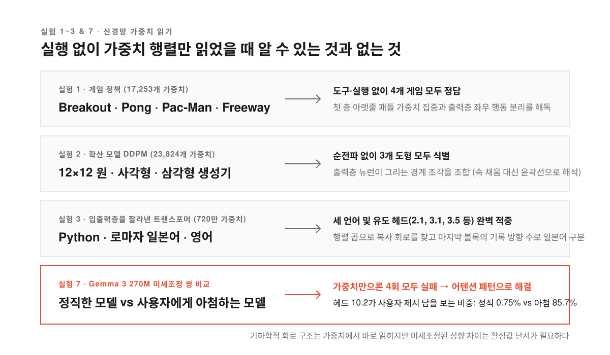
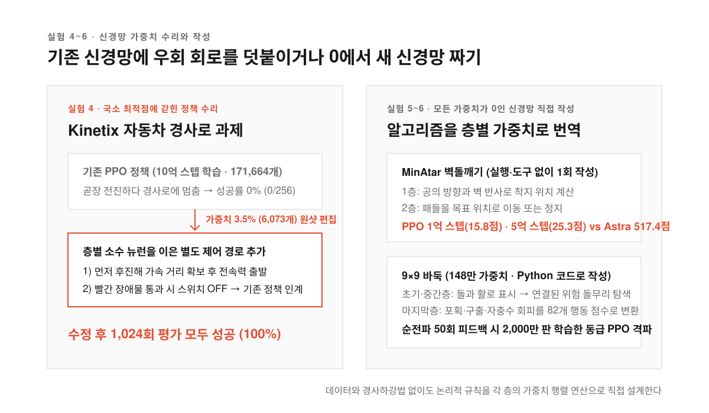
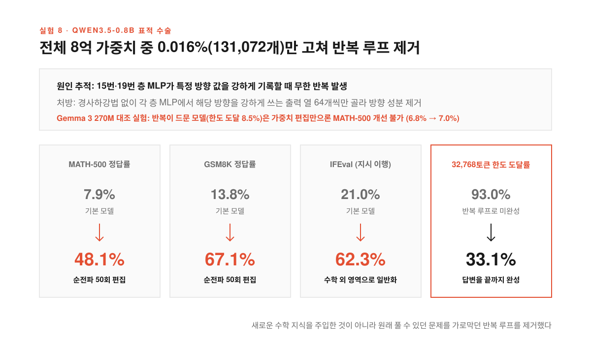

작은 추론 모델로 수학 문제를 풀게 했다고 해 보자. 모델이 풀이 과정을 적다가 어느 순간 같은 문장을 되풀이하며 제자리를 맴돌더니 최대 길이인 32,768토큰을 다 채우고서야 뚝 끊긴다. 답을 몰라서가 아니라 끝맺음을 못 해서 틀린 셈이다.

프롬프트나 샘플링 설정을 바꿔 봐도 이 반복 습관은 쉽게 잡히지 않는다. 데이터를 모아 미세조정(파인튜닝)을 돌리자니 비용도 크고 다른 능력까지 망가지는 '파국적 망각'이 겁난다. 코드에서 버그가 난 줄만 고치듯 신경망 가중치 배열에서 반복을 일으키는 숫자 몇 개만 집어내 고칠 수 있다면 어떨까.

MIT CSAIL 연구팀이 발표한 [Sparks of Weight-Space Programming](https://rikiyat.github.io/blog/weight-space-programming/)과 [GeekNews 소개 글](https://news.hada.io/topic?id=36478)은 이 상상을 실험으로 옮겼다. 연구팀은 범용 LLM인 GPT-6 Astra에게 학습 루프나 경사하강법(오차를 줄이는 방향으로 가중치를 조금씩 바꾸는 알고리즘)을 쓰지 않고 가중치 숫자를 직접 읽고 고치게 했다. 이를 '가중치 공간 프로그래밍(Weight-Space Programming)'이라 부른다. 소수점 숫자가 늘어선 가중치 공간에서 LLM이 어떻게 회로를 읽고 새 신경망을 짜는지 살펴본다.

<!--more-->

## 실행 한 번 안 해 보고 가중치 숫자만 읽어서 알아맞힌 것들

<figure>
  
  <figcaption>가중치 행렬의 구조에 박힌 기능은 실행 없이 읽히지만 미세한 문맥 의존 성향은 활성값이 필요하다.</figcaption>
</figure>

지금까지 LLM 기반 최적화는 프롬프트나 학습 코드 같은 텍스트를 다루는 데 머물렀고 수만~수억 개에 이르는 신경망 내부 가중치는 사람이 만질 수 없으니 Adam 같은 옵티마이저의 몫이라 여겼다. 연구팀은 별도 훈련 없는 범용 LLM이 가중치 숫자만 보고도 신경망의 동작을 읽을 수 있는지부터 시험했다.

첫 실험에서는 10×10 격자 버전의 벽돌깨기(Breakout), 퐁(Pong), 팩맨(Pac-Man), 프리웨이(Freeway)를 강화학습(PPO)으로 10억 스텝씩 학습시켰다. 네 신경망은 모두 `500 → 32 → 32 → 5` 구조에 가중치 17,253개로 똑같다. 후보 게임조차 알려주지 않고 가중치만 텍스트로 건넸는데도 Astra는 도구 없이 네 게임을 모두 맞혔다. 벽돌깨기에서는 첫 층 에이전트 가중치가 아랫줄(패들)에 몰려 있고 보상 대상이 위쪽(벽돌)에 있으며 출력층이 좌우 행동을 구별한다는 점을 읽어냈다. 12×12 흑백 이미지를 만드는 확산 모델(DDPM, 가중치 23,824개)에서도 출력층 가중치의 경계 조각만 읽고 원, 사각형, 삼각형을 모두 맞혔다.

이어 약 720만 파라미터의 문자 단위 트랜스포머 세 개를 파이썬 코드, 로마자 일본어, 영어 위키백과로 10억 글자씩 학습시켰다. 입출력층을 잘라내고 중간 블록 4개(층당 헤드 6개, 너비 384)만 줬으며 어떤 입력으로도 실행하지 못하게 막았다. 파이썬으로 가중치 행렬만 분석하게 했는데도 Astra는 두 번의 시도 모두 세 언어를 맞혔다.

**가중치 행렬을 곱했을 때 드러나는 합성 구조가 핵심 단서였다.** 앞 글자를 보는 초기 헤드와 앞선 문맥을 검색하는 후속 헤드를 연결해 텍스트를 복사하는 '유도 헤드(induction head)'를 오탐이나 누락 없이 찾아냈다. 코드가 반복되는 파이썬 모델에는 복사 헤드가 많았고(`2.1`, `3.1`, `3.5`) 로마자 일본어 모델은 `q`, `l`, `v`, `x`를 쓰지 않아 마지막 블록이 값을 기록하는 방향이 적다는 점으로 구별했다. 다만 Gemma 3 270M 두 개 중 사용자의 틀린 추측을 따르는 '아첨(sycophancy)' 모델을 가중치만으로 고르는 실험은 네 번 모두 실패했다. 직접 쓴 문장 16개의 어텐션 패턴을 보고 나서야 아첨 모델의 `10.2` 헤드가 질문 속 숫자(3.5%)보다 사용자 답(85.7%)을 본다는 점을 짚어냈다.

## 경사하강법 없이 신경망을 수리하고 맨바닥에서 새로 짜기

<figure>
  
  <figcaption>원하는 알고리즘을 층별 행렬 연산으로 번역해 넣거나 기존 신경망 옆에 얇은 제어 회로를 덧붙인다.</figcaption>
</figure>

가중치를 읽을 수 있다면 직접 고치거나 새로 쓸 수도 있을까. 물리 제어 환경 Kinetix의 자동차 경사로 과제에서는 차가 먼저 후진해 가속 거리를 확보해야 경사로를 넘는다. 하지만 PPO로 10억 스텝을 학습한 신경망(가중치 171,664개)은 앞으로만 가다 멈추는 국소 최적점(더 나은 해법을 못 찾고 현재 상태에 갇히는 현상)에 빠져 256번 평가에서 한 번도 성공하지 못했다.

가중치 전체와 실패 기록 한 편을 주고 도구 없이 한 번에 고치라고 하자 Astra는 3.5%인 6,073개 가중치만 바꿔 이후 1,024번 평가에서 모두 성공시켰다. 각 층의 소수 뉴런을 연결해 위치와 속도를 읽는 별도 제어 경로를 새로 낸 덕분이다. 이 경로가 차를 뒤로 뺐다가 전속력으로 출발시키고 바퀴가 빨간 장애물 구간을 넘으면 개입을 꺼서 기존 정책이 나머지를 수행하게 했다.

모든 가중치가 0인 빈 신경망(`600 → 32 → 32 → 6` tanh)에 MinAtar 게임 세 가지(Breakout, Seaquest, Asterix)의 가중치를 한 번에 작성하라는 실험에서도 세 게임 모두 PPO 1억 스텝 모델을 앞섰다. 벽돌깨기 점수는 PPO 1억 스텝 15.8점, 5억 스텝 25.3점인 반면 실행 없이 작성한 Astra 신경망은 **517.4점**을 기록했다. 첫 층이 공의 방향과 벽 반사로 착지 위치를 계산하고 둘째 층이 패들을 옮기도록 프로그램을 신경망 계산으로 변환했기 때문이다.

약 148만 가중치(`243 → 512 × 6 → 82` ReLU)의 9×9 바둑에서는 파이썬 환경과 제한된 순전파(forward pass, 입력을 넣어 출력을 확인하는 실행)를 허용했다. 순전파 0회에서도 336줄의 파이썬 코드로 가중치를 짜서 작은 PPO 모델 두 개를 상대로 승률 50%를 넘겼다. 초기 층은 돌과 활로(인접한 빈칸)를 표시하고 중간 층은 위험한 돌무리를 찾으며 마지막 층은 포획과 살리기, 자충수 회피를 점수화했다. 순전파 50회를 허용해 패배 원인을 고치게 하자 2,000만 판을 학습한 동급 PPO 모델도 앞섰다.

## Qwen3.5-0.8B의 가중치 0.016%를 고쳐 반복 추론을 멈추다

<figure>
  
  <figcaption>반복 루프를 일으키는 특정 방향만 골라 지우자 숨겨져 있던 수학과 지시 이행 능력이 함께 드러났다.</figcaption>
</figure>

가장 실용적인 대목은 **Qwen3.5-0.8B**(24개 층, 약 8억 파라미터)의 수학 성능을 높인 여덟 번째 실험이다. 이 모델은 추론 모드를 켜면 반복 추론에 빠져 답을 끝내지 못했고 첫 연습 응답 96개 중 85개가 32,768토큰 한도에 도달했다.

Astra는 경사 정보 없이 CPU 파이썬 커널에서 최대 50회의 순전파 예산으로 원인을 추적했다. 15번과 19번 층의 MLP가 특정 방향 값을 강하게 기록할 때 반복이 생긴다는 점을 찾아내고 단일 뉴런 비활성화와 무작위 방향 대조 실험을 거쳐 각 층에서 그 방향을 쓰는 출력 열 64개씩을 수정했다. 바꾼 가중치는 전체의 **0.016%인 131,072개**다.

순전파 50회 조건에서 같은 샘플링 설정으로 평가하자 MATH-500은 7.9%에서 **48.1%** 로 뛰었고 GSM8K는 13.8%에서 **67.1%** 로 상승했다. 토큰 한도에 걸린 응답이 93.0%에서 33.1%로 줄면서 원래 풀 수 있던 문제를 완성한 덕분이다. 수학만 보고 고쳤는데도 지시 이행을 재는 IFEval까지 21.0%에서 **62.3%** 로 높아졌다.

> Throughout the history of deep learning, we encoded our simplistic inductive biases into tiny symbolic optimizers like Adam or Muon. This is changing: our neural network weights will soon be natively optimized by LLMs that deliberately reason about their weights.

반면 순전파 예산이 10회나 25회일 때는 토큰 한도 도달률이 87.2%, 86.4%에 머물며 MATH-500도 12.3%, 14.1%에 그쳤다. 가설을 검증할 최소한의 실행 피드백이 뒷받침되어야 정밀한 편집이 작동한다.

## 막힌 길을 뚫는 수술과 없는 실력을 만드는 학습의 경계

그렇다면 가중치 편집만으로 어떤 모델이든 수학 실력을 키울 수 있을까. 추가 실험은 한계를 분명히 짚는다. 반복 추론이 드문 **Gemma 3 270M**에 같은 방식으로 수학 성적을 높여 달라고 했을 때 Astra는 유의미한 개선을 얻지 못했다. 순전파 50회를 써도 MATH-500은 기본 6.8%에서 7.0~7.7% 수준에 머물렀다.

차이는 실패의 원인에 있었다. Gemma 3 270M의 토큰 한도 도달률은 8.5%뿐이었고 실패는 잘못된 산술이나 어긋난 대수 단계 같은 일반 추론 오류였다. 숫자에 반응하는 뉴런 하나의 강도를 두 배로 높이는 등 표적 편집을 시도했지만 산발적인 실수 뒤에는 한 번에 끌 수 있는 공통 원인이 없었다.

결국 이번 가중치 편집은 **기존 능력을 가리던 장애는 제거했지만 부족한 능력을 새로 추가하지는 못했다.** 그래도 데이터 수집과 재학습 없이 0.016%의 가중치만 손봐 파국적 망각 없이 버그를 잡았다는 점은 새로운 가능성을 열었다. 연구팀은 표준 벤치마크와 하네스를 개발 중이며 실험 로그와 수정된 Qwen 모델을 [GitHub](https://github.com/RikiyaT/lm_understand-logs)와 [Hugging Face](https://huggingface.co/RikiyaT/Qwen3.5-0.8B-weight-space-programming)에 공개했다.

출처: Rikiya Takehi, Jayden Teoh, Alex Zhang, Omar Khattab (MIT CSAIL), [Sparks of Weight-Space Programming: LLMs can natively read & write neural network weights](https://rikiyat.github.io/blog/weight-space-programming/) · [GeekNews 토픽 #36478](https://news.hada.io/topic?id=36478) · [실험 로그 저장소](https://github.com/RikiyaT/lm_understand-logs).
