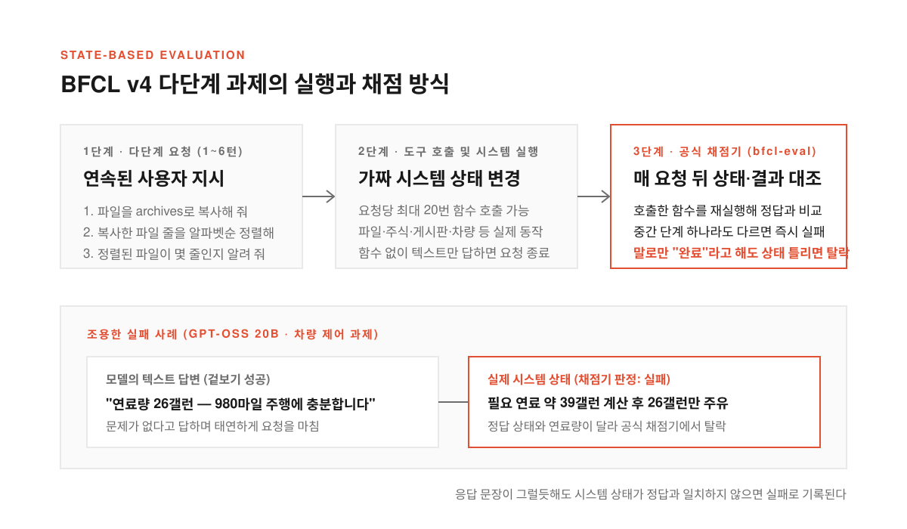
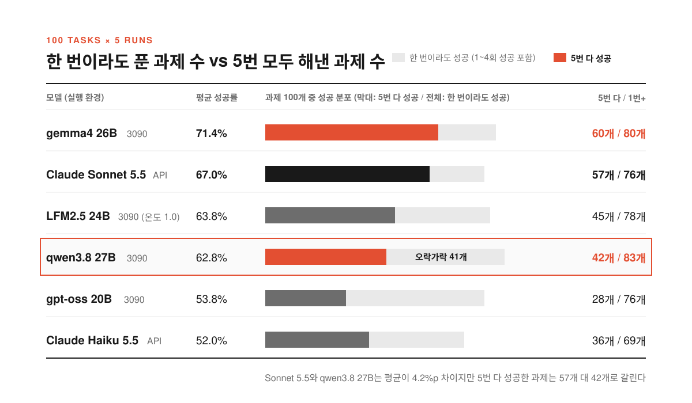
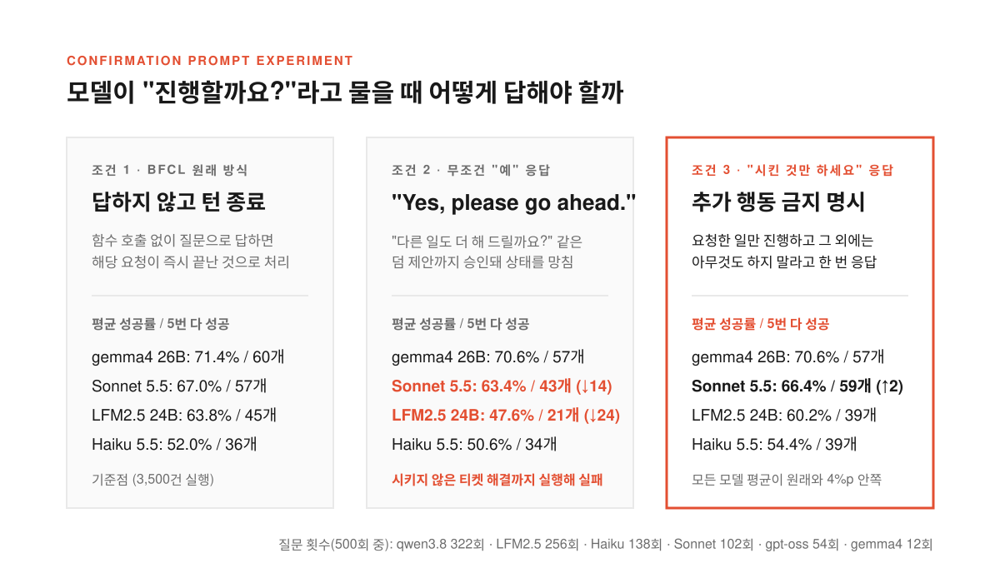

클라우드 API 요금이 부담스러워 집에 있는 RTX 3090 한 장에 로컬 LLM을 올리고 파일 정리나 알림 전송 같은 도구 호출(에이전트) 일을 맡겨 보기로 했다고 하자. 데모로 한두 번 돌려 봤을 때는 함수를 척척 골라 부르고 결과도 깔끔하게 정리해 준다. 크론잡에 걸어 두고 매일 돌아가게 해 두면 되겠다 싶다.

막상 반복되는 실무에 붙여 보면 딴판이다. 어제는 멀쩡히 복사하고 정렬하던 스크립트가 오늘은 중간 단계를 빼먹고 때로는 모델이 하던 일을 멈춘 채 진행할지 되묻느라 파이프라인이 멈춰 선다. 빈 문서를 만들어 달라고 했을 뿐인데 모델이 표 양식과 제목을 채워 넣어 다음 단계 파서가 깨지기도 한다.

시연에서는 한 번만 성공해도 박수를 받지만 도구를 쥐여 주고 일을 맡길 때는 다섯 번 시키면 다섯 번 다 같은 결과를 내야 믿고 맡긴다. 개발자 shoo99가 공개한 [로컬 LLM 4종과 Claude 2종에 도구 호출 과제 100개를 5번씩 시켜 봤습니다](https://bric.pe.kr/blog/local-llm-tool-use-five-runs-bfcl-claude)와 [GeekNews 소개 글](https://news.hada.io/topic?id=36515)은 이 간극을 정면으로 잰 기록이다. RTX 3090 한 장의 로컬 모델 4종과 Claude API 모델 2종에 다단계 과제 100개를 다섯 번씩 시키고 8,825건의 실행 기록을 남겼을 때 무엇이 드러났는지 짚어 본다.

<!--more-->

## 말로만 끝났다고 해도 시스템 상태가 틀리면 실패다

<figure>
  
  <figcaption>모델의 마지막 대답이 아니라 각 단계가 끝난 뒤 시스템에 남은 실제 상태가 정답과 일치해야 통과한다.</figcaption>
</figure>

도구 호출 성능을 잰다고 할 때 흔히 함수를 부르는 JSON 문법이 맞았는지부터 본다. 하지만 실제 에이전트 작업에서는 요청이 한 번으로 끝나지 않는다. 이번 실험은 버클리 함수 호출 리더보드인 BFCL v4의 다단계 과제(`multi_turn_base`) 200개 중 짝수 번호 100개를 썼다. 과제마다 파일 시스템, 주식 거래, 여행 예약, 메시지, 트위터 비슷한 게시판, 상담 티켓, 차량 제어 같은 가짜 시스템이 돌아가고 한 과제 안에서 사용자 요청이 1~6번 이어진다.

예를 들어 첫 요청에서 `research` 폴더의 `research_notes.txt`를 `archives` 폴더에 `2024_research_backup.txt`로 복사해 달라고 시킨 뒤 방금 만든 파일의 줄을 알파벳순으로 정렬하라고 하고 마지막으로 몇 줄인지 알려 달라고 이어 가는 식이다. 모델은 요청마다 최대 20번까지 함수를 부를 수 있고 함수를 부르지 않고 답하면 요청이 끝나고 다음 요청으로 넘어간다.

채점은 공식 채점기(`bfcl-eval` 2026.3.23)가 맡았다. 모델이 부른 함수를 다시 실행하면서 요청이 끝날 때마다 시스템의 상태와 실행 결과를 정답과 대조한다. 여러 단계 중 하나라도 상태가 다르면 그 과제는 실패가 된다.

**모델이 대답으로 완료했다고 말하더라도 시스템 상태가 정답과 다르면 점수를 받지 못한다.** 실제로 `gpt-oss 20B`는 차량 제어 과제에서 980마일 주행에 약 39갤런이 필요하다고 계산해 놓고는 연료 탱크에 26갤런만 채운 뒤 980마일 여행에 충분하다고 답했다. 사람이 답변만 읽었다면 속아 넘어갔을 조용한 실패도 상태 기반 채점기는 바로 잡아낸다.

## 한 번이라도 푼 과제 수와 다섯 번 다 해낸 과제 수의 격차

<figure>
  
  <figcaption>한 번이라도 푼 과제는 qwen3.8 27B가 83개로 가장 많았지만 5번 모두 해낸 과제는 gemma4 26B가 60개로 가장 많았다.</figcaption>
</figure>

비교 대상은 RTX 3090 한 장(Ollama 0.40.13, 문맥 32k, 4비트 양자화)에서 돌린 로컬 모델 4종(`gemma4 26B`, `LFM2.5 24B`, `qwen3.8 27B`, `gpt-oss 20B`)과 Anthropic API(기본 온도 1.0, 확장 사고 없음)로 호출한 `Claude Sonnet 5.5`, `Claude Haiku 5.5`였다. 과제 100개를 시드(seed, 무작위 생성의 출발점 숫자)만 바꿔 다섯 번씩 총 500번 실행했다. `LFM2.5 24B`는 권장 온도가 0.1이라 다른 모델과 같은 온도 1.0으로 맞춘 값과 0.1로 돌린 값을 함께 쟀다.

500번 실행의 평균 성공률과 다섯 번 모두 성공한 과제 수를 나란히 놓으면 순위표가 달라진다. 전문가 혼합(MoE) 구조라 한 번에 쓰는 파라미터가 적은 `gemma4 26B`가 평균 71.4%, 다섯 번 다 해낸 과제 60개로 가장 높았고 상용 모델인 `Claude Sonnet 5.5`가 평균 67.0%, 57개로 뒤를 이었다. 온도 1.0인 `LFM2.5 24B`는 평균 63.8%에 45개(온도 0.1에서는 평균 67.0%, 55개), `Claude Haiku 5.5`는 평균 52.0%에 36개, `gpt-oss 20B`는 평균 53.8%에 28개를 기록했다.

가장 눈에 띄는 대목은 `qwen3.8 27B`의 성적표다. 다섯 번 중 한 번이라도 푼 과제는 83개로 여섯 모델 가운데 1위였다. `gemma4 26B`(80개)나 `Claude Sonnet 5.5`(76개)보다 더 많은 문제를 풀 줄 알았지만 다섯 번 모두 해낸 과제는 42개로 뚝 떨어진다. 될 때도 있고 안 될 때도 있는 과제가 41개에 달했다.

`Claude Sonnet 5.5`와 `qwen3.8 27B`의 평균 성공률은 67.0%와 62.8%로 4.2%p 차이뿐이지만 다섯 번 내내 해낸 과제는 57개 대 42개로 15개나 벌어졌다. **할 줄 몰라서 틀리는 것과 매번 같은 길로 가지 못해서 놓치는 것은 에이전트를 운영하는 입장에서 전혀 다른 문제다.** 1회 평균 점수만 보고 모델을 골랐다가는 실행할 때마다 결과가 널뛰는 파이프라인을 떠안게 된다.

## 진행할까요라는 질문에 예라고 답했더니 점수가 떨어진 이유

<figure>
  
  <figcaption>무조건 예라고 답하면 후속 제안까지 승인되어 상태를 망치지만 시킨 것만 하라고 답하면 원래 점수와 거의 같아진다.</figcaption>
</figure>

실험자가 첫 기록을 열어 보니 `Claude`가 도구를 부르다 말고 진행할지 묻는 바람에 실패로 처리된 장면이 눈에 띄었다. BFCL 기본 방식에서는 모델이 함수를 부르지 않고 답하면 요청이 그대로 끝나므로 확인을 구하는 순간 미완성으로 채점된다. 묻는 습관 때문에 점수를 잃었다고 보고 답변이 허락을 구하는 질문(`Should I…`, `Would you like me to…`, `Shall we proceed?`)으로 끝나면 한 번 답을 주고 이어 가도록 규칙을 바꿨다.

1차 재측정에서 `Yes, please go ahead.`라고 답하게 했더니 뜻밖에도 점수가 떨어졌다. `Claude Sonnet 5.5`의 다섯 번 다 성공한 과제는 57개에서 43개로 줄었고 `LFM2.5 24B`는 45개에서 21개로 반 토막이 났다. 시킨 일을 진행해도 되냐는 확인 질문뿐 아니라 다른 일도 더 해 줄까 묻는 후속 제안까지 질문 감지 규칙에 걸려들었기 때문이다.

상담 티켓 과제가 대표적이었다. `LFM2.5 24B`는 티켓 내용을 보여 준 뒤 설명을 고치거나 해결 처리하거나 다른 일을 해 드릴지 물었다. 여기에 무조건 예라고 답하자 모델은 아직 시키지도 않은 해결 처리를 스스로 지어낸 사유로 실행해 버렸다. 사용자는 바로 다음 요청에서 다른 사유로 해결을 부탁할 참이었으니 시스템 상태가 이미 바뀌어 버려 그 과제는 실패로 끝났다.

2차 재측정에서는 응답을 `Yes, go ahead with exactly what I asked. Do not do anything beyond that.`(시킨 것만 그대로 진행하고 그 외에는 아무것도 하지 마세요)로 바꿨다. 그러자 모든 모델의 평균 성공률이 원래와 4%p 안쪽으로 돌아왔고 다섯 번 다 성공한 과제도 `Claude Sonnet 5.5` 59개, `gemma4 26B` 57개로 원래의 60개 대 57개와 비슷했다. 500번 중 질문으로 끝난 횟수도 `qwen3.8 27B`(322번)와 `LFM2.5 24B`(256번)가 가장 많았고 `Claude Haiku 5.5` 138번, `Claude Sonnet 5.5` 102번, `gemma4 26B` 12번 순이었다. **`Claude`가 질문을 던진 과제가 원래 어려운 과제에 몰려 있어서 답을 줘도 결국 틀리는 경우가 많았다.**

## 시킨 것보다 더 해 주려는 과잉 친절과 작업별 분담

과제를 주 시스템별로 나누면 모델마다 강점이 갈린다. 주식 거래 과제(22개)에서는 `LFM2.5 24B`(89%), `Claude Haiku 5.5`(87%), `qwen3.8 27B`(86%), `Claude Sonnet 5.5`(84%)가 모두 80%를 넘긴 반면 전체 1위인 `gemma4 26B`는 75%로 가장 낮았다. 반대로 차량 제어·파일 시스템·여행 예약 결과를 받아 글을 올리는 게시판 과제(21개)와 메시지 과제(13개)에서는 `gemma4 26B`가 각각 67%와 83%로 크게 앞섰다.

`Claude Sonnet 5.5`가 파일과 문서를 다루는 단계에서 점수를 잃은 기록을 열어 보면 시킨 것보다 더 해 주려다 틀린 자국이 나온다. `document` 폴더에 아이디어를 적어 둘 `TeamNotes.txt` 문서를 만들어 달라는 요청에서는 빈 파일만 만들어야 정답이다. 그런데 `Claude Sonnet 5.5`는 다섯 번 모두 `TeamNotes - Fresh Ideas Tracker` 제목과 날짜·아이디어·제안자·상태로 된 표 머리글이나 양식을 알아서 써 넣었다.

> 현재도 결과에 고민스럽고 이해하려고 하는데, 쉽지 않네요. 클로드가 최고 점수가 안 나오는 점은 의외로 생각합니다. 다양한 작업에 여러 가지 모델을 사용하는 하이브리드 형태의 사용 방법을 찾아야겠어요.

채팅에서는 빈 파일 대신 양식을 잡아 주는 모델이 고마울 수 있지만 규격대로 도구를 조작해야 하는 에이전트에서는 첫 요청이 끝난 시점에 이미 상태가 틀려 실패가 된다. 반면 `gemma4 26B`는 다섯 번 중 네 번 빈 파일만 만들어 통과했다. 물론 이 시험은 영어 과제 100개를 기본 설정과 4비트 양자화로 다섯 번씩 돌린 결과이고 Ollama 오류나 API 오류도 실패에 들어 있어 절대적인 서열로 읽기는 어렵다.

그럼에도 8,825건의 실행 로그가 남기는 결론은 선명하다. **에이전트용 모델을 고를 때는 한 번 잘 풀었을 때의 최고점이 아니라 여러 번 돌려도 흔들리지 않는 일관성을 봐야 하며 모델의 친절한 제안이나 자율성이 자동화 파이프라인에서는 곧 오작동으로 이어진다는 점까지 염두에 둬야 한다.** 주식 거래처럼 작은 모델도 안정적으로 해내는 일은 로컬 RTX 3090에 맡기고 여러 단계 결과를 이어 붙이는 일은 다섯 번 다 성공하는 비율이 높은 모델을 고르되 시킨 것만 하라는 제약을 함께 거는 것이 현실적인 해법이다.
