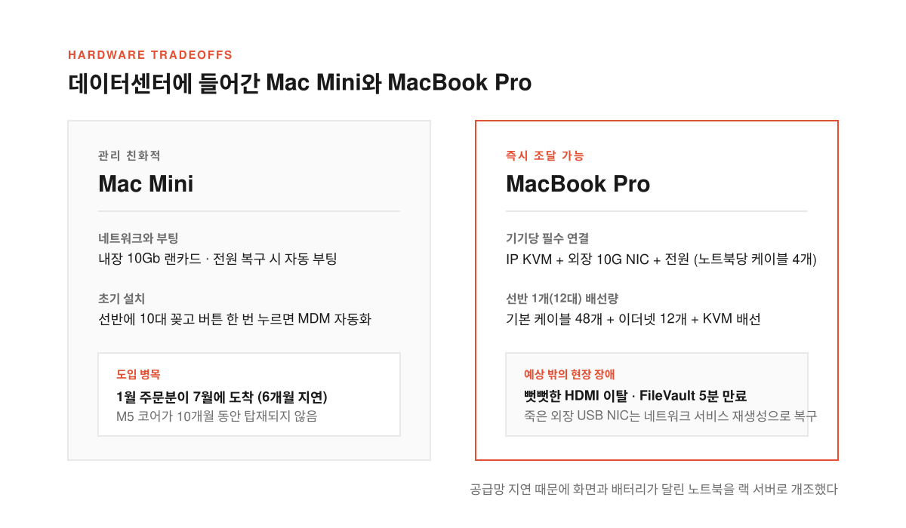
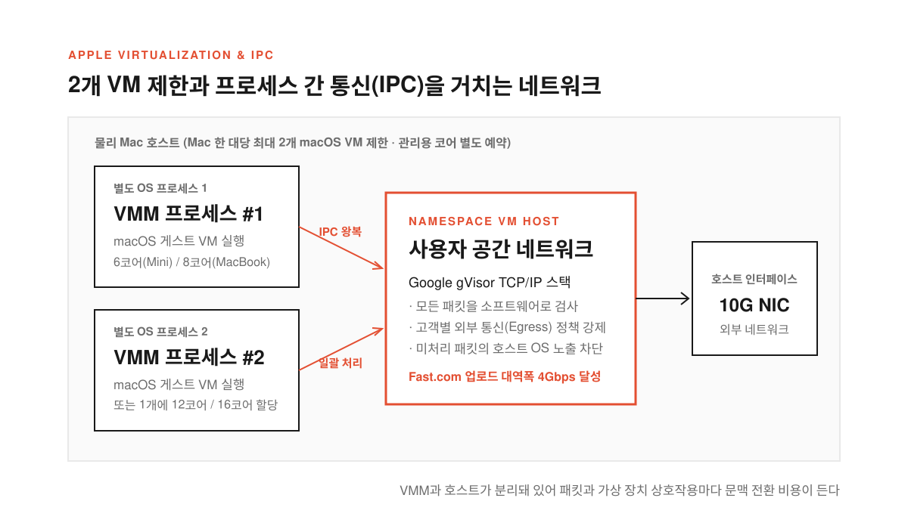
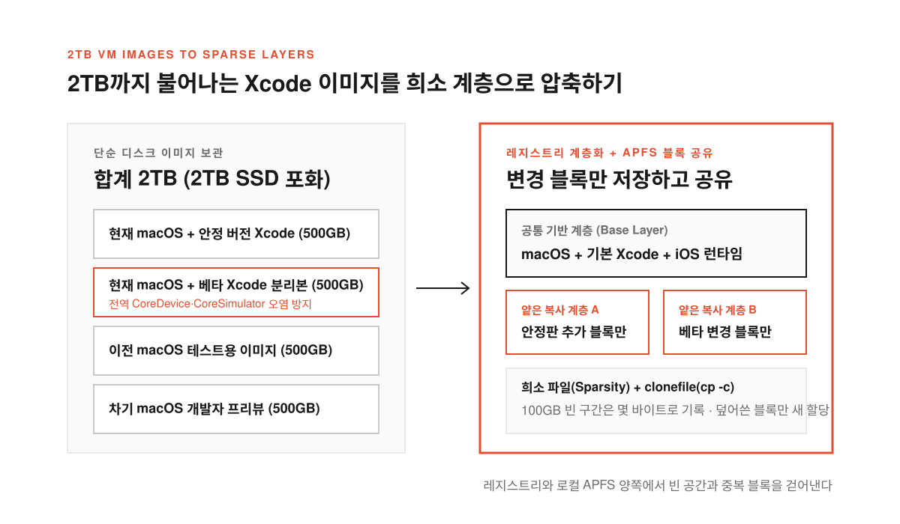
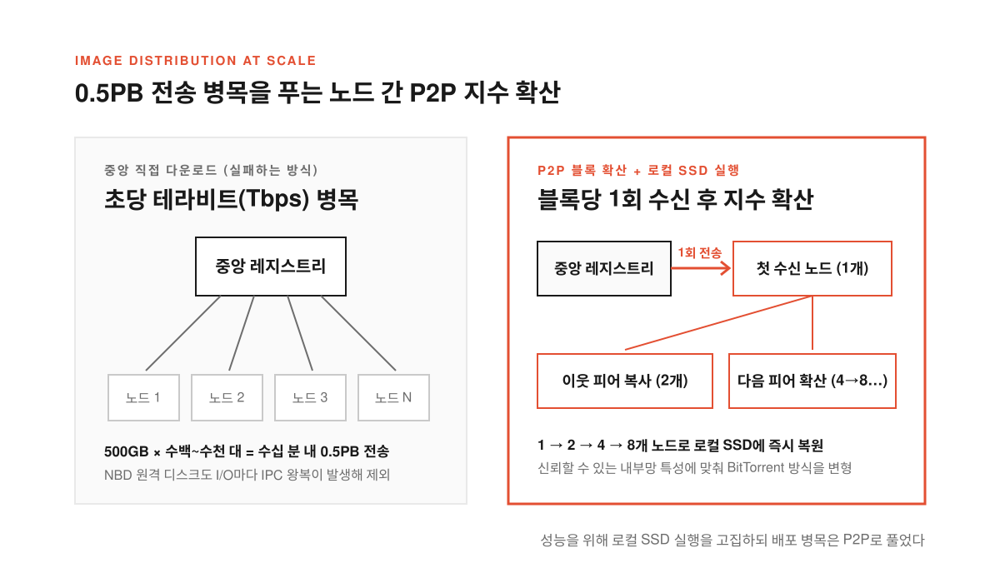

iOS 앱을 빌드해 앱스토어에 올리려면 물리적인 Mac이 꼭 필요하다. 테스트에 쓰는 iOS 시뮬레이터는 Mac에서만 돌고 앱스토어 심사에는 최신에 가까운 Xcode 버전이 강제된다. 오픈소스 도구인 [xtool](https://github.com/xtool-org/xtool)은 아직 Xcode를 대체하지 못해서 개발자든 코딩 에이전트든 결국 Mac이 있어야 한다.

클라우드에서 이 수요를 받치려면 데이터센터에 Mac 수백 대를 두고 새 Xcode가 나온 지 몇 시간 안에 가상 머신(VM, 컴퓨터 한 대를 소프트웨어로 쪼개 쓰는 가상 컴퓨터)을 띄워 줘야 한다. 원래는 화면과 배터리가 없는 Mac Mini가 제격이지만 2026년 1월 주문분이 7월에야 도착할 만큼 공급망이 막혀 있었다. 애플이 새 CPU를 모든 기기에 동시에 넣지도 않아 Mac Mini는 10개월 동안 M5 코어를 받지 못하다가 갑자기 다른 기기보다 먼저 M6를 달고 나왔다.

최신 하드웨어를 제때 제공해야 했던 클라우드 기업 [Namespace](https://namespace.so/blog/mac-at-any-scale)는 6개월을 기다리는 대신 당장 구할 수 있는 MacBook Pro 수백 대를 사들였다. 화면과 키보드와 배터리가 달린 노트북을 서버 랙에 꽂아 몇 초 만에 켜지는 macOS 인스턴스로 개조하기 시작한 것이다.

<!--more-->

## 선반당 케이블 60개와 아마존에서 싹쓸이한 HDMI 선

<figure>
  
  <figcaption>공급망 지연 때문에 화면과 배터리가 달린 노트북을 서버 랙에 꽂자 배선과 전원 복구가 새로운 과제가 됐다.</figcaption>
</figure>

데이터센터에서는 Mac Mini나 Mac Studio가 관리하기 훨씬 쉽다. 10Gb 랜카드가 내장돼 있고 전원이 다시 들어오면 자동으로 켜지며 모바일 기기 관리(MDM, 다수의 기기 설정을 원격으로 일괄 제어하는 체계)로 OS 설정을 자동화할 수 있다. 기류 시뮬레이션으로 설계한 냉각 선반에 Mac Mini 10대를 넣고 전원과 랜선을 꽂은 뒤 전원 버튼을 한 번만 누르면 나머지는 자동화가 처리한다.

반면 노트북 펌웨어는 화면 사용을 전제로 설계돼 일부 유지보수 작업은 그래픽 화면(GUI)의 버튼을 눌러야만 넘어간다. 그래서 모든 MacBook에 원격 제어 장치인 IP KVM과 외장 10G 이더넷 네트워크 카드(NIC), 전원을 따로 물려야 했다. 노트북당 케이블 4개가 붙으면서 선반 하나에 기본 케이블 48개와 이더넷 선 12개, KVM 배선이 몰렸고 열을 빼내 옆 기기로 뜨거운 공기가 가지 않게 유도하는 맞춤형 거치대도 거듭 다듬어야 했다.

현장에서 가장 불안정한 부품은 자석식 MagSafe 전원선이 아니라 두껍고 뻣뻣한 HDMI 케이블이었다. 선반을 건드릴 때마다 HDMI가 빠져서 원하는 각도로 휘어지는 케이블을 찾아내 아마존 재고를 전량 사들였다.

디스크 암호화 기능인 FileVault와 외장 USB NIC 버그도 골칫거리였다. 노트북이 예기치 않게 재부팅되면 닫힌 화면에 잠금 해제 암호 창이 뜨는데 KVM 외부 화면과 macOS Tahoe의 [SSH 원격 잠금 해제](https://keith.github.io/xcode-man-pages/apple_ssh_and_filevault.7.html) 모두 노트북에서는 5분 뒤 만료된다. 계획된 재부팅에는 잠금 해제를 유지하는 `fdesetup authrestart`를 쓰고 돌발 재부팅이 나면 물리 버튼으로 다시 켠 뒤 5분 안에 암호를 입력해야 했다. 전원과 링크가 죽은 것처럼 멈추는 외장 USB NIC는 장비를 바꿔도 소용없었지만 macOS 설정에서 네트워크 서비스를 지웠다 다시 만들면 바로 복구됐다.

## 물리 Mac 한 대당 VM 2개 제한과 IPC 문맥 전환 비용

<figure>
  
  <figcaption>애플 정책상 물리 기기당 macOS VM을 2개까지만 띄울 수 있고 가상 네트워크 패킷은 프로세스 간 통신(IPC)을 거쳐야 한다.</figcaption>
</figure>

하드웨어 위에서 VM을 돌릴 때는 애플의 [Virtualization 프레임워크](https://developer.apple.com/documentation/virtualization)를 쓴다. 리눅스 KVM API에 해당하는 저수준 [Hypervisor 프레임워크](https://developer.apple.com/documentation/hypervisor)는 세밀한 제어가 가능하지만 macOS 구동에 필요한 애플 전용 환경을 제3자가 재현할 수 없어 쓸 수 없다. 결국 Firecracker와 비슷한 위치의 Virtualization 프레임워크 위에서 성능과 보안을 맞춰야 한다.

가장 큰 제약은 애플이 물리 Mac 한 대당 macOS VM을 2개까지만 허용한다는 점이다. 24코어에 192GB 메모리를 갖춘 Mac Pro라도 게스트 VM은 두 개뿐이다. **자원을 최대 두 조각으로만 나눌 수 있어서 관리용 코어를 남겨 두고 14코어 Mac Mini에서는 6·12코어 인스턴스를, 18코어 MacBook에서는 8·16코어 인스턴스를 운영한다.**

또한 가상 CPU를 실행하는 VMM 프로세스와 이를 통합한 Namespace VM 호스트 프로세스가 분리돼 있다. VM 동작에 개입하거나 맞춤형 가상 장치를 구현하면 매번 프로세스 간 통신(IPC, 프로세스끼리 데이터를 주고받는 통로) 왕복과 문맥 전환 비용이 든다.

네트워크에서도 이 비용을 줄이는 설계가 핵심이다. 기본 브리지·NAT 모드는 VMM에서 호스트 랜카드로 트래픽을 바로 넘기지만 신뢰할 수 없는 코드를 격리하거나 고객별 [외부 통신 정책](https://namespace.so/docs/security/egress-policy)을 강제할 수 없다. 그래서 Google gVisor의 사용자 공간 TCP/IP 스택으로 게이트웨이와 방화벽을 구현해 모든 패킷을 소프트웨어로 처리하고 호스트 OS 노출을 최소화했다. 패킷이 VMM과 VM 호스트, 랜카드를 거치는 동안 일괄 처리로 IPC 왕복을 줄여 [Fast.com](https://fast.com) 기준 4Gbps 업로드 대역폭을 얻었지만 물리 회선 속도를 다 채우려면 IPC를 아예 피하는 새 구조가 필요하다.

## 베타 시뮬레이터 오염을 막으려다 2TB로 불어난 VM 이미지

<figure>
  
  <figcaption>전역 시뮬레이터 오염을 피하려고 이미지를 나누면 용량이 2TB에 이르러 빈 구간과 중복 블록을 걷어내는 계층 저장이 필수다.</figcaption>
</figure>

macOS 설치 파일(XIP)로 기본 VM을 만드는 일은 간단하지만 여러 버전의 iOS 런타임과 차기 Xcode 베타를 설치하면 이미지 하나가 500GB까지 커진다. 여기에 이전 macOS와 새 개발자 프리뷰 이미지를 더하면 용량은 금세 불어난다.

게다가 안정 버전 Xcode와 베타 Xcode는 한 이미지에 둘 수 없다. Xcode를 깔면 시스템 전역의 CoreDevice와 CoreSimulator 버전이 함께 올라가서 베타 시뮬레이터의 버그가 안정 버전 Xcode 환경까지 깨뜨리기 때문이다. 결국 베타 유무에 따라 이미지를 따로 유지해야 하고 합계 2TB에 달하는 이미지를 2TB 내장 SSD에 그대로 담을 수는 없다.

이미지 빌드는 새 소프트웨어 출시 때마다 재현할 수 있도록 YAML 작업 흐름으로 자동화했다. VM 재부팅과 셸 스크립트 실행, 원격 화면(VNC)을 통한 설치 UI 조작을 차례대로 수행하며 일반 로컬 환경과 다른 동작이 생기지 않도록 애플이 제공하는 설정 수단을 그대로 따른다.

완성된 이미지는 내부 이미지 레지스트리에 저장한다. 파일 묶음인 일반 컨테이너 계층과 달리 디스크 이미지는 빈 공간까지 포함한 거대한 바이트 배열이다. 빈 구간을 몇 바이트로 기록해 희소성(sparsity)을 보존하는 전용 형식을 만들고 기존 이미지에 Xcode만 추가한 경우에는 얕은 복사 관계로 공통 기반 계층을 공유한 채 변경된 블록만 다음 계층에 저장한다.

## 0.5PB 전송 병목을 깬 BitTorrent 방식 배포와 APFS 블록 공유

<figure>
  
  <figcaption>중앙 레지스트리 병목과 원격 디스크의 IPC 지연을 모두 피하기 위해 블록을 피어 간 P2P로 퍼뜨리고 로컬 APFS에서 복원한다.</figcaption>
</figure>

Virtualization 프레임워크는 레지스트리의 이미지를 직접 읽지 못해 로컬 SSD 파일이나 네트워크 블록 디바이스(NBD, 원격 저장소를 로컬 디스크처럼 연결하는 프로토콜)를 써야 한다. NBD는 필요한 블록만 캐시해 공간을 아끼지만 I/O마다 IPC 왕복과 버퍼 복사, 문맥 전환이 발생해 속도가 떨어진다.

성능을 위해 로컬 SSD 실행을 택하면 500GB 이미지를 수백~수천 노드에 빠르게 풀어야 한다. 수십 분 안에 0.5PB(페타바이트)를 전송해야 해서 중앙 레지스트리에서 직접 받으면 초당 테라비트급 대역폭이 필요해진다.

> Each block only needs to be downloaded from the registry once by some node. Then another node that is close by (by certain metric) can download the block directly from the peer and we have two copies.

그래서 BitTorrent에서 영감을 얻은 P2P(노드 간 직접 전송) 배포를 도입했다. 한 노드가 레지스트리에서 블록을 한 번 받으면 가까운 노드가 이를 복사해 사본이 2개, 4개, 8개로 불어나며 클러스터 전체에 지수적으로 퍼진다. 공개망의 BitTorrent와 달리 신뢰할 수 있는 내부 노드끼리만 통신하므로 효율과 예측 가능성을 높이는 절충이 가능했다.

노드 디스크에 저장할 때도 APFS의 희소 파일과 블록 공유를 쓴다. 100GB 오프셋으로 건너뛰어 블록을 쓰면 빈 구간은 공간을 차지하지 않고 읽을 때만 OS가 0을 돌려준다. 또 `cp -c`나 `clonefile` 시스템 호출로 복제해 같은 디스크 블록을 공유하고 덮어쓰는 블록만 새로 할당한다.

## USB-C 케이블 하나로 묶는 다음 선반과 하드웨어 엔지니어링의 현실

수백 대의 MacBook을 데이터센터에 넣던 작업은 이제 랙 조립과 운영 교육, 이미지 배포까지 정해진 시간 안에 돌아가는 반복 공정으로 자리 잡았다. 기기만 구할 수 있다면 수요에 맞춰 언제든 확장할 수 있고 곧 도입할 M5·M6 Mac Mini와 Mac Studio도 함께 운영할 예정이다.

다음 과제는 선반의 배선을 줄이는 일이다. USB-C 케이블 하나로 MacBook 선반의 전원과 이더넷, KVM 연결을 모두 묶는 장치를 구상했지만 시중에 조건에 맞는 제품이 없어 직접 맞춤형 하드웨어를 개발하고 있으며 향후에는 휴대전화를 데이터센터에 배치하는 방안도 열어 두고 있다.

클라우드에서 몇 초 만에 켜지는 macOS 한 대 뒤에는 화려한 추상화만 있는 것이 아니다. **6개월 밀린 납기를 우회하려고 노트북을 랙에 꽂고 빠지는 HDMI 선과 5분 만에 닫히는 FileVault 창을 수습하며 IPC 문맥 전환을 피하려고 P2P와 APFS 블록 공유를 엮어 내는 현장 엔지니어링이 그 속도를 지탱한다.**

