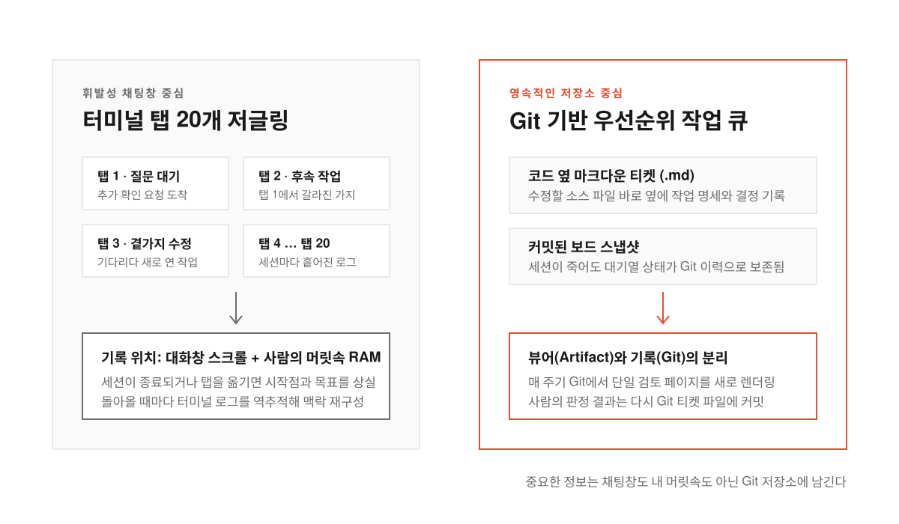
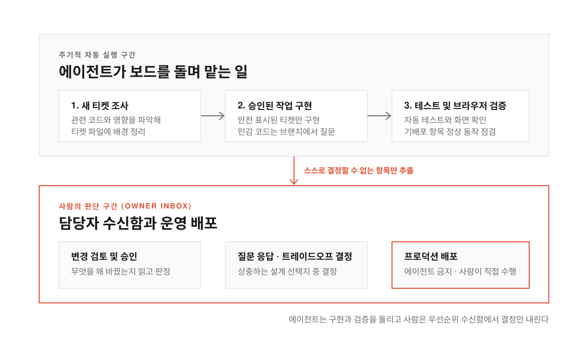
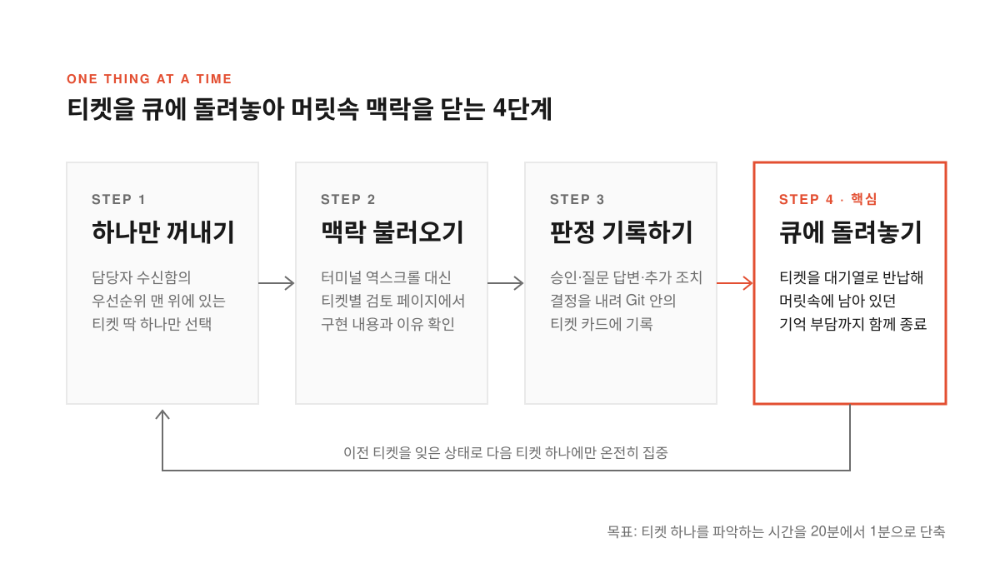

터미널에 Claude Code나 Codex를 띄워 놓고 일을 시키다 보면 누구나 비슷한 유혹에 빠진다. 에이전트가 코드를 읽고 답변을 만드는 데 몇십 초에서 몇 분이 걸리니 그 빈 시간을 참지 못하고 옆에 새 탭을 열어 다른 작업을 시작하는 것이다. 그러다 첫 번째 탭에서 답변이 돌아오는데 거기에는 확인해야 할 질문 하나와 후속 작업 하나, 그리고 곁가지로 처리할 일 하나가 딸려 있다. 각각을 처리하려고 탭을 또 늘리는 사이 두 번째 탭의 응답이 도착한다.

이런 식으로 탭을 늘리다 보면 어느새 스무 개 가까운 대화창을 오가며 일하게 된다. 문제는 각 탭이 다루던 코드의 상태와 앞뒤 사정을 전부 내 머릿속 작업 기억(RAM)에 올려두어야 한다는 점에 있다. 결국 오후가 되면 뇌가 타버린 것처럼 지쳐서 내가 지금 무엇을 고치고 있었는지, 어디서 시작해서 어디로 가려 했는지조차 잊어버린다.

개발자 세르게이 쿠네(Sergey Kuhne)는 최근 자신의 블로그에 [이른바 AI 두뇌 과부하(AI Brain Fry)와 싸우는 개인 실험](https://sergeykuhne.com/blog/fighting-ai-brain-fry)을 공개했다. 흔히 에이전트를 쓸 때 자주 쉬어라, 입력하기 전에 먼저 생각해라, 작업 범위를 좁혀라 같은 조언을 건네곤 하지만 쿠네는 문제의 본질이 작업의 순서(sequencing)와 맥락(context) 두 가지에 있다고 보았다. 그래서 일하는 방식을 아예 우선순위 큐(Priority Queue, 중요도가 높은 일부터 하나씩 꺼내 처리하는 대기열)처럼 바꿨다.

<!--more-->

## 대화창 대신 Git에 작업 큐를 심다

<figure>
  
  <figcaption>대화창 스무 개에 흩어져 있던 맥락을 Git 저장소 안의 마크다운 파일로 옮기면 세션이 끊겨도 작업 상태가 사라지지 않는다.</figcaption>
</figure>

터미널 탭을 여러 개 띄워 놓는 방식이 피곤한 까닭은 중요한 맥락이 휘발성 공간에 갇혀 있기 때문이다. 에이전트와 나눈 대화창이나 내 머릿속 기억은 터미널 세션이 꺼지거나 다른 일에 잠시 한눈을 파는 순간 쉽게 날아간다. 나중에 그 탭으로 돌아오면 스크롤을 한참 위로 올리며 아까 어디까지 얘기했는지 기억을 되살려야 한다.

쿠네가 택한 해법은 작업 큐를 통째로 Git 저장소 안에 넣는 방식이었다. 모든 작업 티켓은 그 티켓이 다루는 실제 소스 코드 바로 옆에 마크다운(Markdown) 파일로 만들어 두고 전체 작업 보드의 현재 상태 역시 커밋된 스냅샷으로 저장소에 남긴다. 중요한 정보가 채팅창이나 사람의 머릿속에만 머물지 않으니 터미널 세션이 갑자기 종료되거나 컴퓨터를 다시 켜도 작업 대기열은 그대로 남아 있다.

작업 기록의 기준점이 Git이 되자 화면을 보는 방식도 달라졌다. 그는 매 주기마다 Git에 저장된 상태를 읽어들여 전체 보드와 티켓별 검토 화면을 한 페이지로 보여주는 클로드 아티팩트(Claude artifact, 대화창 밖에서 문서나 화면을 렌더링해 주는 기능)를 새로 만든다. 터미널 로그를 거슬러 올라가며 변경 내역을 재구성하는 대신 링크 하나만 열면 무엇을 왜 구현했는지 정리된 화면이 보인다. 거기서 내린 판단 결과는 다시 Git 안의 티켓 카드에 기록된다. 웹 페이지는 어디까지나 읽기용 뷰어일 뿐이고 진짜 기록은 Git이 맡는 구조다.

## 에이전트가 달리는 구간과 사람이 멈추는 구간

<figure>
  
  <figcaption>에이전트는 안전한 구현과 검증만 반복하고 결정이 필요한 일은 담당자 수신함으로 모아 사람에게 넘긴다.</figcaption>
</figure>

저장소 안에 작업 보드가 자리 잡으면 에이전트는 일정한 주기로 그 보드를 돌며 일한다. 새로 올라온 티켓이 있으면 관련 코드를 조사해 두고 사람이 미리 만들어도 안전하다고 표시해 둔 티켓은 직접 코드를 짜서 구현한다. 코드만 작성하고 끝내는 게 아니라 테스트를 돌리고 브라우저에서 실제로 잘 뜨는지 확인하며 이미 배포된 기능이 깨지지 않았는지도 함께 검증한다.

그렇다고 에이전트에게 모든 권한을 넘기지는 않는다. 건드리기 민감한 핵심 코드를 수정해야 할 때는 별도 브랜치에서 먼저 작업한 뒤 사람에게 승인을 요청한다. 실제 운영 환경(프로덕션)에 배포하는 마지막 단추 역시 에이전트는 절대 누르지 못하며 오직 사람만 직접 처리한다.

이 작업 흐름을 가르는 가장 중요한 경계선은 결정(decision)이다. **에이전트는 조사하고 만들고 검증할 수는 있어도 무엇이 맞는지 스스로 결정하지는 못한다.** 그래서 사람의 판단이 필요한 항목은 모두 담당자 수신함(owner inbox)이라는 한곳으로 모인다. 별도 스크립트가 전체 보드를 읽은 뒤 변경 사항 검토, 질문에 대한 답변, 상충하는 두 선택지(tradeoff) 중 하나를 고르는 판정처럼 내 결정만 기다리고 있는 항목들을 우선순위 목록으로 추려서 건네준다.

> "그것이 할 수 없는 일은 결정하는 것이다. 그래서 내가 필요한 모든 일은 담당자 수신함이라 부르는 한곳에 모인다."

## 티켓을 큐에 돌려놓으며 머릿속 방을 비우다

<figure>
  
  <figcaption>결정을 마친 티켓을 큐에 돌려놓는 동작이 머릿속에 남아 있던 작업 맥락까지 함께 닫아 주는 스위치가 된다.</figcaption>
</figure>

담당자 수신함에 할 일이 잘 모여 있어도 예전처럼 여러 개를 동시에 열어젖히면 소용이 없다. 쿠네가 이 실험에서 가장 중요한 대목으로 꼽는 부분도 수신함에서 일을 꺼내 처리하고 닫는 습관에 있다.

그는 수신함에서 딱 하나의 티켓만 집어 든다. 정리된 화면을 읽고 그 티켓의 맥락을 머릿속에 불러온 뒤 결정을 내리거나 에이전트에게 다음 조치를 요청한다. 그러고는 그 티켓을 다시 큐에 돌려놓음으로써 작업을 닫는다.

얼핏 보면 당연한 순서 같지만 티켓을 큐에 돌려놓는다는 이 동작에 핵심이 숨어 있다. 터미널 탭을 여러 개 열어 둘 때는 답변을 보낸 뒤에도 저 탭에서 이따가 답이 오면 이렇게 처리해야지라는 생각이 머릿속 한구석에 계속 매달려 있었다. 반면 내 판정을 티켓 파일에 적어 큐로 돌려보내면 그 일은 내 기억 속에서 완전히 닫힌다. 잊어버리면 안 되는 할 일로 머릿속에 남아 있지 않으니 다음 티켓을 집어 들었을 때 온전히 그 하나에만 집중할 수 있다.

## 에이전트의 어중간한 속도와 코드 리뷰라는 진짜 병목

이 글이 해커뉴스(Hacker News)에 공유되자 많은 개발자들이 왜 우리가 유독 에이전트 시대에 이런 과부하를 겪게 되었는지 각자의 경험을 보탰다. 그중 가장 공감을 얻은 지점은 지금의 AI 모델들이 가진 어중간한 추론 속도였다. 예전처럼 모델이 아주 느리고 코드 품질도 낮았을 때는 에이전트가 코딩하는 모습을 보며 옆에서 기타를 치다가 가끔 개입하면 그만이었다. 반대로 모델이 지금보다 네다섯 배쯤 빨라져서 눈 깜짝할 사이에 답을 내놓는다면 굳이 다른 탭을 열지 않고 그 자리에서 한 가지 일만 끝까지 밀고 나갔을 것이다.

지금의 에이전트는 딴짓을 하며 쉬기에는 너무 빠르고 가만히 화면만 보며 기다리기에는 또 너무 느리다. 작업 하나를 시키면 50초에서 몇 분 남짓한 대기 시간이 생기는데 그 짧은 빈틈에 가만히 앉아 놀고 있다는 느낌을 피하려고 새 세션을 하나만 더 열게 된다. 대기 시간이 길어질수록 동시에 벌이는 작업 수가 늘어나고 결국 그 선택이 스무 개의 탭이 되어 돌아오는 셈이다.

설령 에이전트를 세 개씩 병렬로 돌려 코드를 빠르게 만들어 낸다 해도 마지막에는 코드 검토(리뷰)라는 진짜 병목이 기다리고 있다. 에이전트 세 개가 각각 만 줄이 넘는 변경 묶음이나 스무 개 넘는 파일을 고친 PR을 가져오면 결국 사람이 그 세 개의 서로 다른 맥락을 오가며 특정 상황에만 맞춘 취약한 해법이나 기존 구조와 따로 노는 코드를 찾아내야 한다. 작업을 시작하는 건 너무 쉬워졌지만 마무리하는 마지막 20퍼센트는 오히려 더 고된 일이 되었다. 그래서 많은 개발자들이 동시에 신경 쓰는 주의력 레인을 최대 두세 개로 제한하거나 에이전트에게 객체 관계도와 결정 사항을 담은 로컬 HTML 검토 문서를 먼저 만들게 해 리뷰 부담을 줄이는 방식을 택하고 있었다.

## 코딩 속도보다 맥락을 여닫는 속도가 중요해진다

쿠네 역시 이 우선순위 큐 방식으로 바꾼 뒤에도 일 자체가 피곤한 건 여전하다고 말한다. 하지만 예전처럼 정신이 산만해지거나 내가 지금 어디 서 있는지 길을 잃어버리는 느낌만큼은 사라졌다.

그가 지금도 계속 다듬고 있는 과제는 주변 도구다. 새로운 티켓을 열었을 때 앞뒤 사정을 파악하는 데 20분이 아니라 단 1분만 걸리도록 맥락을 더 소화하기 쉬운 형태로 제공하는 일, 그리고 사람만 내릴 수 있는 결정을 기다리느라 막힌 티켓이 에이전트의 무한 반복에 빠지지 않게 막는 일이다.

AI 에이전트가 구현 시간을 크게 줄여준 뒤로 개발자의 에너지를 갉아먹는 주범은 타이핑이 아니라 끊임없는 맥락 전환이 되었다. **중요한 맥락을 대화창과 머릿속에서 꺼내 Git 저장소에 고정해 두고 한 번에 하나의 티켓만 열어 결정을 내린 뒤 깔끔하게 닫는 습관이 에이전트 시대에 집중력을 지키는 현실적인 해법이 되고 있다.**

