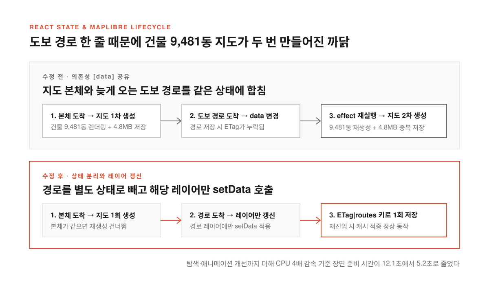

웹에 건물 수천 동이 솟아오른 3D 지도를 띄우려면 비용과 데이터라는 두 가지 벽을 먼저 넘어야 한다. 상용 3D 지도 SDK나 유료 타일 서비스를 쓰면 시작은 빠르지만 호출량이 늘어날수록 고정 라이선스 비용과 사용료가 가파르게 붙는다. 반대로 무료 오픈소스 지도 엔진을 고르면 당장 한국 아파트 단지의 동 모양과 높이, 주변 학교와 공원, 지하철역 출구, 보행 경로를 어디서 가져와 합칠지 막막해진다.

여기에 AI 코딩 에이전트를 붙여 빠르게 화면을 찍어내면 또 다른 문제가 조용히 자란다. 화면에는 그럴듯한 입체 건물이 올라오지만 보이지 않는 곳에서 건물 수천 동짜리 지도가 두 번씩 만들어지거나 층수로 어림잡은 앞 건물 높이가 동지 일조 시간 계산에 그대로 섞여 들어간다. 눈으로 볼 때는 멀쩡해 보여도 직접 성능을 재고 데이터 출처를 따져 보지 않으면 알아채기 어려운 함정이다.

소프트웨어 엔지니어 [Alvin Hong](https://alvin.ing/blog/apartment-3d-map-open-data-stack/)은 아파트 단지 주변 반경 1km의 건물과 생활 시설, 도보 경로, 일조량을 입체로 보여주는 웹 지도를 혼자 만들었다. 10월 31일에 단지 하나로 프로토타입을 시작해 개발 3일 차인 11월 2일에 출시했고 11월 10일까지 시설 모형과 도보 경로, 일조 계산, 성능을 고쳤다. 유료 지도 SDK와 외부 3D 모델 파일을 쓰지 않고 공개 데이터와 오픈소스만으로 11일 동안 겪은 설계 선택과 디버깅 과정을 따라가 본다.

<!--more-->

## 공개 데이터 네 갈래를 서버에서 묶고 브라우저에서 세우다

<figure>
  
  <figcaption>여러 공개 원천에서 가져온 외곽선과 높이, 시설 정보를 서버에서 단지 단위로 합친 뒤 브라우저의 MapLibre가 입체 레이어로 겹쳐 그린다.</figcaption>
</figure>

이 작업에서 무료라는 말은 서버나 작업 환경 비용이 안 들었다는 뜻이 아니라 지도 SDK와 3D 타일, 지오코딩(주소를 경위도 좌표로 바꾸는 작업), 외부 3D 모델 파일에 고정 라이선스 비용을 내지 않았다는 뜻이다. 배경 타일은 API 키 없이 쓰는 [OpenFreeMap](https://openfreemap.org/)을 깔고 그 위에 오픈소스 렌더링 엔진인 [MapLibre GL JS](https://maplibre.org/)의 `fill-extrusion`(바닥 다각형을 위로 밀어 올려 입체로 그리는 레이어)으로 건물을 세웠다.

한국 지도를 그릴 때 까다로운 부분은 건물 외곽선과 실제 높이를 맞추는 일이다. 도로명 주소를 좌표로 바꾸고 건물 바닥 모양·층수·건물명을 가져오는 데는 국토교통부 공간정보 플랫폼인 [브이월드](https://www.vworld.kr/) 지오코더와 WFS(웹에서 벡터 공간 데이터를 주고받는 표준 인터페이스)를 썼다. 여기에 공공데이터포털의 [건축HUB 건축물대장](https://www.data.go.kr/data/15134735/openapi.do) 표제부 API로 실제 건물 높이와 지상 층수를 보정했다. 학교·공원·역·도로·철도·물가·숲은 OpenStreetMap(OSM)에서 가져왔고 보행 경로와 시간은 오픈소스 경로 엔진 [Valhalla](https://github.com/valhalla/valhalla)로, 날짜·시각별 해의 방위와 고도는 미국 해양대기청(NOAA)의 공개 계산식으로 구했다.

문서만 보고 API를 연결하면 끝날 것 같지만 실제 환경에서는 데이터마다 숨은 제약이 있었다. 브이월드 지오코더는 해외 리전의 서버리스 환경에서 호출이 막히는 경우가 있어 국내 API를 부르는 단계만 국내에서 도는 환경에 두었다. WFS 역시 요청당 건수 상한이 있어서 건물이 많은 도심은 영역을 쪼개 다시 요청하도록 만들었다.

공용 서버에 기대던 구조도 단지가 늘어나면서 직접 처리하는 방식으로 바꿨다. 처음에는 OSM을 공개 Overpass API로 질의했지만 단지가 늘어나니 공용 서버에 미안한 수준이 됐고 응답도 들쭉날쭉했다. 지금은 [Geofabrik](https://download.geofabrik.de/asia/south-korea.html) 국내 추출본을 주기적으로 받아 직접 질의하며 실패해도 공용 서버로 우회하지 않는다. Valhalla 공개 서버도 단지당 한 번씩 간격을 두고 부르고 대량으로 다시 계산할 때는 추출본으로 경로 타일을 만들어 일회성 작업 환경에 띄웠다. OSM은 ODbL 라이선스를 따르므로 지도와 공유 화면에 `© OpenStreetMap 기여자`를 항상 표시하고 지도에 시설이 없다고 실제로 없는 것은 아니어서 누락 가능성도 안내에 적었다.

## 도보 경로 한 줄 때문에 건물 9,481동 지도가 두 번 만들어지다

<figure>
  
  <figcaption>뒤늦게 도착하는 도보 경로를 지도 본체 상태에서 분리하고 해당 레이어에만 setData를 호출해 9,481동 지도의 이중 생성과 중복 저장을 막았다.</figcaption>
</figure>

출시 당일인 11월 2일, 어느 순간부터 지도가 느려졌다는 느낌이 들었다. 건물이나 모형이 많아졌으니 에셋 탓이겠거니 했는데 직접 재 보니 주차장 모형 생성은 약 10ms였고 기기 저장본을 읽고 파싱하는 데도 8~34ms밖에 걸리지 않았다.

진짜 문제는 React 상태 관리 코드에 있었다. 도보 경로는 지도 본체보다 늦게 도착하는데 이를 받아 지도 본체가 담긴 `data` 상태에 합쳤고 지도를 만드는 `effect`의 의존성이 `[data]`였다. **경로 한 줄이 도착했을 뿐인데 브라우저는 건물 9,481동짜리 지도를 처음부터 다시 만들고 있었다.** 기기 저장까지 꼬여 4.8MB 저장이 두 번 일어났고 경로를 붙인 저장에 캐시 식별자인 `ETag`가 빠져 있어 다시 열 때 저장을 건너뛰는 로직은 한 번도 맞은 적이 없었다. 해법은 단순했다. 경로를 별도 상태로 빼서 경로가 바뀌면 그 레이어에만 `setData`를 호출하고 지도 본체가 같으면 재생성을 건너뛰며 저장은 경로까지 붙인 뒤 `ETag|routes` 키로 한 번만 하도록 고쳤다.

렌더링 루프와 공간 탐색의 병목도 함께 걷어냈다. 가만히 있어도 차와 열차 효과가 서로 다른 프레임에 흩어져 도착하며 지도를 초당 60번 다시 그리고 있었는데 간격을 50ms에서 200ms로 늘려도 횟수는 그대로였다. 결국 상시 움직임을 `requestAnimationFrame` 루프 하나로 모으고 10초 동안 조작이 없으면 멈추게 해 유휴 상태의 메인 스레드 사용량을 초당 239ms에서 0ms로 줄였다. MapLibre 페인트 값을 90~200ms마다 바꿀 때 기본 300ms 전환이 계속 새로 걸리던 문제를 끄자 초당 다시 그리기가 53번에서 32번으로, 프레임 p95(상위 5% 지연 시간)가 33ms에서 17ms로 줄었고 지도를 움직일 때마다 역 출구 표식 크기를 재던 `getBoundingClientRect`(이동 1분당 약 0.9초 소모)도 이동이 끝난 뒤 묶어서 계산하게 바꿨다.

첫 진입 때 점마다 건물 전체를 훑느라 건물×점으로 약 190만 번 돌던 등록부 검사도 이름 색인과 격자 색인으로 후보를 줄였다. 저장된 지도 47개에서 변경 전후 모형 결과를 바이트 단위로 비교해 같은 것을 확인한 뒤 적용했다. 맥미니 헤드리스 Chrome(390×844)에서 약 9,500동 단지를 재자 맥 기준 지도 `load` 처리는 1,943ms에서 710ms로, CPU 4배 감속 조건에서는 7,639ms에서 2,709ms로 줄었고 진입부터 장면 준비까지는 12.1초에서 5.2초로 줄었다.

## 화면에는 어림잡은 높이를 써도 일조 계산에서는 빼야 하는 이유

<figure>
  
  <figcaption>눈으로 보는 3D 화면은 빈칸을 추정값으로 채워도 무방하지만 숫자로 찍히는 일조 시간 계산에는 직접 확인된 높이만 쓰도록 데이터 구조에 출처를 심었다.</figcaption>
</figure>

성능 못지않게 중요한 갈림길은 출처가 섞인 건물 높이를 어디까지 믿을지 정하는 일이었다. 건축물대장이나 OSM에 실제 높이가 적힌 건물도 있지만 층수만 있는 건물도 있고 아무 기록이 없는 건물도 있다. 3D 화면을 채우려면 빈칸에 뭐라도 넣어야 하므로 화면 표시에는 층수에 일반 층고를 곱한 추정치와 기본 높이를 모두 썼다. 지도에서 건물이 2m쯤 틀려도 보는 사람은 모른다.

하지만 "이 집은 동지에 해가 몇 시간 든다"는 숫자는 다르다. **앞 건물 높이가 층수로 어림잡은 추정값이면 일조 계산 결과도 추정인데 화면에 찍히는 숫자는 정확해 보이기 때문이다.**

그래서 서버에서 데이터를 합칠 때 높이마다 어디서 확인했는지 근거를 같이 저장하고 일조 계산은 직접 확인된 높이만 읽게 했다. 프롬프트에 "추정값은 쓰지 마"라고 적는 것만으로는 부족했다. 다음 수정에서 AI 에이전트가 편한 쪽으로 코드를 고치면 규칙이 조용히 깨지기 때문에 아예 근거 필드를 데이터 구조에 넣어 두었다. 높이를 모르는 건물이 그림자를 만들지 않아 실제보다 햇빛이 많게 나올 수 있다는 대가가 따르지만 이 한계는 일조 화면에 그대로 적었다.

## 커밋 79%를 짠 AI 에이전트와 끝내 사람에게 남은 세 가지 판단

지도 앱 경로를 바꾼 커밋 577개 중 458개(약 79%)에 AI 코딩 에이전트가 작성자나 공동 작성자로 기록돼 있다. 혼자서 사흘 만에 첫 출시를 마치고 260개가 넘는 지도 테스트 파일과 학교 운동장·교량 같은 수십 종의 입체 모형을 만들 수 있었던 이유는 분명 에이전트 덕분이다.

공식과 조건을 말로 설명할 수 있는 작업은 에이전트에게 잘 맡겨졌다. 벽마다 `높이 × cot(해 높이)`만큼 밀어낸 그림자 도형 계산, 층별 창 위치에서 해 쪽으로 쏘는 광선 판정, WFS 응답 파싱과 재시도, OSM 태그 분류 같은 일들이다. 앞에서 겪은 이중 생성이나 탐색 비용 문제도 원인만 찾아 주면 에이전트가 금방 고치고 경로를 지도 상태에 합치거나 `ETag` 없이 저장하는 코드를 잡는 재발 방지 테스트까지 넣어 주었다.

반면 원인을 모르는 동안에는 에이전트도 사람도 그럴듯한 코드를 계속 쌓고 있었다. 유료 SDK와 외부 3D 모델 다운로드를 금지한 제약 역시 처음에 사람이 걸어 준 것이다. 하고 싶은 것보다 하면 안 되는 것을 먼저 적지 않으면 에이전트는 가장 쉬운 길로 간다.

> MapLibre GL JS로 특정 좌표 반경 1km의 3D 건물 지도를 만들어 줘. 유료 서비스와 외부 3D 모델 파일은 쓰지 마. 배경은 OpenFreeMap dark 스타일을 쓰고, 건물 높이가 없으면 화면에는 기본값을 쓰되 어떤 건물이 추정값인지 속성으로 구분해 줘. OSM 출처 표기를 넣고, 지도 객체는 한 번만 만들어.

결국 에이전트에게 맡기지 못한 일은 무엇을 쓰지 않을지, 어떤 숫자를 믿을지, 실제로 빠른지를 정하는 일이었다. 기피 시설을 보는 사람이 불편하지 않게 표현하는 수위를 정하거나 공원 녹색이 안 보이고 차량기지 선로가 끊겨 보인다는 사실을 알아채는 것도 화면을 직접 본 사람의 몫이었다. OpenFreeMap과 MapLibre를 부르는 HTML 파일 하나로 동네 건물을 세워 보는 데는 5분도 안 걸리지만 **추정치와 사실을 가려 데이터 구조에 새기고 실제 성능을 재서 숨은 병목을 잡아내는 판단만큼은 여전히 사람의 손에 남아 있다.**

