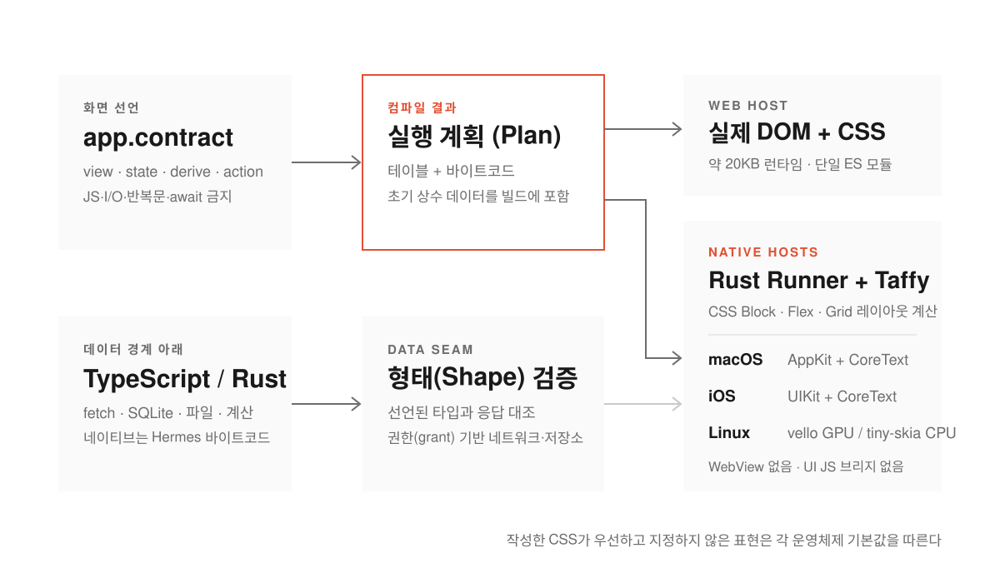
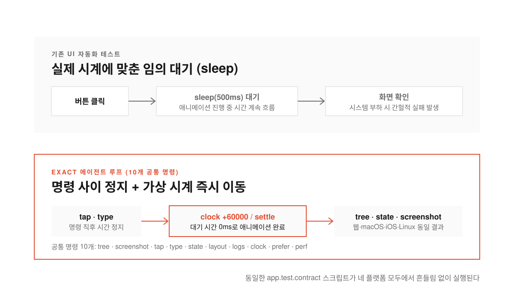
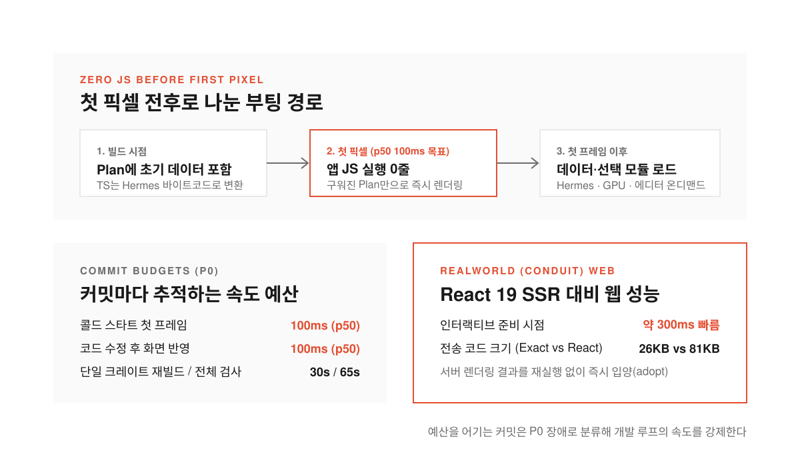

AI 코딩 에이전트에게 앱을 만들어 달라고 시켜 보면 코드를 짜는 단계보다 화면을 띄우고 검증하는 단계에서 먼저 막힌다. 웹 브라우저에서는 그럭저럭 버튼을 눌러 보던 에이전트도 macOS나 iOS 시뮬레이터로 넘어가면 조작 도구가 달라져 길을 잃기 일쑤다. 화면 전환 애니메이션이 끝날 때까지 몇 초를 기다려야 할지 몰라 헛발질을 하거나 타이밍이 조금만 어긋나도 테스트가 깨진다.

React Native 개발 도구로 잘 알려진 Expo가 공개한 [Exact](https://github.com/expo/exact)는 이 병목을 런타임 설계의 출발점에 놓았다. 코드를 주로 AI 에이전트가 작성한다는 전제 아래 에이전트가 사람의 개입 없이 웹과 macOS, iOS, Linux 네 곳에서 앱을 빌드하고 실행하며 화면을 보고 테스트까지 끝낼 수 있도록 밑바닥부터 새로 짠 크로스 플랫폼 런타임이다.

흥미로운 대목은 React 생태계의 핵심 기업인 Expo가 내놓은 도구인데도 React나 JSX를 전혀 쓰지 않는다는 점이다. 화면을 그릴 때 웹뷰(WebView, 앱 안에 띄우는 작은 브라우저 창)나 자바스크립트 브리지를 거치지도 않는다. 화면 구조는 Contract라는 작은 자체 선언형 언어로 적고 데이터를 가져오거나 계산하는 로직만 TypeScript나 Rust로 분리해 작성한다.

<!--more-->

## UI는 Contract로 묶고 데이터만 코드로 분리한 실행 계획

<figure>
  
  <figcaption>화면을 그리는 Contract는 가벼운 실행 계획으로 컴파일되고 TypeScript와 Rust는 데이터 경계 아래에서만 동작한다.</figcaption>
</figure>

기존 크로스 플랫폼 프레임워크들은 대개 범용 프로그래밍 언어 안에 화면 표시 코드를 섞어 쓴다. 자유도는 높지만 컴포넌트 안에 네트워크 요청이나 비동기 반복문이 뒤엉키기 쉬워서 에이전트가 상태를 잘못 연결하거나 데이터 경쟁(data race, 여러 작업이 동시에 같은 값을 고치려다 꼬이는 현상)을 일으키기 쉽다.

Exact는 화면과 데이터의 경계를 엄격하게 나눈다. 화면을 정의하는 Contract 언어 안에는 자바스크립트 코드나 입출력(I/O)을 넣을 수 없고 액션 안에 반복문이나 `await`도 쓸 수 없다. 화면은 오직 상태(state)와 파생 값(derive), 그리고 데이터를 요청하거나 변경을 보내는 선언만 담는다. 실제 네트워크 통신이나 SQLite 접근, 파일 읽기는 데이터 경계(data seam) 아래의 TypeScript나 Rust 모듈이 맡고 런타임은 돌아온 응답이 Contract에 선언된 형태(shape)와 맞는지 매번 검사한다.

이렇게 제약을 걸어 두면 Contract 컴파일러가 구문 분석과 타입 검사를 거쳐 화면 전체를 가벼운 실행 계획(Plan)으로 바꿀 수 있다. **웹에서는 이 실행 계획이 약 20KB짜리 런타임 위에서 돌아가는 단일 ES 모듈이 되어 브라우저의 실제 DOM과 CSS를 직접 움직인다.** macOS와 iOS, Linux에서는 Rust로 만든 가상 머신(Runner)이 같은 실행 계획을 읽고 CSS 규칙을 구현한 Taffy 기반 레이아웃 커널이 모든 상자의 위치를 계산한다. 그 위에서 macOS는 AppKit과 CoreText로, iOS는 UIKit과 CoreText로, Linux는 GPU(vello)나 CPU(tiny-skia) 페인터로 각자 자기 플랫폼의 도구를 써서 화면을 그린다.

레이아웃 규칙은 웹의 CSS를 따르되 색깔이나 글꼴 크기, 컨트롤 모양처럼 개발자가 지정하지 않은 표현은 운영체제 기본값을 따른다. 아무 스타일도 적지 않은 텍스트는 iPhone에서는 17포인트, Mac에서는 13포인트 시스템 라벨 색상으로 나오고 버튼과 뒤로 가기 동작도 각 운영체제의 기본 컨트롤처럼 작동한다. 웹의 언어로 레이아웃을 적되 결과물은 각 플랫폼의 고유한 앱처럼 보이게 만드는 전략이다.

## 열 개의 공통 명령과 가상 시계로 맞춘 에이전트 루프

<figure>
  
  <figcaption>에이전트가 가상 시계를 직접 앞당기면 애니메이션이 끝날 때까지 기다리지 않아도 테스트가 흔들리지 않는다.</figcaption>
</figure>

화면 아키텍처만큼이나 눈에 띄는 부분은 에이전트가 앱을 다루는 인터페이스다. Exact의 이전 버전인 `exact1`에서는 에이전트용 API에 필요해 보이는 기능을 하나씩 보태다 보니 명령어가 80개까지 불어났다. 이번 `exact2` 저장소에서는 이를 의도적으로 10개의 명령(`tree`, `screenshot`, `tap`, `type`, `state`, `layout`, `logs`, `clock`, `prefer`, `perf`)으로 줄였다.

이 열 가지 명령은 `scripts/agent.mjs` 스크립트 하나로 웹과 macOS, iOS 시뮬레이터와 실제 iPhone, Linux를 똑같이 제어한다. 같은 명령을 적은 `app.test.contract` 파일 하나가 별도 변환기 없이 네 플랫폼에서 그대로 실행된다. README 실험을 보면 캐시가 준비된 Mac에서 Claude Code에 할 일(Todo) 앱 프롬프트를 주었을 때 에이전트가 앱을 짜고 웹·macOS·iOS 시뮬레이터 세 곳의 테스트를 통과시키기까지 약 57분이 걸렸고 그중 약 25분은 첫 네이티브 빌드에 쓰였다.

> "두 작업 사이에는 아무것도 움직이지 않는다. 애니메이션이 끝날 때까지 잠들어 기다리는 대신 에이전트가 `clock +60000`이나 `clock settle`을 실행하고 결과를 읽는다. 타이밍 때문에 테스트가 간헐적으로 실패하지도, 기다릴 필요도 없다."

여기서 가장 핵심이 되는 장치는 에이전트가 직접 제어하는 가상 시계(`clock`)다. 일반 UI 자동화 테스트가 자주 깨지는 이유는 화면 전환이나 스프링 애니메이션이 끝날 때까지 임의로 몇백 밀리초씩 대기(`sleep`)하기 때문이다. 컴퓨터가 잠깐 느려져 애니메이션이 늦게 끝나면 테스트는 곧바로 실패한다. Exact에서는 두 명령 사이에 앱의 시간이 흐르지 않는다. 버튼을 누른 뒤 `clock +60000`으로 시간을 60초 앞으로 감거나 `clock settle`로 움직임이 멈출 때까지 시계를 넘기면 기다리는 시간 없이 확정된 화면 상태를 바로 읽을 수 있다.

컴파일러와 주변 도구도 기계가 읽기 좋게 맞춰져 있다. 한 번 컴파일할 때 첫 에러에서 멈추지 않고 독립된 에러를 최대 20개까지 구조화된 JSON으로 돌려준다. 글자 크기를 바꾸려고 `size` 속성을 적으면 여기서는 웹의 이름인 `font-size`로 적어야 한다고 알려주고 화면 요소에서 원래 소스 코드 줄 번호까지 이어 주는 개발용 소스맵도 제공한다.

## 첫 픽셀 전에 자바스크립트를 실행하지 않는 속도 예산

<figure>
  
  <figcaption>초기 화면 데이터를 빌드 시점에 구워 넣어 첫 픽셀이 찍히기 전에는 앱 자바스크립트를 한 줄도 실행하지 않는다.</figcaption>
</figure>

에이전트가 코드를 고치고 화면을 확인하는 루프가 빠르려면 앱 자체의 시작 속도와 재빌드 속도가 빨라야 한다. Exact는 모든 커밋마다 속도 예산(budget)을 추적하고 이를 어기면 최우선 장애(P0)로 다룬다. 앱을 켜서 조작 가능한 첫 프레임이 뜨기까지 중앙값(p50) 100ms 이내, 개발 중 코드를 고쳐 화면에 반영되기까지 100ms 이내, 크레이트(crate, Rust의 패키지 단위) 하나를 다시 빌드하는 데 30초 이내, 전체 필수 검사를 통과하는 데 65초 이내라는 목표치가 걸려 있다.

이 숫자를 지키기 위해 부팅 경로에서는 아무것도 컴파일하거나 실행하지 않는다. 첫 화면에 필요한 상수 데이터는 빌드 시점에 미리 계산해 실행 계획(Plan) 안에 구워 넣는다(baked). **덕분에 화면에 첫 번째 픽셀이 찍히기 전에는 앱의 자바스크립트 코드가 단 한 줄도 실행되지 않는다.** 네이티브 환경에서 데이터 로직을 맡는 TypeScript 코드는 빌드할 때 미리 Hermes 바이트코드로 컴파일해 두었다가 첫 화면이 그려진 뒤에야 불러온다.

웹에서도 이 구조는 빠른 반응 속도로 이어진다. 표준 벤치마크 앱인 RealWorld(Conduit) 비교에서 Exact 웹 런타임은 React 19의 서버 사이드 렌더링(SSR) 빌드가 하이드레이션(hydration, 서버가 보낸 정적 HTML에 자바스크립트 이벤트를 연결해 살려내는 과정)을 마치기 약 300ms 전에 이미 준비를 끝냈다. 전송된 코드 크기 역시 React 빌드가 81KB였던 반면 Exact는 26KB에 그쳤다. 서버에서 Rust 렌더러로 미리 그린 페이지를 브라우저에서 다시 하이드레이션하는 대신 그 자리에서 바로 입양(adopt)해 쓰기 때문이다.

불필요한 기능을 기본 코어에 넣지 않는 원칙도 일관된다. WebGPU나 Metal을 쓰는 GPU 렌더링, 마크다운 에디터, 도형 둘레로 글자를 흘려보내는 텍스트 플로, 브라우저용 SQLite 같은 무거운 기능은 핵심 크레이트의 기능 플래그로 넣지 않고 별도 모듈로 분리해 필요한 앱만 불러오게 했다.

## 새로운 UI 언어가 넘어야 할 장벽과 에이전트 시대의 프레임워크

이 프로젝트가 공개되자 개발자 커뮤니티에서는 에이전트 친화적인 설계에 주목하면서도 자체 언어(DSL)인 Contract의 한계를 짚는 목소리가 함께 나왔다. 실제 서비스의 화면이 복잡해질수록 온갖 예외적인 표현식과 상태 조합이 필요한데 굳이 새 언어를 배우고 컴파일러를 유지보수하는 것보다 이미 검증된 TypeScript 기반의 JSX(TSX)를 쓰는 편이 낫지 않느냐는 지적이다. Rust 기반 선언형 UI 툴킷인 Slint나 Qt의 QML처럼 비슷한 길을 먼저 걸어간 도구들과 비교하며 성숙도를 묻는 시선도 있었다.

운영체제 지원 범위도 아직은 실험 단계인 1.0 이전 수준에 머물러 있다. 웹과 macOS, iOS, Linux 네 곳에서는 캘트레인(Caltrain) 열차 시간표 앱을 포함한 여러 예제 앱이 목표 성능 안에서 돌아가지만 Android는 에뮬레이터와 기기에서 실행과 테스트만 가능할 뿐 스토어 배포용 패키징이 없다. Windows 역시 기본 그리기와 일부 네이티브 컨트롤 예제만 돌아가고 범용 컨트롤 지원과 배포 기능은 미완성이다. 프로덕션 환경에서 화면 계획과 에셋은 서명된 번들로 업데이트할 수 있지만 TypeScript나 Rust 로직 코드를 원격으로 업데이트하는 기능도 빠져 있다.

그럼에도 Exact가 보여주는 방향성은 뚜렷하다. 지금까지의 UI 프레임워크가 사람이 코드를 얼마나 편하게 읽고 쓰느냐를 두고 경쟁했다면 이제는 AI 에이전트가 얼마나 실수 없이 코드를 생성하고 몇 밀리초 만에 스스로 화면을 검증할 수 있느냐가 프레임워크의 구조를 결정하기 시작했다. **표현력을 일부러 제약해 에이전트가 다루기 쉬운 실행 계획으로 낮추고 시간을 마음대로 감을 수 있는 가상 시계와 열 개의 조작 명령을 런타임 한가운데에 심은 Exact의 실험은 에이전트 시대의 개발 도구가 어떻게 달라지는지 잘 보여준다.**
