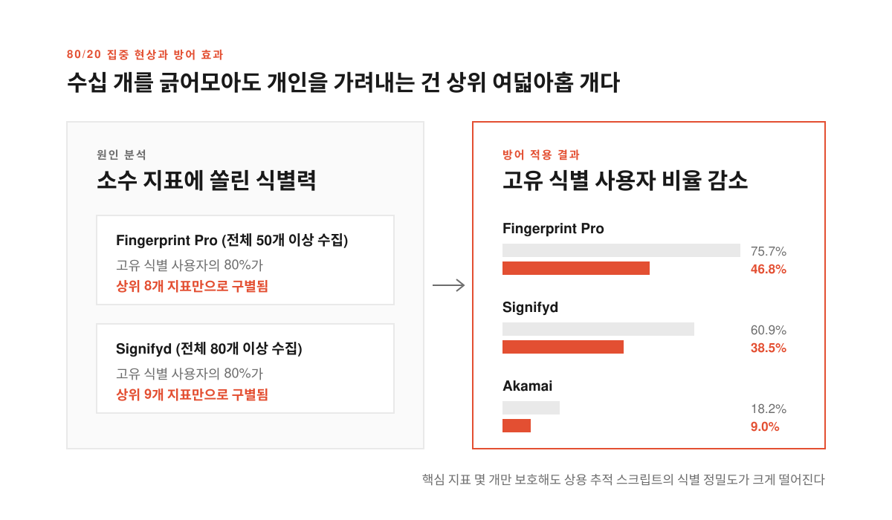
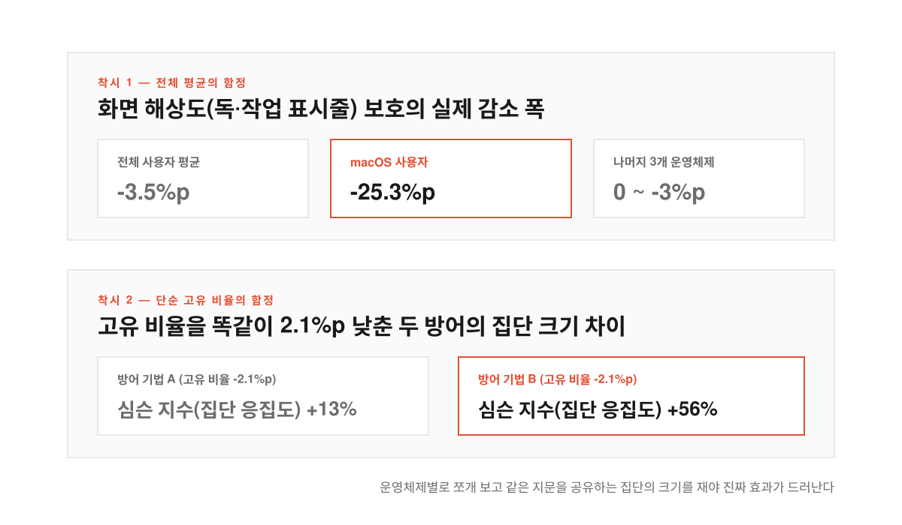
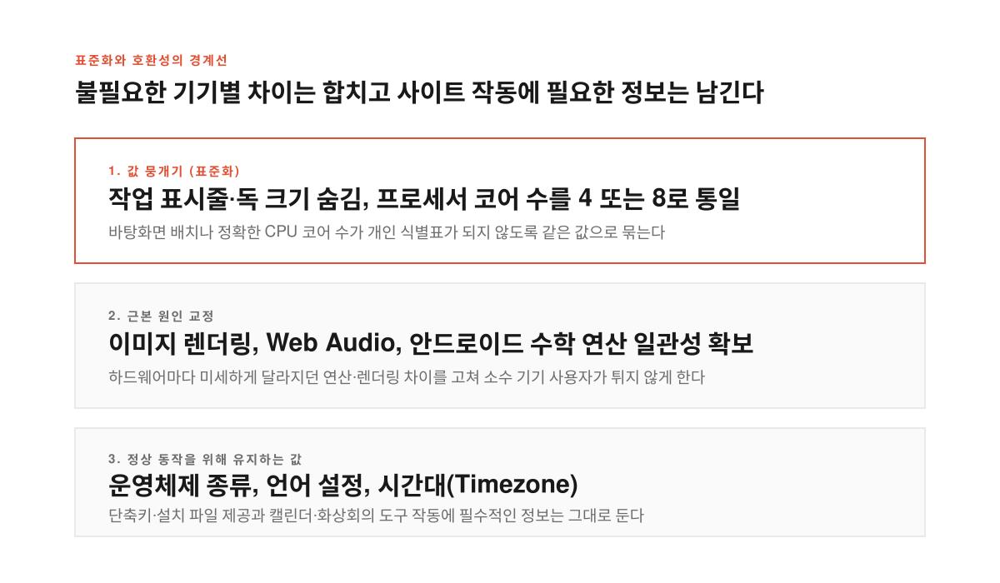

브라우저에서 쿠키를 싹 지우고 사생활 보호 창을 새로 열었는데도 방금 보던 상품 광고가 다른 사이트에서 그대로 따라붙을 때가 있다. 사이트가 컴퓨터에 이름표 파일(쿠키)을 심지 못하게 막아도 브라우저와 기기가 흘리는 단서들을 조합해 같은 사람임을 알아채기 때문이다. 설치된 글꼴 목록이나 화면 크기와 그래픽카드가 그림을 그리는 미세한 차이까지 합치면 수천만 명 가운데 나만 가진 디지털 지문이 만들어진다. 이를 브라우저 핑거프린팅(Browser Fingerprinting, 기기와 브라우저의 설정 조합으로 사용자를 식별하는 추적 기법)이라 부른다.

그동안 핑거프린팅이 위험하다는 경고는 많았지만 수천만 명이 실제로 웹을 쓰는 환경에서 어떤 정보가 사용자를 가장 뚜렷하게 갈라놓는지 측정한 사례는 드물었다. 핑거프린팅 시험 사이트에 들어가 보면 수십 가지 항목이 나열되다 보니 브라우저 개발팀도 어디부터 손대야 웹사이트를 깨뜨리지 않고 추적을 막을 수 있을지 가늠하기 어려웠다.

모질라(Mozilla)는 토론토 대학교 및 UC 샌디에이고 연구진과 함께 약 2,500만 명의 파이어폭스(Firefox) 정식 버전 사용자 데이터를 분석해 [파이어폭스 핑거프린팅 방어 연구 보고서](https://blog.mozilla.org/security/2026/11/10/open-research-stronger-privacy-making-firefox-users-harder-to-fingerprint/)와 [공개 실험 웹사이트(fingerprinting.study)](https://fingerprinting.study/)를 발표했다. 보안 학회 CCS 2026에 채택된 이 논문은 상용 추적 스크립트를 시뮬레이션해 사용자를 구별하는 핵심 원인을 짚어내고 파이어폭스 143과 145 버전의 방어 기능으로 고유 식별 비율을 75%에서 46%로 낮춘 과정을 담고 있다.

<!--more-->

## 50개 넘는 수집 항목 중 사용자를 특정하는 건 상위 여덟아홉 개였다

<figure>
  
  <figcaption>상용 추적 도구가 50~80개 넘는 항목을 수집해도 실제 식별의 80%는 상위 8~9개 지표에서 판가름 나며 이 급소만 막아도 고유 식별 비율이 크게 떨어진다.</figcaption>
</figure>

핑거프린팅을 막겠다고 2,500만 명의 브라우저 특성을 수집하는 일은 자칫 연구진 스스로 추적자가 되는 모순에 빠지기 쉽다. 모질라는 일반 통계 수집과 분리된 일회성 핑(`user-characteristics`)을 만들고 OHTTP(Oblivious HTTP, 암호화된 요청을 독립 중계 서버로 거쳐 보내 중계 서버는 IP만 알고 수신 서버는 내용만 알 수 있게 하는 통신 규격)를 적용했다. 중계 서버는 보낸 사람의 IP 주소만 볼 뿐 브라우저 정보는 열지 못하고 모질라는 IP 주소 없이 측정값만 받았다. 원본 데이터는 허가받은 직원 4명만 열람하도록 제한했고 90일간 보관한 뒤 삭제했다.

연구진은 이 측정값 위에 현재 웹에서 널리 쓰이는 상용 핑거프린팅 스크립트 세 가지인 Fingerprint Pro와 Signifyd 그리고 Akamai의 동작을 재현했다. 흔히 핑거프린팅은 브라우저가 노출하는 수십 가지 자잘한 정보를 모두 합쳐야 개인을 특정할 수 있다고 생각하기 쉽다. 그러나 시뮬레이션 데이터를 뜯어보니 사용자를 유일한 한 사람으로 특정하는 힘은 수십 개 항목에 퍼져 있지 않고 소수의 핵심 지표에 쏠려 있었다.

사용자를 가장 집요하게 가려내는 Fingerprint Pro는 50개가 넘는 지표를 수집하지만 고유하게 식별된 사용자의 80%는 상위 8개 지표만 확인한 시점에 이미 다른 사람들과 구별됐다. 80개 넘는 항목을 모으는 Signifyd 역시 고유 식별 대상의 80%가 단 9개 지표 안에서 판가름 났다. **추적 스크립트가 수십 가지 항목을 샅샅이 뒤지더라도 개인을 발라내는 결정타는 상위 여덟아홉 개 지표에서 나오므로 브라우저가 이 소수의 통로만 집중 방어해도 상용 추적 기법의 위력을 크게 꺾을 수 있다.**

## 전체 평균과 엔트로피라는 착시를 걷어내면 운영체제별 급소가 보인다

<figure>
  
  <figcaption>전체 평균에서는 3.5%포인트에 불과해 보이는 화면 해상도 보호가 macOS에서는 25.3%포인트를 줄여주며 단순 고유 비율이 아닌 집단 크기를 재야 진짜 방어력이 보인다.</figcaption>
</figure>

지금까지 학계와 보안 업계에서는 특정 브라우저 정보가 얼마나 위험한지 따질 때 섀넌 엔트로피(Shannon entropy, 데이터 값이 얼마나 다양하고 예측하기 어려운지 나타내는 수치)나 전체 사용자 중 고유한 지문을 가진 비율을 단일 숫자로 제시하곤 했다. 하지만 전체 사용자를 뭉뚱그린 평균 숫자를 그대로 믿으면 방어 설계를 그르치기 십상이다. 웹사이트가 단축키를 맞추거나 알맞은 설치 파일을 내려주려면 운영체제(OS) 정보는 숨길 수 없는데 운영체제마다 사용자를 구별하게 만드는 결정적 지표가 전혀 다르게 작동하기 때문이다.

사용 가능한 화면 해상도를 제한해 작업 표시줄이나 독(Dock)의 크기와 위치를 숨기는 보호 기능이 대표적인 사례다. 이 방어를 켰을 때 다른 세 운영체제에서는 고유 식별 비율이 0에서 3%포인트 줄어드는 데 그쳤지만 macOS 사용자 집단에서는 단숨에 25.3%포인트나 떨어졌다. 운영체제별로 데이터를 나누지 않고 전체 평균치인 3.5%포인트 감소만 쳐다봤다면 macOS 사용자의 사생활을 지켜줄 가장 강력한 무기를 효과가 미미한 기능으로 치부하고 넘겼을 것이다.

기존 연구들이 써 온 고유 식별 비율이라는 잣대 자체에도 큰 사각지대가 있었다. 고유한 지문을 가진 사람을 뺀 나머지 사용자들이 어떻게 묶여 있는지 보여주지 못하기 때문이다. 고유하지 않은 사용자 100만 명이 하나의 지문을 공유하며 큰 군중 속에 숨어 있는 상황과 2명씩 짝을 지어 50만 개의 지문으로 쪼개져 있는 상황은 고유 식별 비율이 똑같이 0%로 찍히지만 실제 추적 난이도는 완전히 다르다.

연구진은 이 한계를 넘기 위해 집단의 쏠림 정도를 재는 심슨 지수(Simpson Index, 무작위로 뽑은 두 대상이 같은 집단에 속할 확률을 나타내는 지표)를 도입해 같은 지문을 공유하는 집단의 크기를 함께 측정했다. **서로 다른 두 방어 기법이 고유 식별 사용자 비율을 똑같이 2.1%포인트씩 낮추더라도 심슨 지수로 측정한 집단 응집도 개선 폭은 하나가 56%에 달한 반면 다른 하나는 13%에 그쳐 단순 비율만으로는 알 수 없는 방어력의 격차를 드러냈다.**

## 값을 뭉개고 근본 원인을 고치되 웹사이트가 깨지지 않게 지킨다

<figure>
  
  <figcaption>웹사이트 기능에 꼭 필요한 언어와 시간대는 남기되 불필요한 하드웨어 사양과 미세한 연산 차이는 표준화해 사용자를 큰 집단으로 합친다.</figcaption>
</figure>

원인을 짚어낸 뒤 파이어폭스가 택한 해법은 더 많은 브라우저가 추적 스크립트 눈에 똑같이 보이도록 불필요한 차이를 깎아내는 것이었다. 화면 해상도 API가 작업 표시줄이나 독의 크기를 노출하지 못하게 막은 데 이어 프로세서(CPU) 코어 수를 묻는 요청에는 실제 사양 대신 4 또는 8만 돌려주도록 바꿨다. 또한 측정값을 하드웨어 정보와 대조해 왜 기기마다 미세한 차이가 생기는지 추적한 끝에 이미지 렌더링과 웹 오디오(Web Audio) 처리 그리고 안드로이드 기기의 수학 연산 결과가 기기를 타지 않고 일관되게 나오도록 고쳤다.

물론 모든 정보를 가짜 값으로 덮어씌우거나 차단할 수는 없다. 일정 관리 도구나 화상회의 사이트가 돌아가려면 실제 시간대(Timezone)와 언어 설정이 꼭 필요하기 때문이다. 게다가 값을 매번 바꾸는 무작위화(Randomization)는 추적 스크립트가 값의 변동을 감지해 우회할 수 있고 모두 같은 값을 내보내는 표준화(Standardization)만으로는 방문자가 적은 사이트에서 소수 사용자를 다 숨기기 어렵다. 파이어폭스는 정상적인 웹 기능에 필요한 정보는 그대로 두면서 추적에 악용되는 하드웨어 신호를 표준화하고 일부 신호에는 무작위화를 병행하는 균형점을 택했다.

이 과정에서 가장 경계한 문제는 웹사이트 오작동이다. 사용자가 엄격한 추적 차단 기능을 켜더라도 그 설정 때문에 특정 사이트가 깨지는 일은 며칠이나 몇 주 뒤에 찾아온다. 시간차가 벌어지면 사용자는 예전에 바꾼 설정을 떠올리지 못하고 파이어폭스에서 사이트가 안 열린다며 브라우저 자체를 불신하게 된다.

그래서 모질라는 작업 표시줄과 독의 크기를 숨기는 기능처럼 안전한 보호 장치는 모든 탐색 모드에 기본으로 켜고 나머지 기능들은 사생활 보호 모드와 향상된 추적 방지(ETP) 엄격 모드에 먼저 적용한 뒤 단계적으로 넓히는 전략을 썼다. **호환성을 해치지 않는 선에서 핵심 방어를 차례로 쌓아 올린 결과 상용 추적 도구가 파이어폭스 사용자를 고유하게 식별하는 비율은 Fingerprint Pro 기준 75.7%에서 46.8%로 떨어졌고 Signifyd는 60.9%에서 38.5%로 줄었으며 Akamai는 18.2%에서 9.0%로 반 토막이 났다.**

## 봇 차단과 개인정보 보호가 충돌하는 웹에서 남긴 숙제

모질라는 이번 연구의 집계 데이터와 분석 코드 그리고 자기 브라우저가 2,500만 명 중 얼마나 흔하거나 희귀한지 시험해 볼 수 있는 도구를 공개하면서도 몇 가지 세부 분석과 고유한 캔버스(Canvas) 원본 이미지는 공개하지 않았다. 학술 연구나 교육 목적으로 만든 지문 분석 자료가 상용 추적 업체의 제품 개선에 그대로 쓰이는 일이 반복되고 있기 때문이다. 실제로 핑거프린팅의 위험성을 알리려고 만든 시연 사이트 CreepJS의 탐지 기법들이 상용 추적 상품에 고스란히 흡수된 전례가 있었다.

> "더 나은 핑거프린팅 도구를 만드는 일을 돕느니 차라리 질문을 열린 채로 남겨두는 편을 택하겠다."

해커뉴스(Hacker News) 토론장에서는 브라우저가 지문을 지울수록 일반 사용자가 웹에서 겪는 역설적인 불편함도 도마 위에 올랐다. 웹사이트들이 자동화 봇 공격을 막으려고 클라우드플레어 턴스타일(Cloudflare Turnstile) 같은 탐지 도구를 앞단에 세워두는데 개인정보 보호를 위해 브라우저 정보를 숨긴 사용자는 오히려 봇으로 의심받아 하루에도 몇 번씩 신호등과 버스를 골라내는 캡차(CAPTCHA, 자동 입력 방지 문자)를 풀어야 하기 때문이다. 반대로 대규모 악성 봇 트래픽을 막아내는 서버 운영자들은 브라우저가 기기 식별 신호를 지울 때마다 정상 사용자와 봇을 가려낼 단서를 잃는다며 고충을 토로했다.

결국 쿠키 없는 추적을 둘러싼 공방은 브라우저가 정보를 더 숨기고 추적자가 다른 구멍을 찾는 숨바꼭질을 넘어설 수밖에 없다. 모질라 엔지니어들이 언급한 PACT(익명 자격 증명, 사용자를 식별할 지문은 넘기지 않으면서 실제 사람이라는 사실만 암호학적으로 증명하는 웹 기술) 같은 대안이 주목받는 이유도 여기에 있다. **2,500만 명의 실제 데이터로 추적의 급소를 찾아내어 수백만 명을 안전한 군중 속으로 합친 이번 연구는 웹사이트를 깨뜨리지 않고도 개인정보를 지킬 수 있다는 실증적 근거이자 사생활 보호와 봇 방어가 공존할 다음 단계의 출발점이 되고 있다.**
