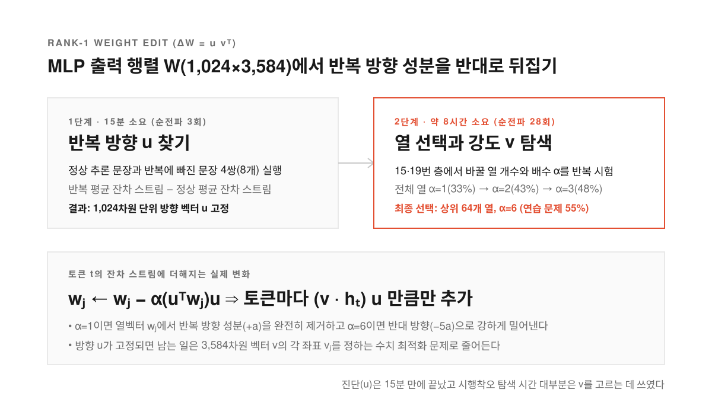
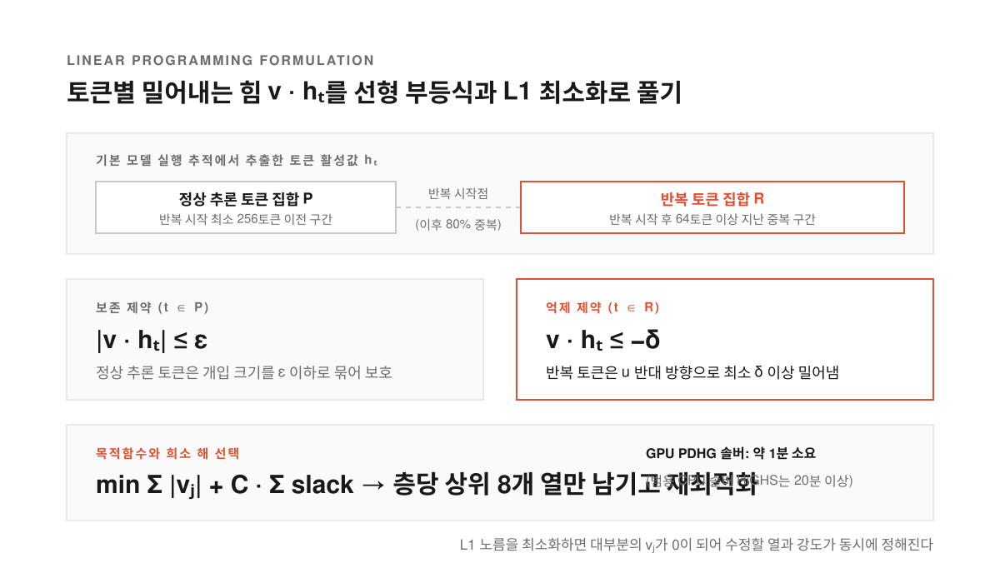
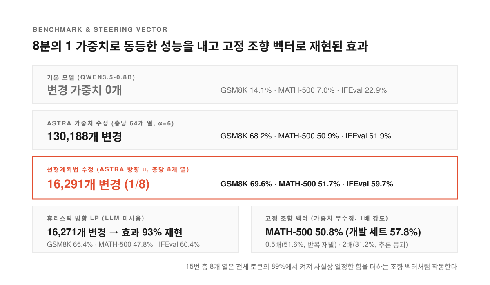

작은 추론 모델로 수학 문제를 풀게 하면 풀이 과정을 적다가 같은 문장을 되풀이하는 '반복 사고(thinking loops)'에 빠지곤 한다. 공식 모델 카드에서도 이 취약점을 인정한 Qwen3.5-0.8B가 대표적인데 수학 벤치마크 MATH-500 응답의 93.0%가 답에 도달하지 못한 채 최대 길이인 32,768토큰 한도에 걸려 끊긴다.

앞서 MIT CSAIL이 발표한 ['가중치 공간 프로그래밍(Weight-Space Programming)' 실험](/posts/weight-space-programming/)에서는 GPT-6 Astra가 경사하강법(오차를 줄이는 방향으로 가중치를 조금씩 밀어 업데이트하는 기법) 없이 이 모델의 가중치 0.016%만 직접 고쳐 반복을 멈추게 했다. 수정 후 토큰 한도 도달률은 33.1%로 줄었고 MATH-500은 7.9%에서 48.1%로, GSM8K는 13.8%에서 67.1%로, IFEval은 21.0%에서 62.3%로 뛰었다. 반복이 드문 Gemma 3 270M에서는 수학 실력을 높이지 못했으니 기존 능력을 가리던 장애물을 치운 셈이다.

연구자 네이선 배리(Nathan Barry)는 공개된 Astra의 실행 로그(전체 158턴, 장애 4.7시간 포함 총 20.3시간)를 분석하다가 Astra가 어느 가중치를 얼마나 바꿀지 찾느라 약 8시간과 순전파 28회를 쓴 탐색이 고전적인 선형계획법(Linear Programming, 1차 부등식 조건 안에서 최적의 값을 찾는 수학 기법)과 똑같다는 사실을 발견했다. 그가 공개한 [Can a Linear Program Do Weight-Space Programming?](https://nathan.rs/posts/weight-space-lp/)과 [GeekNews 소개 글](https://news.hada.io/topic?id=37003)을 따라 8시간짜리 시행착오가 어떻게 1분짜리 최적화로 바뀌는지 살펴본다.

<!--more-->

## Astra가 8시간 동안 시행착오로 찾은 랭크 1 가중치 수정

<figure>
  
  <figcaption>반복 방향 u를 찾는 진단은 15분 만에 끝났고 탐색 시간의 대부분은 바꿀 열과 강도 v를 고르는 데 쓰였다.</figcaption>
</figure>

트랜스포머는 각 층의 출력을 이전 값에 계속 더하는 잔차 스트림(residual stream, 이 모델에서는 토큰당 1,024차원 벡터)을 쓴다. 모델이 반복에 빠질 때 잔차 스트림은 일정한 방향으로 이동하며 Astra는 15번과 19번 층의 출력을 그 반대 방향으로 바꿨다. 정상 추론과 반복 추론으로 구성된 짧은 문장 4쌍(총 8개)을 입력한 뒤 반복 텍스트 평균에서 정상 텍스트 평균을 빼고 정규화해 '반복 방향($u$)'을 구한 것이다.

각 층 MLP의 마지막 행렬 `down_proj`($W$)는 3,584차원 활성값 $h$를 1,024차원 출력 $Wh$로 바꿔 잔차 스트림에 더한다. 출력은 열벡터 $w_j$와 활성값 $h_j$의 가중합($Wh = \sum_j h_j w_j$)이므로 내적 $u^\top w_j$는 그 열이 모델을 반복 쪽으로 얼마나 미는지를 뜻한다. Astra는 각 열에서 이 성분의 $\alpha$배를 빼는 방식($w_j \leftarrow w_j - \alpha(u^\top w_j)u$)을 택했다. $\alpha=1$이면 해당 성분을 제거하고 $\alpha=6$이면 기존 $+a$ 성분을 $-5a$로 바꿔 반대쪽으로 밀어낸다.

수정한 모든 열이 같은 벡터 $u$의 배수로만 바뀌므로 전체 수정은 '랭크 1(rank-1) 변경($\Delta W = u v^\top$)'이 된다. 토큰 $t$에 추가되는 값도 $(v \cdot h_t)u$뿐이라서 다른 방향은 바뀌지 않는다.

**방향 $u$가 정해지면 남은 일은 어느 열을 골라 얼마나 세게 밀지 결정하는 벡터 $v$를 찾는 것뿐이다.** 순전파 50회 예산이 주어진 파이썬 커널에서 Astra는 약 10시간 시점에 수정안을 고정하고 마지막 17회는 재검증에만 썼다. 그중 $u$를 찾는 데는 15분밖에 안 걸렸지만 $v$를 찾는 데 약 8시간과 순전파 28회가 들었다. 모든 열에 $\alpha=1, 2, 3$을 넣어 연습 문제 정확도를 약 9%에서 33%, 43%, 48%로 올렸고 무작위 방향 대조군이 12.5%에 그침을 확인한 뒤 $u$ 방향 기여가 가장 큰 64개 열에 $\alpha=6$을 적용해 55%에 도달했다.

## 반복 토큰은 밀어내고 정상 토큰은 아끼는 선형 부등식

<figure>
  
  <figcaption>토큰마다 가해지는 힘이 v에 대한 1차식이므로 L1 노름을 최소화하면 바꿀 열과 강도가 한 번에 풀린다.</figcaption>
</figure>

토큰별 밀어내는 양인 $v \cdot h_t$는 $v$에 대해 선형(1차식)이다. 따라서 반복 토큰은 반대쪽으로 밀고 정상 추론 토큰은 거의 건드리지 말라는 요구를 선형 부등식으로 작성할 수 있다. 반복 토큰 집합 $R$에서는 $v \cdot h_t \le -\delta$로 최소 $\delta$만큼 밀어내고 정상 토큰 집합 $P$에서는 $|v \cdot h_t| \le \varepsilon$으로 개입 크기를 제한한다.

목적함수는 L1 노름($\sum_j |v_j|$) 최소화이며 실제로 모든 제약을 동시에 만족할 수 없어 벌점을 부여한 여유 변수(slack variable)를 추가한다. **L1 공은 다이아몬드 형태라서 실행 가능 영역과 처음 만나는 지점이 대개 여러 좌표가 0인 꼭짓점에 걸린다.** 덕분에 솔버가 수정량뿐 아니라 수정할 열도 함께 선택한다.

학습 자료는 기본 모델 자체의 실행 추적에서 얻었다. 해당 위치에서 끝나는 16토큰 구간이 앞부분에 이미 등장했다면 반복 토큰으로 판정하고 남은 토큰의 80% 이상이 반복인 최초 지점을 반복 시작점으로 잡았다. 시작점 이후 최소 64토큰이 지난 반복 토큰은 집합 $R$에, 시작점보다 최소 256토큰 앞선 토큰이나 정상 종료한 응답의 토큰은 집합 $P$에 넣고 15번과 19번 층의 활성값을 기록했다.

층마다 정확히 8개 열만 남기기 위해 $|v_j|$와 $h_j$의 표준편차를 곱한 영향도 상위 8개 열만 고른 뒤 나머지를 0으로 고정해 다시 풀었다. 범용 해법 HiGHS는 각 최적화에 20분이 넘게 걸렸지만 행렬-벡터 곱만 쓰는 GPU용 PDHG(PDLP의 기반 알고리즘)를 직접 구현하자 약 1분 만에 최적값의 0.2% 이내에 도달했다.

## 8분의 1 가중치로 같은 성적을 내고 고정 조향 벡터로 재현하기

<figure>
  
  <figcaption>Astra보다 8분의 1 적은 가중치만 바꿔도 동등한 성능이 나오며 일정한 조향 벡터로도 효과의 대부분이 재현된다.</figcaption>
</figure>

설정 조정(128문제 개발 세트)에 쓰지 않은 독립 평가에서 선형계획법의 효율이 드러난다. 기본 모델은 GSM8K 14.1, MATH-500 7.0, IFEval 22.9에 그쳤고 Astra 수정은 가중치 130,188개를 바꿔 각각 68.2, 50.9, 61.9를 기록했다. 반면 Astra의 층과 방향 $u$를 쓴 선형계획법은 **가중치를 약 8분의 1인 16,291개만 바꾸고도 GSM8K 69.6, MATH-500 51.7, IFEval 59.7로 잡음 범위 내의 유사한 성능을 냈다.**

LLM이나 수작업 문장 없이 두 토큰 집단의 평균 잔차 스트림 차이로 구한 '휴리스틱 방향'에서도 가중치 16,271개 변경으로 GSM8K 65.4, MATH-500 47.8, IFEval 60.4를 기록해 개선 효과의 약 93%에 도달했다. 개발 세트에서 휴리스틱 방향에 Astra의 기존 방식(상위 64개 열, $\alpha=6$)을 그대로 적용하면 44.5였지만 선형계획법은 54.7을 기록했다. 또한 선형계획법이 고른 8개 열 중 Astra의 64개와 겹치는 것은 15번 층 3개, 19번 층 1개뿐이어서 특정 열보다 $u$ 방향으로 가해지는 총량이 중요했다. 무작위 방향은 개발 세트에서 10.2로 기본 모델(10.9)보다 낮았다.

15번 층 활성값의 선형 탐침은 진행 중인 반복은 구별했지만(AUC 0.93) 시작 시점에서는 0.73에 그쳤다. 그래서 반복처럼 보이는 토큰만 밀도록 요구해도 모든 토큰을 미는 것보다 낫지 않았다. 실제로 15번 층의 8개 열은 토큰의 89%에서 활성화됐고 추가하는 힘도 토큰마다 거의 달라지지 않았다.

따라서 가중치 수정 대신 모든 토큰의 잔차 스트림에 고정 벡터를 더하는 '조향 벡터(steering vector)'로도 비슷한 효과를 낼 수 있다. 수정하지 않은 모델의 15번과 19번 층에 선형계획법 수정의 평균 개입량(1배 강도)을 더하자 같은 실행(문제당 1회 생성)에서 개발 세트 57.8, MATH-500 50.8을 기록해 선형계획법 수정(62.5 / 53.2) 및 Astra 수정(59.4 / 50.0)의 효과를 거의 재현했다. 다만 0.5배에서는 개발 세트 51.6으로 반복이 돌아왔고 2배에서는 반복은 멈췄지만 추론이 무너지며 31.2로 떨어졌다.

## 에이전트가 방향을 짚고 고전 최적화가 숫자를 채우는 분업

일정한 조향 벡터만으로 효과가 재현된다면 선형계획법 수정은 무엇이 다를까. 핵심은 적정 강도를 데이터에서 한 번에 찾고 추론 코드 수정 없이 배포하는 데 있다.

> "유일한 차이는 전달 방식이다. 선형계획법 수정은 평범한 체크포인트 파일이지만 조향 벡터는 추론할 때 추가 코드가 필요하다."

조향 벡터는 추론 시 추가 코드가 필요하지만 선형계획법은 그 일정한 힘을 8개 뉴런의 일반 가중치에 내장해 일반 체크포인트로 사용할 수 있다.

한계도 분명하다. 이번 결과는 단일 모델의 반복 제거에 한정되며 층 선택은 여전히 Astra에 의존한다. 반복은 일정한 힘으로 고칠 수 있어 토큰별 제약의 중요성이 크지 않았으니 일부 토큰만 바꾸고 나머지는 보존해야 하는 행동(거부, 아첨, 특정 인물 말투 등)에서도 유효한지는 추가 검증이 필요하다.

해커뉴스(Hacker News)에서도 에이전트와 수치 최적화의 결합이 주목받았다. 에이전트는 모호한 목표에서 원인을 진단해 의미 방향($u$)과 층을 짚어내고 1940년대 경영과학에서 출발한 선형계획법 솔버는 수만 개 토큰 제약을 1분 만에 풀어 최적 가중치($v$)를 계산한다. **에이전트의 회로 해석 능력에 선형계획법 솔버를 결합하는 분업이 가중치 공간 프로그래밍을 한층 빠르고 정밀하게 만들 수 있다.**

출처: Nathan Barry, [Can a Linear Program Do Weight-Space Programming?](https://nathan.rs/posts/weight-space-lp/) · [상세 보고서 및 코드 저장소](https://github.com/nathanrs/weight-space-lp) · [GeekNews 토픽 #37003](https://news.hada.io/topic?id=37003).
