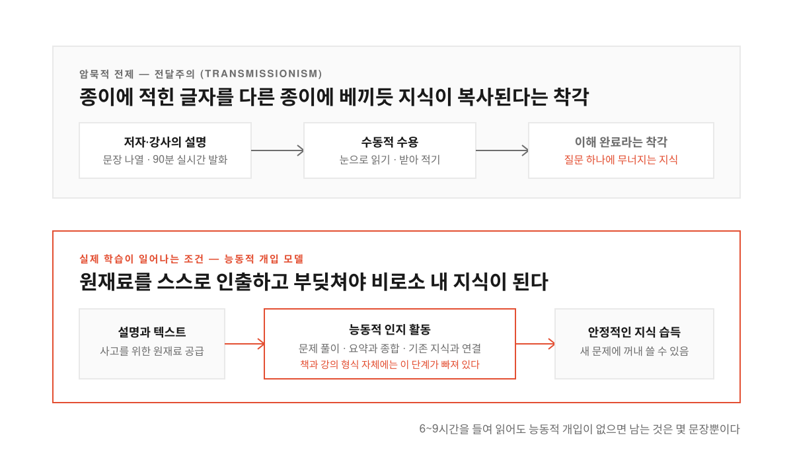
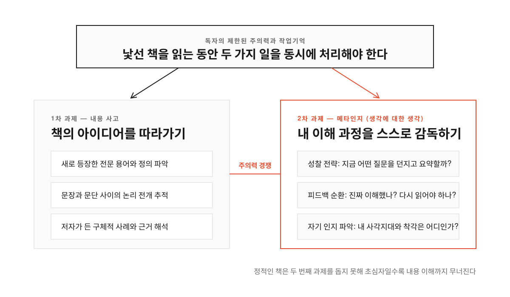
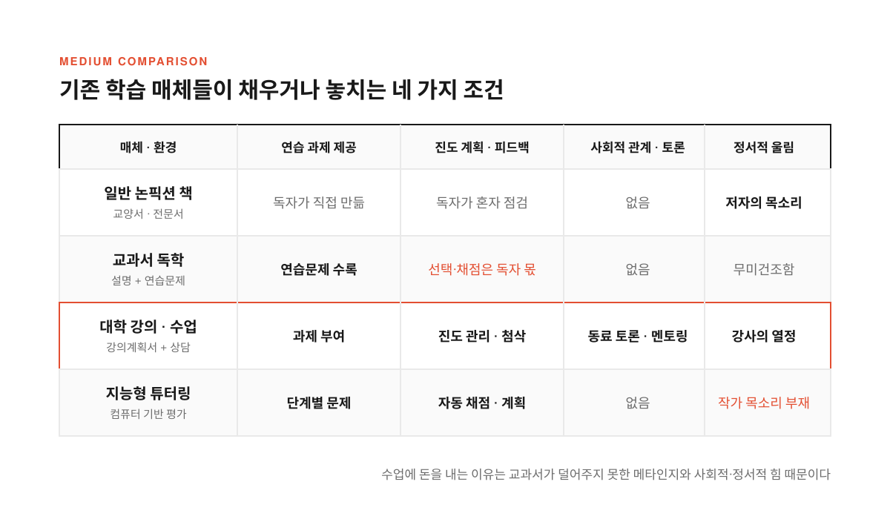
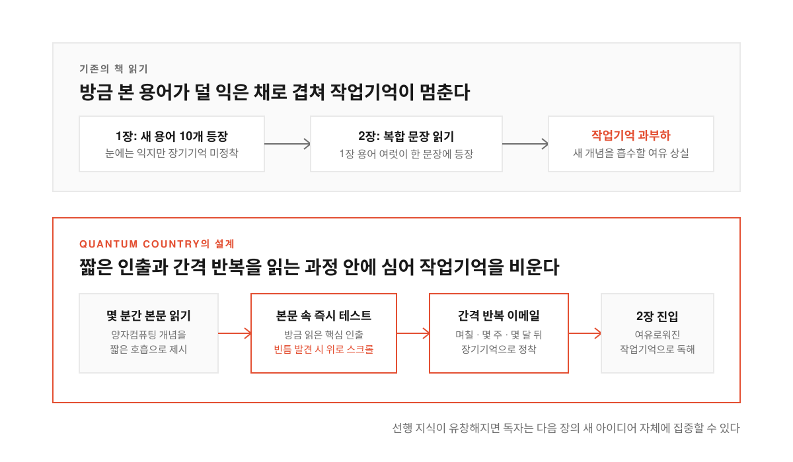

주말마다 시간을 내어 《이기적 유전자(The Selfish Gene)》나 《생각에 관한 생각(Thinking, Fast and Slow)》, 《총, 균, 쇠(Guns, Germs, and Steel)》 같은 교양서를 읽고 책장을 덮는다. 읽는 동안에는 고개를 끄덕이며 논리를 따라잡았다고 느낀다. 그런데 며칠 뒤 대화 자리에서 그 책 이야기가 나와 핵심 주장을 두세 문장으로 꺼내는 순간 상대가 "그건 왜 그렇게 되는 거야?"라고 한 걸음만 더 물으면 말문이 막힌다.

세부 내용이 기억나지 않는 수준이 아니다. 머릿속을 더듬어 볼수록 읽을 때는 이해했다고 믿었던 대목을 처음부터 이해하지 못했다는 점과 질문받기 전까지는 얼마나 적게 흡수했는지조차 몰랐다는 점을 깨닫는다. 책 한 권을 읽는 데는 6~9시간이 걸리고 미국 대졸 성인의 하루 평균 독서 시간이 24분이라는 통계를 대입하면 한 달 치 독서 시간을 쏟은 셈이다. 수백만 명이 합쳐 수천만 시간을 들였는데도 남는 지식은 몇 문장에 그친다.

칸 아카데미(Khan Academy) 초기 연구개발과 애플 iOS 개발에 참여했던 앤디 마투샤크(Andy Matuschak)는 2019년 발표한 [「Why books don't work」](https://andymatuschak.org/books/)([GeekNews 토픽 #36969](https://news.hada.io/topic?id=36969))에서 이 좌절이 독자의 결함이 아니라 책이라는 매체의 설계 문제에서 비롯된다고 짚는다. 설명형 논픽션 책과 강의가 왜 지식 전달에 실패하는지, 읽기가 곧 이해가 되려면 매체를 어떻게 설계해야 하는지 살펴본다.

<!--more-->

## 강의와 책이 암묵적으로 기대는 전달주의라는 착각

<figure>
  
  <figcaption>문장을 눈과 귀로 따라가는 것만으로는 지식이 머릿속에 복사되지 않는다.</figcaption>
</figure>

책이 실패하는 이유를 보려면 같은 일이 벌어지는 강의실부터 떠올려 보면 쉽다. 한 시간 동안 강의를 들으며 다 이해했다고 생각하다가 그날 밤 연습문제를 펴는 순간 손을 대지 못해 당황하는 경험은 익숙하다. 강의에서 즐거움이나 영감을 얻을 수는 있지만 강의만으로 복잡한 지식이 머릿속에 자리 잡지 않는다는 점은 상식에 가깝다.

강의와 책이 흔들리는 이유는 두 매체 모두 사람이 어떻게 배우는지를 설명하는 인지 모델(cognitive model, 지식을 받아들이고 처리하는 원리를 정리한 틀) 없이 굳어졌기 때문이다. 두 매체를 지배하는 암묵적 전제는 전달주의(transmissionism)다. 강사가 설명하고 학생이 받아 적으면 이해가 일어나며 저자가 문장을 적어 놓고 독자가 끝까지 읽으면 지식이 전해진다는 믿음이다. 종이 한 장의 글자를 다른 종이에 베껴 쓰듯 지식을 머릿속으로 옮길 수 있다는 생각은 학습과학에서 오래전에 틀렸다고 판명 났다.

물론 강사나 저자에게 전달주의를 믿느냐고 물으면 손사래를 친다. 강의나 책은 나중에 문제를 풀고 에세이를 쓰거나 깊게 생각할 때 쓸 원재료를 건네는 준비 운동일 뿐이라는 설명을 내놓는다. 하지만 정말 그 모델에서 출발했다면 90분짜리 실시간 독백을 골랐을 리 없다. 청중의 주의력은 몇 분만 지나도 흐트러지니 설명 중간에 문제 풀이를 섞었을 것이고 실시간 말은 멈추거나 되감을 수 없으며 읽는 속도가 말하기 속도보다 빠르니 글자를 택했을 것이다.

무엇인가를 이해하려면 학습자가 대상을 능동적으로 다루어야 한다. 칼 세이건이 《코스모스》에서 책을 두고 시대를 건너 저자가 독자의 머릿속에서 말을 건네는 마법 같은 발명품이라 찬탄했듯 소설이나 에세이에서 관점과 영감, 즐거움을 얻는 일은 소중하다. **다만 상세한 지식을 전달하려는 설명형 논픽션에서 대다수 독자가 실패를 기본값으로 겪는다면 그 매체가 기대고 있는 전제부터 의심해야 한다.**

## 정적인 책이 독자에게 떠넘기는 메타인지의 이중 부담

<figure>
  
  <figcaption>낯선 내용을 따라가는 일과 내 이해도를 점검하는 일이 제한된 주의력을 두고 경쟁한다.</figcaption>
</figure>

그렇다면 같은 책을 읽고도 깊은 지식을 건져 올리는 소수의 독자는 무엇을 다르게 할까. 이들은 눈으로 문장만 따라가지 않고 머릿속에서 쉴 새 없이 자문자답한다. 방금 읽은 주장이 예전에 알던 개념과 어떻게 이어지는지 떠올려 보고 앞 장의 설명과 충돌하는 대목을 찾으며 메모를 남길 때도 저자의 문장을 베끼는 대신 자기 말로 요약하고 분석한다.

학습과학에서는 이처럼 자신의 생각과 이해 과정을 점검하고 조절하는 능력을 메타인지(metacognition)라고 부른다. 어떤 질문을 던지고 요약할지 고르는 성찰 전략, 방금 읽은 문단을 이해했는지 확인하고 다시 읽을지 다른 자료를 찾을지 결정하는 피드백 순환, 이해했다는 느낌과 실제 이해를 구별해 사각지대를 찾아내는 능력이 모두 여기에 들어간다.

린다 베이커(Linda Baker)의 1989년 연구 검토가 보여주듯 이런 기술은 익히기 까다롭고 많은 성인 독자에게 부족하다. 능숙한 독자에게도 부담스럽기는 마찬가지다. 낯선 개념을 따라가면서 제대로 이해하고 있는지를 감시하는 질문까지 함께 돌리는 일은 진을 빼놓는다. 슬라바 칼류가(Slava Kalyuga)의 2009년 인지부하 연구에 따르면 스스로 질문을 만들고 피드백을 내는 활동은 해당 분야 지식과 메타인지에 능숙한 사람에게만 효과가 있을 뿐 초심자에게는 본문을 이해할 주의력을 갉아먹는다.

저자는 독자가 헷갈릴 지점을 미리 내다보고 설명 깊이를 조절하며 배경지식을 안내해 부담을 덜어주려 애쓴다. 하지만 메타인지는 독자의 생각이 바뀌면서 시시각각 달라지는 동적인 과정인 반면 책은 인쇄된 뒤 반응하지 않는 정적인 매체다. **강사가 과제를 내주고 첨삭을 해주는 수업과 달리 책은 독자에게 문제집을 직접 만들고 채점까지 하라고 요구해 내용 사고와 메타인지가 주의력을 두고 충돌한다.**

## 연습문제를 넣은 교과서와 대학 수업이 남기는 빈칸

<figure>
  
  <figcaption>교과서에 연습문제를 넣어도 계획과 피드백, 사회적·정서적 힘까지 채워주지는 못한다.</figcaption>
</figure>

여기서 교과서라는 대안이 떠오른다. 교양서 끝에 연습문제와 토론 질문을 붙여 교과서처럼 만들면 해결되지 않을까. 교과서는 설명과 연습문제를 번갈아 배치하는 명시적 인지 모델을 갖추고 있다. 하지만 현실에서 많은 사람은 교과서만 사서 독학하는 대신 비용과 시간을 들여 대학 수업을 듣는다. 자격증 때문만은 아니라 혼자 교과서를 읽을 때보다 수업을 들을 때 더 많이 배운다고 느끼기 때문이다.

교과서에 연습문제가 실려 있어도 학습 계획과 피드백이라는 메타인지 부담은 상당 부분 독자 몫으로 남는다. 어떤 문제를 언제 풀지, 답은 맞혔는데 그 문제가 드러내려던 통찰을 놓친 것은 아닌지, 막혔을 때 무엇을 할지를 혼자 판단해야 한다. 반면 수업은 강의계획서로 진도를 잡아주고 채점과 토론, 상담 시간, 지난 과제의 해설로 이 부담을 대신 맡아 학생이 내용 자체에 쏟을 주의력을 남겨 준다.

지능형 튜터링 시스템(intelligent tutoring system, 수준에 맞춰 문제와 피드백을 자동으로 주는 컴퓨터 교육 체계)은 이 과제 계획과 피드백을 교실 밖으로 옮기려 시도해 왔다. 그러나 수업이 교과서보다 나은 이유는 과제 관리에만 있지 않다. 수업에는 동료들과 부딪치며 배우는 사회적 학습과 전문가와의 관계, 공부를 이어가게 만드는 책임 구조가 있다. 좋은 논픽션과 수업에는 강사나 저자의 열정이 주는 정서적 울림도 살아 있지만 교과서는 무관심을 부르기 쉽다. **저자의 목소리를 지운 채 평가에만 매달려 온 컴퓨터 튜터링 시스템은 학습 동기를 키우는 이 정서적 연결을 교과서보다도 더 놓쳐 왔다.**

## 읽기가 곧 이해가 되도록 매체의 결을 다시 짜는 Quantum Country

<figure>
  
  <figcaption>앞 장의 개념이 장기기억에 정착되어야 다음 장을 읽을 때 작업기억이 멈추지 않는다.</figcaption>
</figure>

이 지점에서 질문을 바꿀 수 있다. 책을 어떻게 고칠까 고민하는 대신 논픽션 책의 역할을 해내는 새로운 매체를 설계할 수는 없을까. 산문이나 종이를 버리자는 뜻이 아니라 기존 형식의 고정관념을 내려놓자는 제안이다. 더글러스 엥겔바트(Douglas Engelbart)가 1962년 「Augmenting Human Intellect」에서 그리고 마이클 닐슨(Michael Nielsen)이 2016년 「Thought as a Technology」에서 보였듯 매체는 물려받는 그릇이 아니라 특정한 인지적 아이디어를 구현하도록 설계할 수 있다.

수학 증명은 단계별 구조에 형식논리를 녹여 냈고 스냅챗 스토리(Snapchat Stories)는 사라지는 성질로 감정과 정체성의 아이디어를 구현했으며 웹(World Wide Web)의 하이퍼링크는 지식의 연상적 성격을 재료로 삼았다. 매체의 재료와 제약은 고유의 결(grain)을 만들어 사용자의 행동과 생각을 이끈다. 수학 증명에 논리를 덧붙인 것이 아니라 증명 형식 자체가 논리로 이루어져 있듯 학습 원리로 매체 자체를 짤 수 있다.

> How might we design a medium so that its “grain” bends in line with how people think and learn?

인지과학이 밝혀낸 출발점 하나는 작업기억(working memory, 방금 들어온 정보를 머릿속에 잠시 붙들고 처리하는 공간)이 과부하되면 새 내용을 받아들이기 어렵다는 점이다. 낯선 용어를 배운 직후 그 용어 여럿이 한 문장에 나오면 거의 흡수하지 못한다. 선행 지식이 장기기억에 저장되어 유창하게 꺼내 쓸 수 있어야 다음 이해가 열린다. 여기에 시간 간격을 늘려 가며 다시 시험하는 간격 반복(spaced repetition)을 결합해 마투샤크와 닐슨이 만든 첫 실험이 양자컴퓨팅 학습 매체 [Quantum Country](https://quantum.country/qcvc)다.

Quantum Country에서는 몇 분 동안 본문을 읽은 뒤 사이에 심어진 짧은 기억 테스트로 방금 읽은 내용을 확인하고 필요한 대목은 위로 스크롤해 다시 읽는다. 이후 며칠, 몇 주, 몇 달에 걸쳐 넓어지는 간격으로 오는 이메일 복습에 답한다. 첫 장을 읽고 복습을 거치면 둘째 장을 읽을 때 작업기억 부담이 줄고 어디를 놓쳤는지 드러나 메타인지 부담까지 가벼워진다. 기억은 이해의 일부일 뿐이니 개념 사이의 연관을 짓고 서로 다른 해석을 비교하게 만드는 매체 연구가 과제로 남아 있다. **책을 읽고도 남는 것이 없다고 자책할 것이 아니라 첫 페이지부터 따라가는 행동 자체가 곧 이해가 되도록 매체의 결을 새로 짜야 한다.**

출처: Andy Matuschak, [Why books don't work](https://andymatuschak.org/books/), 2019년 5월 11일 · [GeekNews 토픽 #36969](https://news.hada.io/topic?id=36969).
